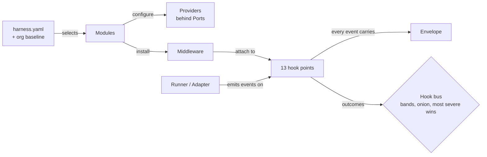

# AGENTS.md

This file is for AI coding agents (and humans) working **on** the HarnessWeaver codebase. If you want to *use* HarnessWeaver in an app, read [README.md](README.md) instead.

> **HarnessWeaver** is *the composable AI harness framework*. Teams use it to weave their own AI harness: bring your models, choose your plugins, define your execution.
> It is a framework that **produces** harnesses. It is not an agent framework, and the core never does reasoning (R12).

## Read first

| Doc | Why |
| --- | --- |
| [RULES.md](RULES.md) | Non-negotiable invariants (R1-R14) and the coding, testing, security, docs, versioning and git rules. Cite rule IDs in reviews and commit bodies. |
| [DESIGNS.md](DESIGNS.md) | Architecture: hook bus, spec layering, modules, governor, approvals, cross-language delivery, ADRs. |
| [`docs/AI Harness Framework Design and Build Guide.md`](docs/AI%20Harness%20Framework%20Design%20and%20Build%20Guide.md) | The original design source. Read it, but never edit it; record deviations as ADRs in DESIGNS.md (D4). |

## Repository map

```
.
|-- AGENTS.md  CLAUDE.md  RULES.md  DESIGNS.md  README.md
|-- pyproject.toml                  # uv workspace root (virtual): members, dev group, tool config
|-- Makefile                        # make check | test | lint | fmt | typecheck | schemas | docs
|-- contracts/                      # SOURCE OF TRUTH shared by every language (R11)
|   |-- schemas/                    #   generated JSON Schemas, checked in, drift-tested
|   |-- openapi/                    #   generated sidecar OpenAPI, drift-tested
|   |-- proto/harnessweaver/v1/     #   sidecar service definition (future gRPC)
|   `-- fixtures/conformance/       #   language-neutral behavior fixtures, one folder per suite
|-- python/
|   |-- harnessweaver/              # core package (import harnessweaver as hw)
|   |   `-- src/harnessweaver/
|   |       |-- core/               #   envelope, hooks, outcomes, bus, middleware, budgets, errors, registry, expr (cel-lite)
|   |       |-- spec/               #   models, sources, merge (locks/bounds/provenance), levels, explain, diff
|   |       |-- modules/            #   models, routing, policy, tools, approvals, guardrails, validation, context, state, observability, evals
|   |       |-- runners/            #   direct, session, workflow
|   |       |-- testing/            #   ScriptedModel, FakeTool, assert_trace, cassettes, conformance plugin
|   |       |-- profiles/           #   built-in profiles (YAML)
|   |       |-- harness/            #   Harness: load, run, session, instrument, approve, ... (one mixin per concern)
|   |       `-- session.py
|   |-- harnessweaver-cli/          # `harnessweaver` command + templates + gateway generators
|   |-- harnessweaver-sidecar/      # harnessd (FastAPI)
|   `-- plugins/<name>/             # first-party plugins harnessweaver-<name>: openai, anthropic, pydantic-ai, monty, otel, cel
|-- typescript/                     # pnpm workspace: packages/core (@harnessweaver/core), packages/ai-sdk (@harnessweaver/ai-sdk)
|-- examples/                       # _org baseline + 01..04, each runnable offline and tested
|-- deploy/harnessd/                # sidecar Dockerfile
`-- docs/                           # mkdocs site + the original design guide and assets
```

Some of these directories are added as the framework is built out; check the tree for what exists today.

## Setup and commands

Prerequisites: [uv](https://docs.astral.sh/uv/) (Python 3.12+; the repo pins 3.14 in `.python-version`), and Node 22+ with pnpm for `typescript/`.

```bash
uv sync --all-packages          # install every workspace package + dev tools into .venv
```

| Task | Command |
| --- | --- |
| Everything CI runs (lint, format check, types, tests, conformance) | `make check` |
| Tests only | `make test` (or `uv run pytest -q`) |
| One test | `uv run pytest python/harnessweaver/tests/test_bus.py::test_onion_order -q` |
| Lint / auto-fix / format | `make lint`, `make fmt` |
| Type check | `make typecheck` (pyright; strict on `core/` and `spec/`) |
| Regenerate contract schemas | `make schemas` (then commit `contracts/schemas` and `contracts/openapi`); `make schemas-check` reports drift |
| Conformance fixtures only | `uv run pytest python/harnessweaver/tests/conformance -q` |
| Plugin conformance (T5) | `make conformance`, or `uv run pytest --harnessweaver-conformance=<namespace>` |
| Run an example offline | `HARNESSWEAVER_ENV=offline uv run python examples/01_invoice_extraction/run.py`; Example 04 (TypeScript): `HARNESSWEAVER_ENV=offline node examples/04_polyglot_typescript/dist/run.js` after `pnpm -C typescript build` |
| CLI from source | `uv run harnessweaver --help` |
| Check a spec | `uv run harnessweaver spec validate <spec> -e offline`, `uv run harnessweaver doctor <spec>`, `uv run harnessweaver hooks <spec>` |
| Evals, policy tests, replay | `uv run harnessweaver eval run <spec> -e offline`, `uv run harnessweaver policy test <spec>`, `uv run harnessweaver replay <run_id> <spec>` |
| Grow a spec | `uv run harnessweaver add guard <use> <spec>` (shadow mode), `uv run harnessweaver add tool <module:function> <spec>`, `uv run harnessweaver tools pin <spec>` |
| Plugins | `uv run harnessweaver plugin list`, `uv run harnessweaver plugin new <namespace> <dir>` (a standalone package) |
| Sidecar | `HARNESSD_TOKEN=<token> uv run harnessd <spec>` (or `uv run harnessweaver sidecar <spec>`); `docker build -f deploy/harnessd/Dockerfile .` |
| Gateways and the dev stack | `uv run harnessweaver gateway litellm <spec>`, `uv run harnessweaver gateway mcp <spec>`, `uv run harnessweaver dev <spec> [--up]` |
| TypeScript (see [typescript/README.md](typescript/README.md)) | `pnpm -C typescript install && pnpm -C typescript test && pnpm -C typescript typecheck && pnpm -C typescript build`; the tests include Example 04, which starts harnessd, so run `uv sync --all-packages` first |
| Docs site | `make docs` (`mkdocs build --strict`) |

Never `pip install` into the workspace. Add dependencies with `uv add --package <member> <dep>`, and only after an ADR if it's a new third-party dependency (C10). The core package may not gain dependencies at all (R6).

## The architecture in one screen



- **Hook points** (fixed set of 13): `run.start`, `input.before`, `route.decide`, `context.after`, `model.before`, `model.after`, `stream.chunk`, `tool.before`, `tool.after`, `output.before`, `approval.resolved`, `run.error`, `run.end`.
- **Outcomes:** `Block` > `Suspend` > `Escalate` > `Retry` > `Continue(modified)` > `Continue`.
- **Bands:** `baseline` -> `platform` -> `app` -> `task`. Inbound hooks run outermost-first; outbound hooks run innermost-first.
- **Spec layers:** defaults -> built-in profile -> org baseline -> app spec -> env overlay -> per-run overrides. Locks and bounds are enforced at load and are never clamped.

## Conventions (summary of RULES.md C1-C12)

- Python 3.12+, fully typed, `pyright` strict on `core/` and `spec/`. Pydantic v2 for anything that crosses a boundary; `extra="forbid"` on spec and config models; `frozen=True` on contract values.
- Async first with `anyio`. No blocking I/O on the event loop.
- No global mutable state. Use the injected `Clock`, never `datetime.now()` in logic.
- Raise only `harnessweaver.errors` taxonomy errors across public boundaries.
- Log with loguru (`from loguru import logger`); a package that logs calls `logger.disable(__name__)` in its top-level `__init__` so it is silent until the app enables it. No `print`, never raw content in logs (R9).
- Keep modules small: when a module grows past about 350 lines, turn it into a package of focused modules whose `__init__` exports only what other code imports.
- Public API lives in `harnessweaver/__init__.py`. Anything prefixed `_` is private.
- Names: hook points `tool.before`; providers `area.capability` (`pii.regex`); spec keys `snake_case`; env vars `HARNESSWEAVER_*`.
- Match the surrounding code's style and naming.
- Give every module, package, class, method and function a docstring, wherever possible (Google style, RULES C9).
- Comment any complex or long piece of logic enough that a reader can follow how it works and why without reverse-engineering it: the approach, the steps, the non-obvious cases and the reasons. Don't narrate obvious single lines (RULES C9).
- Implement with the `ponytail` skill: the simplest solution that works, with the standard library and existing code before anything new. An agent without the skill follows the same approach.
- Only keyboard characters (D5): `No. 13` for sections, `-` for dashes, `->` for arrows, `...` for ellipses. `make check` runs `scripts/check_ascii.py`.

## Checklists

### Add a provider for an existing port
1. Write a Pydantic config model and a class that satisfies the port Protocol in `core/ports.py`.
2. Decorate it with `@hw.provider(port=..., name="area.capability", config=..., contract=">=1.0,<2", deterministic=..., latency_class=...)`. If the config has required fields, add `sample={...}` so the conformance suite can build it.
3. Add it to the owning plugin's `hw.Plugin(providers=[...])`. Its name must sit in that plugin's namespace (`acme.pii`); core providers belong to the built-in plugin and use the reserved area namespaces (DESIGNS No. 13).
4. Add unit tests, and make it pass `--harnessweaver-conformance=<name>` (T5).
5. If its behavior is part of a contract (built-in guards, cel-lite, the governor), add JSON fixtures and make the TypeScript implementation pass them too (R11, T4).
6. Document it on the module's docs page and in `CHANGELOG.md` (D1).

### Add middleware
1. `@hw.middleware(hooks=[...], band=..., fail_mode="closed"|"open", timeout=...)`. `fail_mode` is required (R2, ADR-0014).
2. Return an outcome (or `None` for `Continue()`). Never raise for control flow.
3. Test the outcome and the trace (`assert_trace`). Test the failure path for its fail mode.

### Add an adapter or runner
1. Declare `reaches=[...]` honestly (R4). Loading must fail when the baseline needs a hook you can't reach.
2. Inject governed model calls and governed tools (`RunContext.generate(provider=...)` and `RunContext.call_tool(backend=...)` for calls the framework makes itself); bridge native callbacks onto hook points; translate errors into the taxonomy.
3. No framework types in hook payloads (R7).
4. Pass the adapter conformance suite (declared hooks fire in documented order).

### Add or change a hook point, outcome, action, spec field or wire payload (a contract change)
1. Stop and check: is it additive within `harnessweaver/v1` (V2)? If not, it needs an ADR and a new major `apiVersion`.
2. Change the contract model first, then run `make schemas`.
3. Add or extend fixtures in `contracts/fixtures/conformance/<suite>/` (format in [contracts/README.md](contracts/README.md)). Write expected values by hand from the design, never by copying an implementation's output.
4. Make Python **and** TypeScript (and the sidecar, if affected) pass (R11).
5. Update DESIGNS.md, the docs page and `CHANGELOG.md`.

### Add a module (new port)
Platform-level decision. Write an ADR in DESIGNS.md first, covering the port, default provider, hook points, config schema, failure modes, telemetry and tests.

### Add a plugin
A plugin is defined by its design, not its name (DESIGNS No. 13, ADR-0015). First-party plugins use exactly the contract that third-party plugins use; never give them private access to core internals.
1. Create `python/plugins/<name>/` with `pyproject.toml` (distribution `harnessweaver-<name>`, hatchling, `requires-python = ">=3.12"`, depends on `harnessweaver`), `src/harnessweaver_<name>/`, `py.typed` and `tests/`.
2. Expose one `plugin = hw.Plugin(namespace="<name>", version=..., contract=">=1.0,<2", providers=[...], ...)` and register it once: `[project.entry-points."harnessweaver.plugins"] <name> = "harnessweaver_<name>:plugin"`.
3. Import nothing heavy and do no I/O at import time (S8). Build only against the public extension surface: `hw.Plugin`, the decorators, `harnessweaver.ports`, contract models, `harnessweaver.testing`.
4. Pass `pytest --harnessweaver-conformance=<name>` (T5). Add the package to the workspace members and a convenience extra on the core (`harnessweaver[<name>]`).
5. TypeScript plugins go in `typescript/packages/<name>/` as `@harnessweaver/<name>` and export `definePlugin({...})`. Their tests run against the core's sources (see `packages/ai-sdk`'s `tsconfig.json` and `vitest.config.ts`).

### Add a CLI command, template or example
- CLI commands live in `python/harnessweaver-cli`. Test them with Typer's `CliRunner`, and add them to the CLI docs.
- Templates must produce a project whose own tests pass (T6).
- Examples run offline (`HARNESSWEAVER_ENV=offline`). Each has a README with a Mermaid diagram, `harness.yaml`, overlays, code, evals and tests.

## Testing

- Offline only (R14, T2): `harnessweaver.testing` has `harness_for_test`, `scripted` (`text`, `output`, `tool_call`), `FakeTool`, `FakeDecider`, `assert_trace`, `assert_no_content` and `Cassette`. `HARNESSWEAVER_TEST_MODE=1` (set for every test by the root `conftest.py`) makes live providers refuse network calls.
- Every first-party plugin passes `make conformance` (T5); it is part of `make check`.
- Async tests: `@pytest.mark.anyio`. Fake clocks, not sleeps (T8).
- Property tests (Hypothesis) for merge, outcome and expression logic (T3).
- A bug fix starts with a failing test (T1).

## Docs

- Diagrams are Mermaid, next to the text (D2), and use only keyboard characters (D5). Never document an API that doesn't exist without marking it *planned* (D3).
- Every public change updates the relevant doc and `CHANGELOG.md` (D1).

## Commits and pull requests

- **Never commit without explicit human approval (G1).** Finish the step, run `make check`, summarize what changed and what wasn't verified, then ask. Approval for one commit does not cover the next.
- Never push, force-push or rewrite history without approval (G2).
- One logical change per commit, Conventional Commits, a body that explains *why* and cites rules or ADRs (G3). AI-assisted commits carry a `Co-Authored-By:` trailer (G6).
- Use the review checklist in RULES.md; it is also the PR template.

## Don'ts

- Don't add a planner, memory model, prompt template language, vector store or open-ended agent loop to the core (R12).
- Don't let an app config switch off a baseline control, or clamp a value instead of failing (R1, R10).
- Don't let a classifier, judge or LLM *grant* anything (R3).
- Don't put OpenAI, Anthropic, Pydantic AI or LangChain types in a hook payload or contract (R7).
- Don't log or trace raw prompts, outputs or tool args (R9).
- Don't add a core dependency (R6) or any dependency without an ADR (C10).
- Don't call the network or spend tokens in tests (R14).
- Don't edit the design guide in `docs/`; record deviations as ADRs (D4).
- Don't rely on memory for fast-moving external APIs (Pydantic AI, Monty, Vercel AI SDK, OTel semconv, LiteLLM). Read the installed source under `.venv/` or `node_modules/`, or the current docs.
