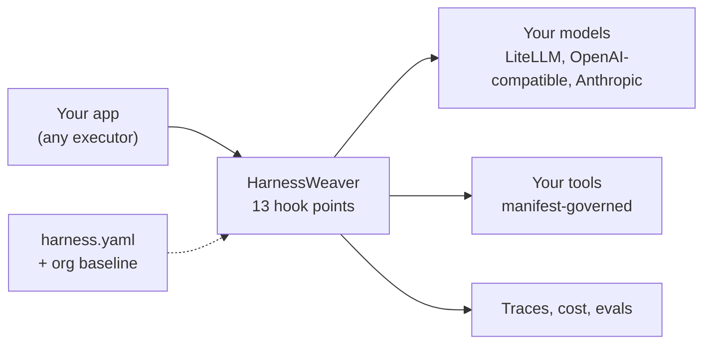

<div align="center">

# HarnessWeaver

**The composable AI harness framework**

*Weave your own AI harness. Bring your models. Choose your plugins. Define your execution.*

`Python 3.12+`, `TypeScript`, `Apache-2.0`, **early development**

</div>

---

> **Status: early development.** This README describes the framework being built. Code samples marked *planned* describe APIs that don't exist yet.

## What is HarnessWeaver?

Every AI application needs the same cross-cutting controls around its models: tracing and cost, budgets and deadlines, PII redaction and injection checks, validated output, governed tool calls, human approvals, routing and evals. Most teams rebuild these controls inside each app, differently every time.

HarnessWeaver is a **framework for building your own harness**. You keep the executor you already use (raw SDK calls, Pydantic AI, a custom pipeline), describe your controls in one `harness.yaml`, and HarnessWeaver intercepts every model call, tool call and output at 13 fixed hook points. Your platform team publishes an org baseline that every app inherits and no app can remove.



## Why a framework, not a harness

| | A central harness | HarnessWeaver |
| --- | --- | --- |
| Who owns control flow | The harness | Your app, with HarnessWeaver intercepting |
| How controls are applied | Hard-wired in one runtime | Composed per app from plugins, plus an org baseline that can't be removed |
| Adopting it | Route your app through it | One line for tracing, then grow level by level |
| Languages | Usually one | Python, TypeScript, and any language through the sidecar |

## A taste *(planned API)*

```python
import harnessweaver as hw

harness = hw.load("harness.yaml")        # spec + org baseline + env overlay, validated at startup

# Level 0 - keep your code, add tracing and cost in one line
client = harness.instrument(AsyncOpenAI(base_url=LITELLM_URL))

# Level 3 - let the harness own the lifecycle: budgets, guards, tool governance, approvals
result = await harness.run("extract_invoice", InvoiceDoc(text=doc), principal=user)
```

## Packages

| Package | What it is |
| --- | --- |
| `harnessweaver` | Python core: spec loader, hook bus, envelope and budgets, runners, the 12 modules, test kit |
| `harnessweaver-cli` | Developer tooling: the `harnessweaver` command |
| `harnessweaver-sidecar` | `harnessd`, which serves the core to other languages over HTTP |
| `harnessweaver-openai`, `-anthropic`, `-pydantic-ai`, `-monty`, `-otel`, `-cel` | First-party Python plugins |
| `@harnessweaver/core` | TypeScript core |
| `@harnessweaver/ai-sdk` | First-party TypeScript plugin for the Vercel AI SDK |

**Plugins are defined by design, not by name.** Any package that exposes an `hw.Plugin` through the `harnessweaver.plugins` entry point is a plugin, so you can build one in your own repository, publish it under any name, and use it from `harness.yaml` (`use: acme.pii`). See [DESIGNS.md No. 13](DESIGNS.md#13-plugins).

## Adoption levels

| Level | You add | You get |
| --- | --- | --- |
| **L0 Observe** | `harness.instrument(client)` | OTel GenAI traces, token and cost per tenant and task, error taxonomy |
| **L1 Guard** | `guardrails:` and `validation:` | PII redaction, injection and secret checks, schema validation with bounded repair |
| **L2 Govern** | tool manifests, `budgets:`, `policy:`, `approvals:` | Tool allow-lists, arg validation, risk-based approval, budgets, audit trail |
| **L3 Orchestrate** | `tasks:` with runners, `routing:` | Idempotency, deadlines, durable suspend and resume, routing cascades |
| **L4 Improve** | `evals:` | CI quality gates, shadow-guard reports, online sampling |

## Documentation

| Doc | For |
| --- | --- |
| QUICKSTART.md *(planned)* | Your first governed task |
| [DESIGNS.md](DESIGNS.md) | Architecture and decisions |
| [RULES.md](RULES.md) | Engineering rules and invariants |
| [AGENTS.md](AGENTS.md) | Contributing with AI coding agents |
| [Design guide](docs/AI%20Harness%20Framework%20Design%20and%20Build%20Guide.md) | The original design source |

## License

[Apache-2.0](LICENSE)
