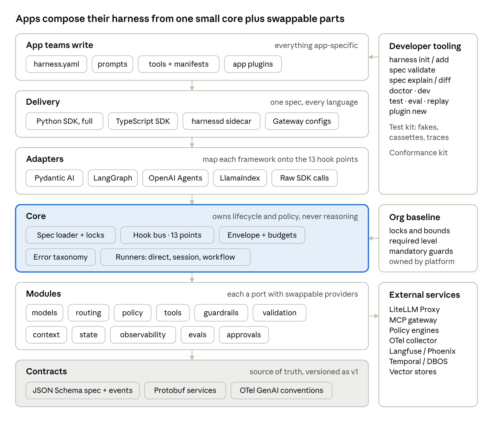

# AI Harness Framework: Design and Build Guide

Oct 13, 2026 · @MK

## Why a framework, not a harness

The goal is a toolkit that any application team embeds to assemble *its own* harness, not one central harness that every app is routed through. The earlier guides described the harness. This guide describes the framework that produces harnesses: its contracts, building blocks, extension points, packaging and developer tooling.

The difference changes almost every design decision.

| Question | Building a harness | Building a harness framework |
| --- | --- | --- |
| Who is the user? | End users of one AI system | Engineers building many different AI apps |
| What ships? | A running service | Libraries, a spec, adapters, a sidecar, a CLI, a test kit |
| Who owns control flow? | The harness | The app team, with the framework intercepting |
| How do controls get applied? | Hard-wired in one runtime | Composed per app from modules, with an org baseline that can't be removed |
| What must stay stable? | The service API | The extension contracts (ports, hook points, spec format) |
| What does success look like? | One system is reliable | A new team gets tracing, budgets, guardrails, tool governance and evals in under a day, without rewriting its app |

The split of responsibilities is the core of the design.

- **The framework ships:** the harness spec format, the runtime core (lifecycle, budgets, hook bus, error taxonomy), standard modules (routing, guardrails, validation, tool governance, observability, evals), adapters for popular AI frameworks, a sidecar for other languages, a CLI, templates and a test kit.
- **The platform or security team ships:** an org baseline profile (mandatory controls, locked values) and approved plugin packs.
- **Each app team writes:** a `harness.yaml`, its prompts, its tools and any app-specific plugins. It keeps whatever executor it already uses: raw SDK calls, Pydantic AI, LangGraph, LlamaIndex or a custom loop.

The closest analogies are OpenTelemetry and Spring Boot. Like OpenTelemetry, the framework separates a tiny stable API from swappable implementations and contributed integrations. Like Spring Boot, it offers starters and opinionated defaults that work with zero config and can be overridden piece by piece.

Code in this guide uses the working name `harnesskit`; the package name is still an open decision.

## How this compares to the earlier lean harness design

The earlier guide ("Building a Lean, Plugin-First, Cross-Language AI Harness") designed one harness architecture for an organization: Pydantic AI capabilities for in-process enforcement, LiteLLM Proxy and an MCP gateway for network enforcement, and a decision service for other languages. This framework keeps nearly all of its technical choices but changes the product: from an architecture a platform team runs to a toolkit every app team uses to build its own harness.

| Dimension | Earlier lean harness design | This framework | Why it changed |
| --- | --- | --- | --- |
| Primary goal | One governed harness architecture for the org's AI apps | A toolkit each app team uses to assemble its own harness | Teams use different frameworks, languages and risk levels |
| Who builds what | Platform team builds and runs the harness; apps integrate | Framework team ships building blocks; platform team ships a baseline; app teams compose | Spreads the work and keeps app choices local |
| Unit of reuse | Plugins behind 12 ports | Modules (port + providers + middleware + config schema), plus profiles | A module wires a capability end to end, so teams add one thing, not five |
| Enforcement mechanism | Pydantic AI capabilities and hooks in-process; gateways on the network | Framework-owned hook bus with 13 fixed hook points; adapters map Pydantic AI, LangGraph, agent SDKs and raw calls onto it; gateways kept | Enforcement must not depend on one agent framework |
| Role of Pydantic AI | Default executor and the enforcement layer | One adapter among several; default runner only in the `agent` template | Apps on LangGraph or raw SDKs get identical controls |
| Core runtime | Deliberately dropped ("contract + envelope + adapters only") | Small core reintroduced: spec loader, hook bus, budgets, error taxonomy, runners | A framework-neutral hook bus needs an owner |
| Configuration | Separate YAML files for tools, guard pipelines and decider pipelines | One `harness.yaml` per app with layered profiles, `extends`, locks and bounds | One place to read an app's controls; `spec explain` shows provenance |
| Org-wide controls | Achieved through gateways and convention | Locked org baseline enforced at load; required adoption level per risk tier | Controls an app can delete are only suggestions |
| Adoption path | Stand up the stack, then integrate apps | Five levels (L0–L4) and three styles (wrap, session, run) | Teams get value in minutes and grow into governance |
| Cross-language | Decisions/Guards/Policy service plus generated TypeScript client | Native TypeScript core SDK, `harnessd` sidecar, location-transparent providers, gateways | Same spec drives every language; Python-only providers still usable |
| Middleware result model | Seven guard actions | Same seven actions plus a unified outcome model (Continue, Block, Suspend, Retry, Escalate) with priority bands and declared fail modes | Predictable ordering when many modules act on one event |
| Adapter safety | Not specified | Adapters declare which hook points they reach; load fails if the baseline needs one they can't reach | No silent gaps in governance |
| Developer tooling | Conformance kit and eval suites | CLI (init, add, spec explain/diff, doctor, dev, replay), five templates, test kit with fakes and cassettes | "Very easy to plug and use" depends mostly on tooling |
| Versioning | Contract version plus SemVer | Contracts, packages and profiles versioned separately, with support windows | Baselines tighten on a different clock than code changes |
| Minimum footprint | Gateways and decision service needed from day one | Core runs in-process alone; gateways and sidecar added by level | Lower cost to start; same end state |
| Roadmap | Six phases built around the stack | Five phases, each ending at a gate measured on pilot apps | Progress measured by adoption, not components |

**Carried over unchanged:** LiteLLM Proxy as the single model egress, with one owner per control; the MCP gateway and OAuth 2.1 for shared tools; the tool manifest and nine-step governor; the routing cascade and the rule that probabilistic deciders (including AnyJev) never grant permission; the layered guardrail pipeline with shadow mode; OpenTelemetry GenAI conventions; contract-first JSON Schema and protobuf; hash-pinned supply chain.

**When the earlier design is the better fit:** a small organization where one platform team builds every AI app, all in Python on Pydantic AI. It has fewer moving parts because Pydantic AI's own capability system replaces the hook bus. Choose this framework once more than a few teams, frameworks or languages are involved, or when security needs controls that app teams cannot remove.

## Design goals and non-goals

Every feature request should be tested against these ten goals. When two goals conflict, the earlier one wins.

1. **Safe by default, removable by nobody.** Org baseline controls (tracing, budgets, PII redaction, tool policy) apply automatically and can't be switched off by app config.
2. **Non-invasive.** The framework wraps whatever the app already uses. Adopting it never requires rewriting an agent or switching frameworks.
3. **Incremental.** Each adoption level (observe, guard, govern, orchestrate, improve) is useful on its own. One line of code gets you level 0.
4. **Composable.** Every capability is a module behind a port. Apps pick modules; modules pick providers.
5. **Declarative first, code when needed.** Common setup is a YAML spec. Anything the spec can't express is a plain Python or TypeScript function registered as a plugin.
6. **Small core.** The core package depends only on Pydantic and OpenTelemetry API. Everything heavy (LiteLLM, Presidio, AnyJev, LangGraph) is an optional extra.
7. **Polyglot by contract.** One spec format and one set of wire contracts serve Python, TypeScript and any language that can call HTTP.
8. **Testable.** Every module can run against fakes. Every plugin passes a shared conformance suite.
9. **Stable extension surface.** Hook points, ports and the spec are versioned and change slowly. Internals can change freely.
10. **Observable.** Every decision the framework makes (route chosen, guard fired, tool denied, budget hit) is a traced, queryable event.

**Non-goals.** The framework is not an agent framework, a prompt library, a vector database, a model host or a hosted platform. It does not pick an app's model, prompt, retrieval method or workflow. It ships adapters to the tools that do those jobs and governs them.

## Mental model and framework layers

App teams touch only the top layer and their spec; everything below it is shipped by the framework or the platform team. The core is deliberately small: it owns lifecycle and policy, and delegates all reasoning to whatever runner the app chose.



Arrows run from what uses to what is used. The core is the one shared piece every app runs unchanged; delivery mode, adapters and modules are picked per app, and the org baseline is merged into every spec at load time.

## Core concepts

App developers learn eleven concepts. Everything else is an implementation detail of a module.

| Concept | What it is | Who defines it |
| --- | --- | --- |
| **Harness** | The runtime object an app creates from a spec. It exposes `run`, `session` and `wrap`. | Framework (built from the app's spec) |
| **HarnessSpec** | The declarative definition of one app's harness, usually `harness.yaml`. It lists modules, providers, policies, budgets and tasks. | App team |
| **Profile** | A reusable partial spec. Built-in ones (`extraction`, `rag`, `agent`, `workflow`, `chat`) preset sensible modules; the org baseline is also a profile. | Framework, platform team |
| **Task** | A named, versioned unit of work with input and output schemas, a runner and task-level overrides, such as `extract_invoice@3`. | App team |
| **Envelope** | The immutable context carried through every call: run id, tenant, principal, task, budget, deadline, labels (data class, provenance). | Framework (filled from the request) |
| **Hook point** | A named moment in the lifecycle (`model.before`, `tool.before`, `output.after`). Modules attach behavior here. | Framework (fixed, versioned set) |
| **Middleware** | A function attached to one or more hook points. It can observe, modify, block, retry or suspend. | Modules, app plugins |
| **Port** | A typed interface for one capability: `Decider`, `Guardrail`, `Validator`, `ToolGovernor`, `ModelProvider` and so on. | Framework |
| **Provider** | A concrete implementation of a port, such as `presidio` for `Guardrail` or `anyjev` for `Decider`. Discovered as a plugin. | Framework, third parties, app teams |
| **Module** | A bundle that wires one capability end to end: its port, a default provider, the middleware it installs and its config schema. Example: the `guardrails` module. | Framework |
| **Runner** | The adapter that executes a task: `direct`, `workflow`, `pydantic_ai`, `langgraph`, `openai_agents` or a custom one. Runners don't implement controls; hook points do. | Framework, app teams |

The key relationship is: a **spec** selects **modules**; each module configures a **provider** behind its **port** and installs **middleware** on **hook points**; the **runner** emits hook events as the task executes; every event carries the **envelope**.

## Universal lifecycle and hook points

The framework's most important contract is a fixed set of 13 hook points. Every runner and every adapter maps its own events onto these, so one guardrail or policy module works unchanged across raw SDK calls, Pydantic AI, LangGraph or an agent SDK.

| Hook point | Fires when | Middleware may | Typical modules |
| --- | --- | --- | --- |
| `run.start` | Envelope built, before any work | Reject, check idempotency, set budget and deadline | identity, budget, tracing |
| `input.before` | Raw input arrives | Validate schema, redact, block | guardrails (input), validation |
| `route.decide` | A choice is needed: task variant, runner, model alias, pipeline | Return a `Decision` | routing |
| `context.after` | Retrieval or memory returns items | Filter by ACL, label provenance, drop, cap size | context, guardrails (context) |
| `model.before` | A model request is about to be sent | Modify messages, pick model alias, pre-check budget, block | budget, guardrails, model access |
| `model.after` | A model response arrives | Record usage and cost, redact, block | budget, observability |
| `stream.chunk` | A streamed chunk arrives (optional) | Buffer, moderate, cut the stream | guardrails (output) |
| `tool.before` | The model proposes a tool call | Allow, deny, rewrite args, require approval | tool governance |
| `tool.after` | A tool returns | Sanitize, truncate, label untrusted | tool governance, guardrails |
| `output.before` | A candidate final output exists | Validate, repair, escalate, block | validation, guardrails (output) |
| `approval.resolved` | A human answers a suspended step | Re-authorize edited args, resume or end | approvals |
| `run.error` | Any exception escapes a step | Classify into the error taxonomy, retry or fail | core |
| `run.end` | The run reaches a terminal state | Persist, emit completion, sample for evals | state, evals, observability |

### Middleware semantics

A middleware is a small async function or class bound to one or more hook points. It returns one of six outcomes, so the framework can combine results predictably.

```python
from harnesskit import middleware, Continue, Block, Suspend, Retry, Escalate

@middleware(hooks=["tool.before"], priority="app", fail_mode="closed")
async def no_weekend_refunds(event, env):
    if event.tool.name == "refund_payment" and env.clock.is_weekend():
        return Suspend(reason="weekend refunds need approval", approver_role="finance")
    return Continue()
```

Four rules make ordering predictable:

1. **Priority bands.** Middleware runs in bands: `baseline` (org, locked, outermost), then `platform`, then `app`, then `task`. Within a band, registration order applies.
2. **Onion order.** `*.before` hooks run outermost-first. `*.after` hooks run innermost-first. A baseline tracer therefore sees every block an inner middleware issues.
3. **Most severe outcome wins** when several middleware answer the same event: `Block` > `Suspend` > `Escalate` > `Retry` > `Continue(modified)` > `Continue`.
4. **Fail mode is declared, never implied.** If a middleware raises or times out, `fail_mode: closed` turns that into `Block`; `fail_mode: open` logs, alerts and continues. Baseline middleware is always closed.

## Three ways to use it

App teams pick one of three integration styles per task. All three load the same spec and apply the same baseline controls; they differ only in who owns control flow. Code below uses the working name `harnesskit`.

```python
import harnesskit as hk
harness = hk.load("harness.yaml")   # spec + org baseline + env overrides, validated at startup
```

### 1. Wrap: keep your code, add controls

Best for existing apps. The adapter maps the framework's native hooks onto the 13 hook points.

```python
# Raw SDK: every call now goes through model.before / model.after
client = harness.instrument(AsyncOpenAI(base_url=LITELLM_URL))

# Existing Pydantic AI agent: tools, outputs and model calls are governed
agent = harness.wrap(my_pydantic_agent, task="support_agent")

# Existing LangGraph graph
graph = harness.wrap(compiled_graph, task="rfp_analysis")
```

### 2. Session: you own the flow, the harness owns the clients

Best for custom pipelines, such as RAG with routing. Every capability you use comes pre-governed from the session.

```python
async with harness.session(task="support", principal=user, tenant=org) as s:
    route = await s.decide("support_router", text=question)          # route.decide
    chunks = await s.context("kb").fetch(question)                    # context.after: ACL + labels
    answer = await s.generate(model="fast", output=CitedAnswer,      # model.*, output.before
                              prompt="support_answer@4", question=question, chunks=chunks)
    return answer
```

### 3. Run: the framework owns the lifecycle

Best for new tasks and long-running work. The task's runner executes; the framework handles idempotency, budgets, approvals, repair and persistence.

```python
result = await harness.run("extract_invoice", InvoiceDoc(text=doc), principal=user,
                           idempotency_key=upload_id)

run_id = await harness.submit("rfp_analysis", rfp, principal=user)  # async + durable
async for event in harness.stream(run_id): ...                       # progress, approvals
await harness.approve(run_id, approval_id, decision="approve", approver=manager)
```

| Style | Effort to adopt | Control-flow owner | Controls guaranteed | Use for |
| --- | --- | --- | --- | --- |
| Wrap | Minutes | App's existing framework | Model, tool, output hooks the adapter can reach | Existing apps, quick wins |
| Session | Hours | App code | All hooks except run-level durability | Custom pipelines, RAG |
| Run | Hours to days | Framework runner | All hooks plus idempotency, durability, approvals, repair | New tasks, agents, long-running work |

A wrap adapter declares which hook points it can reach. If it can't reach one the baseline requires (for example, a framework that calls tools out of band), `hk.load` fails at startup rather than running with a silent gap.

## Progressive adoption levels

Teams adopt the framework in five levels, and each level pays for itself before the next. The platform team sets the minimum level per risk tier: for example, internal tools need L1, customer-facing apps L2, and apps that take actions L3.

| Level | What the team adds | Spec lines (approx.) | What they get |
| --- | --- | --- | --- |
| **L0 Observe** | `harness.instrument(client)` or `harness.wrap(agent)` | 3 | OTel GenAI traces, token and cost per tenant and task, error taxonomy, latency |
| **L1 Guard** | `guardrails:` and `validation:` blocks; output schemas | 15 | PII redaction, injection and safety checks, schema validation with bounded repair |
| **L2 Govern** | Tool manifests, `budgets:`, `policy:`, `approvals:` | 30 | Tool allow-lists, arg validation, risk-based approval, per-run and per-tenant budgets, audit log |
| **L3 Orchestrate** | `tasks:` with runners; `harness.run` / `submit`; `routing:` | 50 | Idempotency, deadlines, cancellation, durable runs, HITL suspend and resume, routing cascades |
| **L4 Improve** | `evals:` suites, feedback API, experiments | 70 | CI quality gates, online judges, feedback capture, A/B variants, eval-gated promotion |

Two properties keep this honest. First, the org baseline profile can require a level, and `harness doctor` reports the level each app actually reaches. Second, moving up a level never changes code written at a lower level; it only adds spec sections and, from L3, swaps direct calls for `harness.run`.

## Harness-as-code: specs, layers and org baselines

The framework's answer to "don't let teams reimplement cross-cutting controls" is layered config with locks. The platform team publishes a baseline profile; every app spec extends it; locked values and bounds are enforced when the harness loads, not by convention.

### Layer order

Effective config is merged in this order, later layers overriding earlier ones except where locked or bounded:

1. Framework defaults (safe, minimal).
2. Built-in profile (`profile://rag`, `profile://agent` and so on).
3. Org baseline (`org://acme-baseline@^2`), with locks and bounds.
4. App spec (`harness.yaml`).
5. Environment overlay (`harness.prod.yaml`).
6. Per-run overrides, only for fields the spec marks `overridable`, and only within bounds (a caller can lower a budget, never raise it).

### Org baseline profile

```yaml
apiVersion: harnesskit/v1
kind: Profile
metadata: { name: acme-baseline, version: 2.3.0, owner: platform-security }
spec:
  require_level: { default: L1, tiers: { customer_facing: L2, takes_actions: L3 } }
  observability: { exporter: otlp, endpoint: "http://otel-collector:4317", capture_content: false }
  model_access:
    provider: litellm
    base_url: "https://llm-gw.internal"
    allowed_aliases: [fast, strong, reasoning, embed]
  budgets:
    per_run: { max_usd: 2.00, deadline: 5m }
  guardrails:
    input:  [ { id: base-pii, use: presidio.pii, action: redact } ]
    output: [ { id: base-secrets, use: secrets.scan, action: block } ]
  tools:
    require_manifest: true
    approval_by_risk: { high: required, critical: required }
locks:
  - observability.capture_content
  - model_access.base_url
  - guardrails.input[base-pii]
  - guardrails.output[base-secrets]
  - tools.require_manifest
bounds:
  budgets.per_run.max_usd: { max: 5.00 }
  budgets.per_run.deadline: { max: 30m }
```

### App spec

```yaml
apiVersion: harnesskit/v1
kind: Harness
metadata: { name: support-assistant, owner: cx-team, risk_tier: customer_facing }
extends: [ "org://acme-baseline@^2", "profile://rag" ]

models: { default: fast }

routing:
  support_router:
    options: [rag_qa, billing_agent, smalltalk]
    cascade:
      - { use: rules,    file: routes/support.rules.yaml }
      - { use: semantic, encoder: local/bge-small, threshold: 0.82, utterances: routes/support.utterances.yaml }
      - { use: llm,      model: fast, threshold: 0.70 }
    default: rag_qa

context:
  kb: { use: pgvector, acl: openfga, label: untrusted }

guardrails:
  input:  [ { use: promptguard2.inject, threshold: 0.8, action: block, parallel: true } ]
  output: [ { use: grounded.citations, min_supported: 0.9, action: escalate } ]

tools: { manifests: "tools/*.tool.yaml" }

tasks:
  rag_qa:
    version: 4.1.0
    runner: session
    output: "app.schemas:CitedAnswer"
    budget: { max_usd: 0.10, deadline: 20s, overridable: [max_usd] }
  billing_agent:
    version: 2.0.0
    runner: { use: pydantic_ai, agent: "app.agents:billing_agent" }
    budget: { max_usd: 1.00, max_tool_calls: 20, deadline: 2m }
    approvals: { tools: [refund_payment], approver_role: finance, timeout: 24h, on_timeout: escalate }

evals:
  rag_qa: [ evals/rag_golden.yaml, evals/rag_regression.yaml ]
```

### Merge rules

| Value type | Rule | Example |
| --- | --- | --- |
| Scalar | Later layer wins unless locked | App sets `models.default: fast` |
| Map | Deep merge | App adds `context.kb` beside baseline settings |
| Guard and middleware lists | Append by `id`; baseline items can't be removed or reordered | App's `promptguard2.inject` runs inside the baseline's `base-pii` |
| Locked path | Any override is a load error | Setting `capture_content: true` fails `hk.load` |
| Bounded number | Value outside bounds is a load error, never a silent clamp | `max_usd: 8.00` fails against `max: 5.00` |

Two commands make the result inspectable. `harness spec explain` prints every effective value with the layer it came from. `harness spec diff` shows what changes between two spec versions, and runs in CI on every pull request.

## Module catalog

The framework ships 12 first-party modules. Each is one optional package with a port, a default provider and the middleware it installs, so an app pulls in only what its spec names.

| Module | Port(s) | Default provider | Other providers | Hook points used |
| --- | --- | --- | --- | --- |
| `core` | `Runner`, `ErrorClassifier` | `direct`, `session` | — | `run.*` |
| `models` | `ModelProvider` | LiteLLM Proxy | OpenAI-compatible endpoint, direct provider SDKs | `model.*` |
| `routing` | `Decider` | Cascade (rules → semantic → LLM) | CEL, GoRules ZEN, semantic-router, AnyJev, RouteLLM | `route.decide` |
| `policy` | `PolicyEngine` | CEL (embedded) | Cedar, OPA, OpenFGA | `tool.before`, `run.start` |
| `tools` | `ToolRegistry`, `ToolGovernor` | Manifest registry + CEL policy | MCP client via agentgateway or ContextForge | `tool.*` |
| `approvals` | `ApprovalChannel` | In-process callback | Webhook, Slack, email, harnessd approval page | `tool.before`, `output.before`, `approval.resolved` |
| `guardrails` | `Guardrail` | Presidio (PII), Prompt Guard 2 (injection) | Llama Guard, LLM Guard, Bedrock, Azure Prompt Shields, Lakera, custom | `input.before`, `context.after`, `tool.after`, `output.before`, `stream.chunk` |
| `validation` | `Validator` | Pydantic schema + repair | JSON Schema, business rules, groundedness | `output.before` |
| `context` | `ContextProvider`, `Memory` | Pass-through | pgvector, OpenSearch, Qdrant with ACL filter | `context.after` |
| `state` | `StateStore`, `DurableRunner` | In-memory, SQLite | Postgres, Redis, Temporal, DBOS | `run.*`, `approval.*` |
| `observability` | `Telemetry` | OpenTelemetry GenAI | Langfuse, Phoenix, Logfire exporters | all |
| `evals` | `Evaluator`, `DatasetStore` | Built-in runner + deterministic graders | promptfoo, DeepEval, Ragas, Pydantic Evals | `run.end` |

The four modules that carry most of the governance load get more detail below.

Every module, including these four, is specified in full (ports, config, providers, hook behavior, failure modes, telemetry and testing) in Module reference.

### Routing and decisions

One `Decider` port covers three kinds of decision, with different trust rules.

| Decision kind | Example | Allowed deciders | Trust rule |
| --- | --- | --- | --- |
| Intent / task | Which pipeline answers this question? | Rules, semantic-router, AnyJev, LLM classifier | May be probabilistic; thresholds tuned on a labelled routing set |
| Model | Which model alias serves this call? | Rules by task and size; optional learned router | Returns an alias; LiteLLM handles fallback and failover |
| Policy | May this principal call this tool with these args? | CEL, Cedar, OPA, OpenFGA | Must be deterministic; ML may only tighten a decision, never grant one |

The default decider is a **cascade**: the first stage that answers with enough confidence wins, and every stage's answer is recorded on the trace. Cheap and exact stages go first.

```python
@hk.decider("vip_rules")                      # stage plugin: deterministic
async def vip_rules(req: hk.DecisionRequest) -> hk.Decision:
    if req.state.get("tier") == "vip":
        return hk.Decision.exact("billing_agent", reason="vip customer")
    return hk.Decision.abstain()
```

**Where AnyJev fits.** AnyJev (Nokia Applied Research, Apache-2.0, v0.3.0) reads a calibrated probability over a fixed set of options from an open-weight model's logits. That makes it a strong *stage* for intent routing and yes/no classifier guardrails when you self-host open models, because "route if p ≥ 0.85, else fall through" is exactly what a cascade needs. It is not a rules or policy engine, it needs logprob access (no closed APIs), and its API broke between 0.2 and 0.3. Ship it as the optional `harnesskit-anyjev` provider, pin it exactly, and run it in shadow mode against your routing eval set before letting it decide.

### Model access and typed calls

The `models` module makes LiteLLM the single egress point and Pydantic models the single typing system.

- **Gateway.** Every provider resolves model aliases through LiteLLM Proxy, which holds provider keys, fallbacks, cooldowns and per-tenant virtual-key budgets. Apps never hold provider keys.
- **Typed output.** `s.generate(output=Schema)` and every runner validate against a Pydantic model (or JSON Schema in TypeScript), then hand failures to the `validation` module's bounded repair.
- **Pydantic AI** is the recommended Python runner for agents: the adapter installs the framework's middleware as Pydantic AI capabilities and hooks, and points its model at LiteLLM.
- **BAML** is the recommended option for typed LLM functions in TypeScript, Go or Ruby, pointed at the same LiteLLM endpoint.
- **One owner per control.** LiteLLM owns retries, fallbacks and tenant budgets; SDK clients are built with retries off; the harness owns per-run budgets, deadlines and repair. `harness doctor` flags any duplicate owner it detects.

### Tool governance

No tool runs without a manifest. The manifest is the contract between the tool's owner, the security team and the governor.

```yaml
apiVersion: harnesskit/v1
kind: Tool
metadata: { name: refund_payment, version: 2.1.0, owner: payments-team }
spec:
  transport: mcp                        # native | mcp | http
  server: "mcp://payments.internal"
  definition_digest: "sha256:9f3c..."   # pinned tools/list entry: rug-pull defense
  input_schema: { $ref: schemas/refund_args.json }
  side_effect: write_external           # none | read | write_internal | write_external | destructive
  risk: high
  data_access: ["pii:customer"]
  egress: [payments.internal]
  scopes: ["payments:refund"]
  rate_limit: { per_principal: 10/m, per_tenant: 200/h }
  approval: { when: "args.amount_usd > 100" }
  sandbox: none
  output: { max_bytes: 20000, sanitize: [strip_instructions, pii_redact], label: untrusted }
```

The governor runs nine deterministic steps on every `tool.before` and `tool.after` event:

1. **Registry.** The tool exists, is enabled for this tenant, and its live definition matches `definition_digest`.
2. **Schema.** Arguments validate against `input_schema`.
3. **Policy.** The `policy` module decides allow, deny or require approval from principal, tenant, scopes, risk and args.
4. **Lethal-trifecta check.** If the run has touched untrusted content and holds private data, any tool with external egress needs approval or is blocked.
5. **Limits.** Rate limits, the run's tool-call budget and idempotency keys for non-idempotent tools.
6. **Optional judge.** A probabilistic check (an LLM judge or AnyJev yes/no) may raise the decision to approval or block, never lower it.
7. **Approval.** The run suspends durably until an authorized approver answers; edited args go back through step 3.
8. **Execute** in the sandbox the manifest names. (recommend on using pydantic-monty)
9. **Sanitize output**: truncate, redact, and label it untrusted for later steps.

The same manifests generate allow-list rules for the MCP gateway and LiteLLM's tool-permission guardrail, so a non-Python app calling tools over the network gets identical allow-lists.

### Guardrails and validation

Every guardrail implements one port and returns one of seven actions: `allow`, `redact`, `repair`, `escalate`, `require_approval`, `block` or `log_only`. The spec decides where it runs and what happens.

| Stage | Cheap checks first | Then | Default action |
| --- | --- | --- | --- |
| Input | Size, rate, regex, Presidio PII | Injection classifier, topic decider | Redact, block |
| Context | ACL filter, provenance label | Injection scan of retrieved chunks | Drop chunk |
| Tool result | Truncate, secrets scan | PII redaction | Redact |
| Output | Pydantic schema, business rules | Groundedness, safety classifier | Repair once, then escalate or block |

New guards always start with `mode: log_only`. The `evals` module reports their would-have-fired rate and false positives; promoting a guard to enforcing is a one-line spec change reviewed like code.

### Remaining modules in brief

- **Context and memory.** A `ContextProvider` must filter by the envelope's principal and tenant itself; the module adds provenance labels and token caps. Memory writes are namespaced by tenant, principal and task, with TTLs.
- **State and durability.** `StateStore` holds checkpoints, idempotency records and pending approvals. For long or approval-gated runs, a `DurableRunner` adapter delegates to Temporal or DBOS; the framework never builds its own scheduler.
- **Observability.** Spans follow OpenTelemetry GenAI conventions (`invoke_agent`, `chat`, `execute_tool`) plus framework spans (`harness.run`, `harness.decision`, `harness.guard`, `harness.approval`). Cost is computed from a versioned price table.
- **Evals.** One dataset format and one grader interface serve CI (`harness eval run --suite ci`) and production sampling; external tools plug in as `Evaluator` providers.
- **Approvals.** An `ApprovalChannel` port delivers requests by in-process callback, webhook, Slack or email, and records who approved what.

## Extending the framework

There are four kinds of extension, and most teams only ever need the first two.

| Extension | Effort | Who writes it | Example |
| --- | --- | --- | --- |
| Provider for an existing port | 20–100 lines | Any team | A guardrail wrapping your in-house PII service |
| Middleware | 10–50 lines | Any team | "No refunds on weekends without approval" |
| Runner / framework adapter | 200–600 lines | Platform team or framework maintainers | Adapter for LlamaIndex Workflows or a custom agent loop |
| New module (new port) | Days | Platform team only, via design review | A future `cache` or `feedback` module |

### Writing a provider

A provider is a class that satisfies a port, plus a Pydantic config model so the spec loader can validate its settings. Metadata tells the framework how to schedule it.

```python
from pydantic import BaseModel
import harnesskit as hk

class InHousePIIConfig(BaseModel):
    endpoint: str
    entities: list[str] = ["EMAIL", "PHONE"]

@hk.provider(
    port="Guardrail", name="acme.pii", config=InHousePIIConfig,
    contract=">=1.0,<2", stages=["input", "tool_result", "output"],
    deterministic=True, latency_class="fast",
)
class InHousePII:
    def __init__(self, cfg: InHousePIIConfig):
        self.client = AcmePIIClient(cfg.endpoint)
        self.entities = cfg.entities

    async def check(self, content: str, env: hk.Envelope) -> hk.GuardResult:
        hits = await self.client.scan(content, self.entities)
        if not hits:
            return hk.GuardResult.allow()
        return hk.GuardResult.redact(self.client.mask(content, hits), findings=hits)
```

Publishing it takes one entry in `pyproject.toml`, after which any spec can say `use: acme.pii`:

```toml
[project.entry-points."harnesskit.providers"]
"acme.pii" = "acme_harness_plugins.pii:InHousePII"
```

In-repo plugins can skip packaging: listing `plugins: ["app.harness_plugins"]` in the spec imports the module and registers its decorated classes.

### Writing a framework adapter

An adapter makes an AI framework emit the 13 hook points. It must do four things and declare what it can reach.

1. **Inject the governed model client.** The framework's model calls must go through the harness's `ModelProvider`, so `model.before` and `model.after` fire.
2. **Inject governed tools.** Each tool the framework sees is a wrapper that calls `harness.tools.invoke`, so `tool.before` and `tool.after` fire.
3. **Bridge native hooks and traces.** Map the framework's callbacks, middleware or hooks onto hook points, and parent its spans under `harness.run`.
4. **Translate errors** into the framework's error taxonomy (budget, policy, validation, provider, tool, internal).

```python
@hk.adapter(name="llamaindex", wraps="llama_index.core.workflow.Workflow",
            reaches=["model.before", "model.after", "tool.before", "tool.after",
                     "output.before", "run.start", "run.end", "run.error"])
class LlamaIndexAdapter(hk.Adapter):
    def bind(self, target, ctx: hk.RunContext):
        target.llm = ctx.models.as_llamaindex_llm(alias=ctx.task.model)
        target.tools = [ctx.tools.as_llamaindex_tool(t) for t in ctx.task.tools]
        target.add_event_handler(ctx.events.bridge("llamaindex"))
        return target

    def translate_error(self, exc):
        return hk.errors.from_known(exc) or hk.errors.Internal(exc)
```

If the baseline requires a hook point that an adapter does not list in `reaches`, the harness refuses to load that task.

### Conformance kit

Every provider and adapter runs the same contract suite, shipped as a pytest plugin with language-neutral JSON fixtures:

```bash
pytest --harnesskit-conformance=acme.pii
```

The suite checks that:

- Every result validates against the contract schema and carries an action.
- Timeouts are honored, and failures become `Block` when `fail_mode: closed`.
- Providers that declare `deterministic=True` return the same output for the same input.
- Policy deciders never return a probabilistic `allow`.
- Raw content is never written to logs or spans before redaction.
- Adapters fire every hook point they declare in `reaches`, in the documented order.
- p95 latency stays within the declared `latency_class`.

The TypeScript SDK and the sidecar run the same JSON fixtures, so a plugin that passes in one language behaves the same through any other.

## Cross-language delivery

The framework reaches every language through one spec, one wire contract and location-transparent providers. Python is the reference implementation; TypeScript gets a native SDK; every other language gets a thin client to a sidecar plus the network gateways.

| Delivery mode | Languages | What runs in-process | What runs elsewhere |
| --- | --- | --- | --- |
| Native SDK, full | Python | Spec loader, hook bus, all modules, all adapters | Gateways only |
| Native SDK, core | TypeScript | Spec loader, hook bus, budgets, routing rules, schema validation, tool governor, OTel | Heavy providers (Presidio, AnyJev, semantic-router) via the sidecar |
| Sidecar client | Go, Java, .NET, Ruby, others | A generated client (≈300 lines) | `harnessd`, a container running the Python core over gRPC and HTTP |
| Gateway only | Anything that can make HTTP calls | Nothing | LiteLLM Proxy and the MCP gateway, configured from the same spec |

### Location-transparent providers

Any provider can run in-process or in the sidecar. The spec chooses; app code doesn't change. This is what lets a TypeScript app use a Python-only guardrail without anyone writing a port of it.

```yaml
guardrails:
  input:
    - { use: presidio.pii, action: redact, where: sidecar }    # Python-only provider
    - { use: regex.deny,   action: block,  where: local }      # runs natively in TS
```

### Contracts

Three artifacts are the source of truth, generated into every SDK:

- **JSON Schema 2020-12** for the spec format, tool manifests, guard pipelines and every event payload (`Envelope`, `Decision`, `GuardResult`, `ToolCall`).
- **Protobuf** (served as gRPC and as HTTP/JSON via OpenAPI) for the sidecar's services: `Runs`, `Hooks`, `Decisions`, `Guards`, `Policy`, `Evals`.
- **OpenTelemetry GenAI conventions** plus the framework's `harness.*` attributes as the observability contract.

### TypeScript example

The TypeScript SDK wraps the Vercel AI SDK's language-model middleware and the OpenAI client, with the same three styles as Python.

```ts
import { load } from "@harnesskit/core";
import { openai } from "@ai-sdk/openai";
import { generateObject } from "ai";

const harness = await load("harness.yaml");          // same spec as the Python app

export async function answer(question: string, user: User) {
  return harness.session({ task: "support", principal: user.id, tenant: user.org }, async (s) => {
    const route = await s.decide("support_router", { text: question });  // rules local, semantic via sidecar
    const model = s.wrapModel(openai("fast"));                           // model.before / model.after
    const { object } = await generateObject({ model, schema: CitedAnswerSchema,
                                               prompt: await s.prompt("support_answer@4", { question }) });
    return s.validate("output", object);                                 // output.before
  });
}
```

### Go via the sidecar

```go
h := harnesskit.NewClient("localhost:7070")
run, _ := h.Session(ctx, harnesskit.Envelope{Task: "support", Principal: user.ID, Tenant: user.Org})
input, err := run.Guard(ctx, "input", question)        // Block, Redact or Allow
// model calls go straight to LiteLLM with run.Headers() for budgets and tracing
```

Two rules keep the languages in step. A feature isn't released until the JSON conformance fixtures pass in Python, TypeScript and the sidecar. And the gateways are configured from the same spec, so even a language with no SDK at all still gets model and tool controls.

## Developer tooling

The tooling is what makes the framework feel easy. A new team should get from zero to a governed, traced, tested task in one sitting.

### CLI

| Command | What it does |
| --- | --- |
| `harness init --template rag` | Scaffolds `harness.yaml`, sample code, a tool manifest, an eval dataset and tests from a template |
| `harness add guard presidio.pii --stage input` | Adds a module or provider to the spec, installs its package extra, and validates the result |
| `harness add tool ./tools/refund.py` | Generates a manifest from the function signature and docstring for the owner to complete |
| `harness spec validate` / `explain` / `diff` | Validates against the schema and baseline, shows where each value came from, diffs two versions |
| `harness doctor` | Reports adoption level, unreachable hook points, duplicate control owners, unpinned dependencies, guards still in shadow mode |
| `harness dev` | Starts LiteLLM, the sidecar, an OTel collector and Langfuse locally with Docker Compose, pre-wired to the spec |
| `harness test` | Runs the app's tests in test mode, with fakes for models and tools |
| `harness policy test` | Runs table-driven tests for policy rules and tool approvals |
| `harness eval run --suite ci` | Runs eval suites and compares against the stored baseline; exits non-zero on regression |
| `harness replay <run_id>` | Re-runs a recorded production run against the current code and spec |
| `harness plugin new guardrail acme.pii` | Scaffolds a provider package with config model, entry point and conformance tests |

### Templates

Five templates cover most apps. Each one is a working app plus the spec sections its profile needs.

| Template | Profile | Starts with |
| --- | --- | --- |
| `extraction` | `profile://extraction` | One typed `generate`, schema validation with one repair, golden-set eval |
| `rag` | `profile://rag` | Routing cascade, ACL-filtered context, citation check, faithfulness eval |
| `agent` | `profile://agent` | Pydantic AI runner, two governed tools, one approval-gated tool, red-team eval |
| `workflow` | `profile://workflow` | Three-step deterministic pipeline with a parallel step and an evaluator-optimizer loop |
| `chat` | `profile://chat` | Streaming output with moderation, memory, topic guard |

### Test kit

Tests run without network access or model spend.

```python
from harnesskit.testing import harness_for_test, ScriptedModel, FakeTool, assert_trace

async def test_refund_over_100_needs_approval():
    h = harness_for_test("harness.yaml",
        model=ScriptedModel([tool_call("refund_payment", order_id="o1", amount_usd=250)]),
        tools={"refund_payment": FakeTool(returns="ok")})
    result = await h.run("billing_agent", "refund order o1", principal="alice")
    assert result.status == "awaiting_approval"
    assert_trace(result, ["run.start", "model.after", "tool.before:require_approval"])
```

The kit also includes record-and-replay cassettes for real model calls, a `FakeDecider` for routing tests, and fixtures that load the org baseline so tests fail when an app's spec drifts from it.

## Tech stack for building the framework

Keep the core's own dependencies to two (Pydantic and the OpenTelemetry API) and push every integration into an optional extra. The choices below favor boring, widely used tools.

| Concern | Choice | Why |
| --- | --- | --- |
| Core language | Python 3.11+ | Most AI teams and libraries; `TaskGroup` and exception groups for clean concurrency |
| Core dependencies | `pydantic` v2, `opentelemetry-api` | Typed contracts and tracing; nothing else in the core |
| Async | `anyio` | Works under asyncio and trio; clean cancellation scopes for deadlines |
| Rules | `cel-python` in the core; GoRules ZEN as an extra | CEL for small predicates; ZEN when decision tables must behave identically across languages |
| CLI | `typer` | Typed commands, generated help |
| Contracts | JSON Schema (source) → Pydantic via `datamodel-code-generator`, TS types and Zod via codegen; protobuf with `buf` for the sidecar | One schema, generated everywhere; `buf breaking` catches incompatible changes |
| Python packaging | `uv` workspaces, `hatchling` builds, PyPI trusted publishing | Fast monorepo installs; no long-lived publish tokens |
| TypeScript packaging | `pnpm` workspaces, `tsup`, `vitest`, `zod`, `changesets` | Standard, fast, versioned releases per package |
| Sidecar | FastAPI + `grpcio`, distroless container image | Runs the Python core; one image for all non-Python languages |
| Quality | `pytest`, `hypothesis` (property tests for merge rules), `pyright --strict`, `ruff` | Merge and policy logic need property tests, not just examples |
| Docs | `mkdocs-material` with runnable examples tested in CI | Docs examples can't silently rot |
| Supply chain | Hash-pinned lockfiles, CI actions pinned by commit SHA, SBOM per release, Sigstore-signed artifacts | The March 2026 LiteLLM compromise came through an unpinned CI action |

Integration extras, each its own package:

- `harnesskit[litellm]`: LiteLLM provider and gateway config generator. Run LiteLLM as a pinned, scanned container, not as an in-process import, wherever possible.
- `harnesskit[pydantic-ai]`: Pydantic AI runner and adapter (capabilities and hooks).
- `harnesskit[langgraph]`, `harnesskit[openai-agents]`, `harnesskit[llamaindex]`: other adapters.
- `harnesskit[presidio]`, `harnesskit[llm-guard]`, `harnesskit[llama-guard]`: guardrail providers.
- `harnesskit[semantic-router]`, `harnesskit[anyjev]`, `harnesskit[zen]`: routing providers.
- `harnesskit[cedar]`, `harnesskit[opa]`, `harnesskit[openfga]`: policy providers.
- `harnesskit[temporal]`, `harnesskit[dbos]`, `harnesskit[postgres]`: state and durability.
- `harnesskit[promptfoo]`, `harnesskit[deepeval]`, `harnesskit[ragas]`: eval providers.

## Repo layout, packaging and versioning

Use one monorepo with independently versioned packages. The contracts directory is the source of truth; everything else is generated from it or tested against it.

```
harnesskit/
  contracts/                    # SOURCE OF TRUTH
    schemas/                    #   spec, Profile, Tool, GuardPipeline, events (JSON Schema)
    proto/harnesskit/v1/        #   sidecar services
    fixtures/conformance/       #   language-neutral JSON test cases
  python/
    harnesskit/                 # core: spec loader, merge, hook bus, envelope, budgets, errors, CLI
    harnesskit-testing/         # fakes, cassettes, assert_trace, conformance pytest plugin
    providers/                  # one package per extra: litellm, presidio, anyjev, cedar, ...
    adapters/                   # pydantic-ai, langgraph, openai-agents, llamaindex
  typescript/
    core/                       # @harnesskit/core
    adapters/                   # @harnesskit/ai-sdk, @harnesskit/openai
  sidecar/                      # harnessd container (FastAPI + gRPC over the Python core)
  profiles/                     # built-in profiles: extraction, rag, agent, workflow, chat
  templates/                    # harness init templates
  gateway/                      # spec → LiteLLM config and MCP gateway rule generators
  docs/
```

### Versioning

Three things carry separate version numbers, because they change at different speeds.

| Versioned thing | Scheme | Breaking change means | Support window |
| --- | --- | --- | --- |
| Contracts (`harnesskit/v1`) | Major in the API version string; minor additions only | Removing or changing a field, hook point or action | Previous major supported 12 months after the next ships |
| Packages (core, SDKs, providers, adapters) | SemVer per package | Public Python or TS API change | Latest two minors patched |
| Profiles (built-in and org) | SemVer; specs pin a range such as `@^2` | Adding a lock or tightening a bound | Org decides; `spec diff` shows impact |

### Compatibility rules

- Every provider and adapter declares the contract range it supports (`contract=">=1.0,<2"`). The loader refuses incompatible combinations at startup.
- New hook points and actions are additive in a minor contract version. Old providers ignore them; adapters declare whether they reach them.
- Tightening a baseline is a breaking profile change, so org baselines move by major version and app specs opt in with `^`.
- `buf breaking` and a JSON Schema compatibility check run on every pull request that touches `contracts/`.


## Anti-patterns and open decisions

### Anti-patterns to avoid when building the framework

- **Becoming an agent framework.** The moment the core grows its own planner, memory model or prompt templating, teams must choose between it and Pydantic AI or LangGraph. Govern those; don't compete with them.
- **Controls that apps can switch off.** A baseline guard that an app can remove by editing YAML is a suggestion. Locks and load-time failures are the point.
- **Silent gaps.** An adapter that can't reach `tool.before` must fail loading, not run quietly without tool governance.
- **Two owners for one control.** Retries in both the SDK and LiteLLM, or budgets in three places, produce multiplied calls and confusing failures.
- **A fat core.** If installing the core pulls in a vector database client or a model SDK, adoption stalls in every team that doesn't need it.
- **Contracts that leak a framework.** A hook payload containing a Pydantic AI or LangChain type ties every other language and adapter to it.
- **Probabilistic authorization.** A classifier or LLM judge (including AnyJev) may route or tighten; it never grants permission.
- **A rewrite in Rust before the contracts settle.** Bindings multiply the cost of every contract change. Revisit only for a hot, stable, deterministic component.
- **Guards that start enforcing.** Without a shadow period, false positives reach users before anyone measures them.

### Open decisions

| Decision | Options | Recommendation |
| --- | --- | --- |
| Framework name | `harnesskit` (working), other | Check package-name availability on PyPI and npm before announcing |
| TypeScript at launch | Python only first; Python and TS together | Python first, TS in phase 3, sidecar covers TS earlier |
| Default agent runner | Pydantic AI; none (adapters only) | Pydantic AI as the default in the `agent` template, never required |
| Default policy language | CEL; Cedar; OPA | CEL embedded for tools and routing; Cedar or OPA as providers for orgs that already run them |
| Durability backend | Temporal; DBOS; none in v1 | None in v1 (SQLite or Postgres checkpoints); Temporal adapter in phase 4 |
| Observability backend default | Langfuse; Phoenix; vendor | OTLP only in the core; `harness dev` ships Langfuse locally |
| Hosted control plane | Build later; never | Defer; the spec plus Git is the control plane until more than 20 apps adopt |
