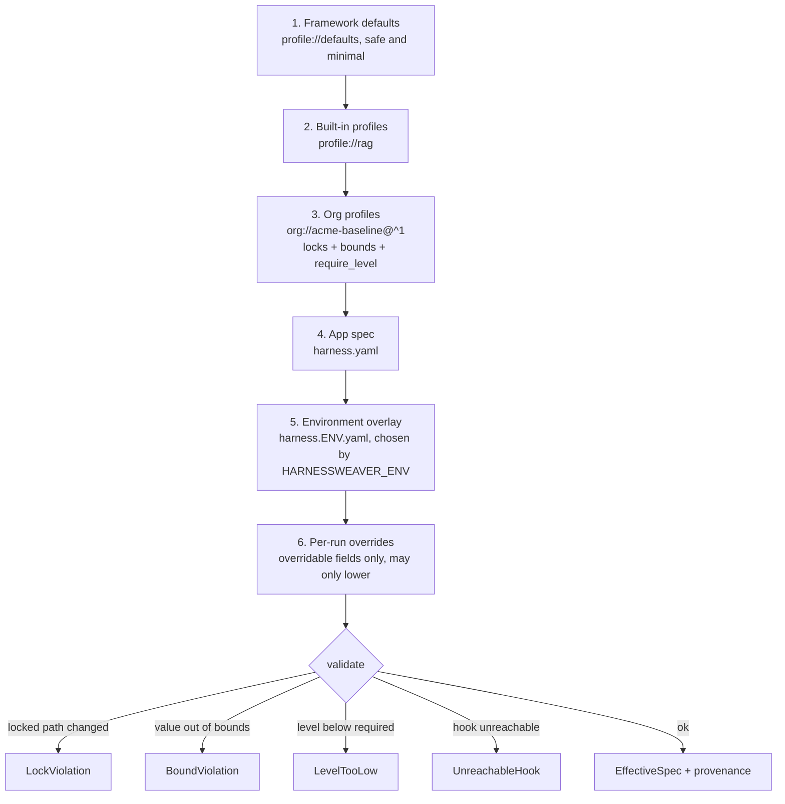

# Layers, locks and bounds

An app's effective spec is built from layers. The platform team's controls live in an org profile that every app extends, and **locks** and **bounds** make sure no app can remove or loosen them. This page explains how layers merge and how a baseline is enforced.

## The layers

Effective config is merged in this order. Later layers override earlier ones, except where a value is locked or bounded.



| Layer | Kind | Where it comes from | Middleware band |
| --- | --- | --- | --- |
| `profile://defaults` | defaults | Always first; ships with the core | `platform` |
| `profile://<name>` | profile | Built-in profiles named in `extends` | `platform` |
| `org://<name>@<range>`, `profile://<ns>.<name>@<range>`, a file path | org | Org profiles, plugin profiles and profile files named in `extends`. The app's own come last ([below](#who-owns-a-profile)) | `baseline` |
| `harness.yaml` | app | The app spec | `app` |
| `harness.<env>.yaml` | overlay | The environment overlay, if the file exists | `app` |
| Per-run budget | - | `harness.run(..., budget={...})` | - |

**Built-in profiles always come before org profiles**, whatever order `extends` lists them in, so an org baseline can tighten a built-in profile and never the reverse. A profile can itself `extends` other profiles; parents come before it, each profile (each file, for a profile read from one) appears once, and a cycle is an error.

### Who owns a profile

A profile is **app-owned** when the app's team can write it: it's in `.harness/profiles/` next to the app spec, or it's a file named by the app spec or by another app-owned profile. Everything else belongs to the platform: a directory on `--profile-dir` or `HARNESSWEAVER_PROFILE_PATH`, a plugin's profile, and a file a platform profile names.

**App-owned profiles merge after the platform's**, whatever order `extends` lists them in, so the platform's locks bind them ([ADR-0043](../adr/0043-profile-ownership.md)). This protects a baseline that reaches the app through the platform's channels. A baseline in the app's own repository, or one the app names by file path, has no boundary to protect, because its team can edit it.

## Profiles

`extends` takes a list of references:

| Reference | Resolves to |
| --- | --- |
| `profile://rag` | A built-in profile: `extraction`, `rag`, `agent`, `workflow` or `chat` ([Built-in profiles](../reference/profiles.md)) |
| `org://acme-baseline@^1` | An org profile on the profile search path: each directory in `HARNESSWEAVER_PROFILE_PATH` (separated like `PATH`), then `.harness/profiles/` next to the app spec. Files are named `<name>.yaml` or `<name>@<version>.yaml`. The first directory holding any file for a name owns that name, and the highest version there that matches the range wins; versions are never compared across directories |
| `profile://acme.baseline@^1` | A profile shipped by the plugin that owns the `acme` namespace (`hw.Plugin(profiles={"baseline": "profiles/baseline.yaml"})`). Only that plugin is imported, and `plugins.allow` applies to it |
| `profiles/team.yaml` | Anything else is a file path, relative to the document that names it |

Version ranges are npm-style, the same in every language (fixtures suite `semver`): `^1.2.3` (same major), `^0.2.3` (same minor below 1.0), `~1.2` (same minor), `>=1.0,<2` or `>=1.0 <2` (all must hold), `1.x`, `1.2.3` or `=1.2.3` (exact), `*` (any release), and `~1.4 || ^2` (either). Pre-releases match only a range that names one. Org profiles need `metadata.version`; pin them with a range so a breaking baseline change (a new lock or a tighter bound is a major version, RULES V3) never reaches an app unannounced. `harnessweaver doctor` warns about unpinned profiles.

On the CLI, `--profile-dir DIR` adds a directory to the search path; in code, `hw.load(path, profile_dirs=[...])`.

## Merge rules

| Value type | Rule | Example |
| --- | --- | --- |
| Scalar | The later layer wins, unless locked | The app sets `models.default: fast` |
| Map | Merged key by key | The app adds `context.kb` next to the baseline's settings |
| Plain list | Replaced by the later layer | `routing.<router>.options` |
| Keyed list | Merged by `id`. A known id updates that item in place; new items are appended; earlier items keep their position and can't be removed. Later items run *inside* earlier ones | The app's injection guard runs inside the baseline's `base-pii` |
| Item without an `id` | Appended, then given the id `<use>#<n>` (`rule#<n>` in rule lists, `item#<n>` otherwise), skipping ids already taken. Ids starting with `~auto` are reserved | `pii.regex#1` |
| `null` | Unsets a scalar. It can't remove a map or a keyed list, or a value with a [maximum](#bounds) | `models.default: null` |
| Type change (map vs scalar) | Replaces the whole subtree, unless that would change a locked value | Rare; usually a mistake |

The keyed lists are `guardrails.<stage>`, `middleware`, `routing.<router>.cascade`, `policy.rules`, `validation.rules` and `tasks.<task>.guardrails.<stage>`. Before merging, shorthands are expanded: `runner: session` becomes `runner: { use: session }`, and a single `tools.manifests` glob becomes a list. The `merge` conformance fixtures pin down every rule, in Python and TypeScript.

To change an item a profile added, restate its id:

```yaml
# The rag profile adds { id: rag-injection, use: injection.heuristic, action: block }.
guardrails:
  input:
    - { id: rag-injection, threshold: 0.7 }   # same item, stricter threshold
    - { id: topics, use: topic.deny, topics: { legal: [lawsuit, attorney] } }   # appended after it
```

To switch off an item that isn't locked, set `enabled: false` on its id.

## Locks

A profile's `locks` list paths that later layers may not change (RULES R1):

```yaml
locks:
  - plugins.allow                       # the whole value
  - observability.capture_content
  - guardrails.input[base-pii]          # one keyed-list item
  - tools.approval_by_risk
```

| Lock | Means |
| --- | --- |
| A path such as `observability.capture_content` | Changing the value, or anything under it, is a load error |
| A keyed-list item `path[id]` | Changing that item (including `enabled: false`) is a load error; other items can still be added |
| A keyed list `path` | The list can't change or grow |
| Wildcards | `*` matches any map key (`tasks.*.budget`), `[*]` any item. They cover items and keys added later, so `guardrails.input[*]` stops apps adding to that list, and `tasks.*.budget` stops apps setting a budget on a new task. Use exact ids to lock only the baseline's own items |

A lock forbids *changing* a value, not restating it: an app may repeat a locked value for readability ([ADR-0018](../adr/0018-locks-and-bounds.md)). A layer's own locks bind only the layers after it. Breaking a lock fails loading with `LockViolation`, naming the path and the layer that tried.

A locked guard declared `where: sidecar` also needs a lock covering `sidecar.url`, or loading fails: otherwise a later layer could point the guard at a server that allows everything.

## Bounds

A profile's `bounds` limit numbers and durations:

```yaml
bounds:
  budgets.per_run.max_usd: { max: 5.00 }
  budgets.per_run.deadline: { max: 30m }
  tasks.*.budget.max_usd: { max: 2.00 }
  validation.max_repairs: { min: 1, max: 3 }
```

- A value outside a bound **fails loading** with `BoundViolation`. It is never clamped (RULES R10), so nobody is surprised by a limit they didn't set.
- `null` at a path with a `max` fails the same way, because it removes the limit. A `null` on a task budget is fine: the per-run limit still applies.
- Bounds from several profiles all apply; a later layer can't loosen an earlier bound.
- Task budgets are also checked against the `budgets.per_run.<field>` bounds, so a task can't exceed the org's per-run cap.

## Per-run overrides

A caller can lower a task's limits for one run, for the fields the task lists in `budget.overridable`:

```yaml
tasks:
  extract:
    budget: { max_usd: 0.05, deadline: 30s, overridable: [max_usd] }
```

```python
await harness.run("extract", doc, budget={"max_usd": 0.01})   # fine
await harness.run("extract", doc, budget={"max_usd": 0.10})   # BoundViolation: may only lower
await harness.run("extract", doc, budget={"deadline": "10s"}) # BoundViolation: deadline isn't overridable
```

## Required level

A profile's `require_level` picks the adoption level an app must reach by its `metadata.risk_tier` ([Adoption levels](../concepts/adoption-levels.md#requiring-a-level)). A spec below it fails with `LevelTooLow`.

## Plugin allow-lists

`plugins.allow` lists the plugin namespaces a spec may use, usually set and locked by the org baseline. A spec that uses another namespace fails with `PluginNotAllowed` (RULES S8). The core's built-in providers are always allowed.

## Provenance

Every effective value remembers the layer and file it came from.

```bash
uv run harnessweaver spec explain examples/02_support_rag/harness.yaml --profile-dir examples/_org --path guardrails
```

prints each value under `guardrails`, the layer that set it, and the locks and bounds on it. `harness.explain()` returns the same rows in code. `harnessweaver spec diff BEFORE AFTER` compares two effective specs, including locks, profile layers and the adoption level, as Markdown for a pull request comment; either side can be `git:<ref>:<path>`, read with the profiles committed at that ref, and `--exit-code` exits 1 when they differ.

## Writing an org baseline

[Write an org baseline](../how-to/org-baseline.md) is a step-by-step recipe, with a complete baseline and the guidelines for locks, bounds, versions and tests.
