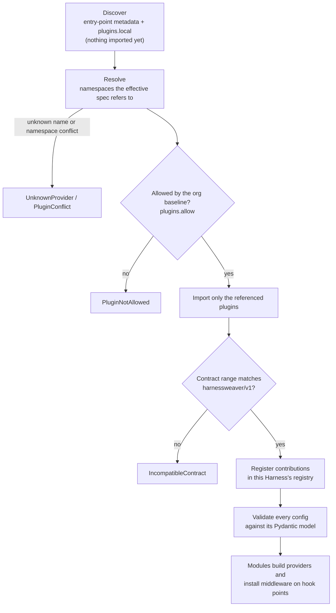

# Plugins

A plugin is any importable Python module that exposes a `harnessweaver.Plugin` object. It contributes providers, middleware, routing stages, runners, adapters, profiles and templates, all named under the plugin's **namespace**.

## A plugin package

```text
acme-harness/
  pyproject.toml
  src/acme_harness/
    __init__.py          # exposes `plugin`
    guards.py
    middleware.py
    profiles/baseline.yaml
    py.typed
  tests/
    test_guards.py
```

```python
# src/acme_harness/__init__.py
"""Acme's HarnessWeaver plugin: guards and middleware under the namespace `acme`."""

import harnessweaver as hw
from acme_harness import guards, middleware

plugin = hw.Plugin(
    namespace="acme",                      # owns every name acme.*
    version="1.2.0",
    contract=">=1.0,<2",                   # the contract range it was built against (V5)
    providers=[guards.InHousePII],         # @hw.provider classes and @hw.decider functions
    middleware=[middleware.no_weekend_refunds],
    profiles={"baseline": "profiles/baseline.yaml"},
    description="Acme's guards and controls",
)
```

```toml
# pyproject.toml
[project]
name = "acme-harness"                      # any name: there is no naming convention
version = "1.2.0"
requires-python = ">=3.12"
dependencies = ["harnessweaver>=0.1,<1"]

[project.entry-points."harnessweaver.plugins"]
acme = "acme_harness:plugin"               # the entry point's name is the namespace
```

```yaml
# an app's harness.yaml
guardrails:
  input: [{ use: acme.pii, action: redact, mode: log_only }]
middleware:
  - { use: acme.no_weekend_refunds }
```

`harnessweaver plugin new acme` writes this layout for you, with a sample guard and tests whose `uv run pytest` also runs the conformance suite.

!!! note "Before the packages are published"
    The scaffold depends on `harnessweaver` from PyPI, which isn't published yet. Point it at your clone of the repository in its `pyproject.toml`, then `uv sync && uv run pytest` works as it will after the release:

    ```toml
    [tool.uv.sources]
    harnessweaver = { path = "../HarnessWeaver/python/harnessweaver", editable = true }
    ```

### hw.Plugin

| Argument | Meaning |
| --- | --- |
| `namespace` | The plugin's namespace: a lowercase letter, then lowercase letters, digits or `_`. Must match the entry point's name, and can't be a reserved namespace |
| `version` | The plugin's SemVer version |
| `contract` | The contract range it supports (default `>=1.0,<2`) |
| `providers` | `@hw.provider` classes and `@hw.decider` functions |
| `middleware` | `@hw.middleware` functions and classes |
| `runners` | `@hw.runner` classes |
| `adapters` | `@hw.adapter` classes |
| `profiles` | Profile name to a YAML file in the package |
| `templates` | Template name to a directory in the package |
| `description` | Free text, shown by `harnessweaver plugin list` |

## Two ways to load a plugin

| | Installed package | In-repo code |
| --- | --- | --- |
| How | An entry point in the `harnessweaver.plugins` group | `plugins.local: ["app.harness_plugin"]` in the spec |
| Namespace | The entry point's name | The plugin's `namespace` |
| Use for | Plugins shared between apps | An app's own guards and middleware ([Example 03](../resources/examples.md#example-03-refund-agent)) |

## Names and namespaces

- Every contributed name is `<namespace>.<name>`: `acme.pii`, `openai.chat`. A bare name in a decorator (`name="pii"`) gets the plugin's namespace; a name in another namespace is refused. This lets the loader find the owning plugin **without importing anything**.
- The core's built-in plugin owns bare names (`direct`, `session`, `workflow`, `memory`) and a set of reserved area namespaces (`pii`, `secrets`, `regex`, `injection`, `size`, `topic`, `grounded`, `llm`, `cel_lite`, `rules`, `lexical`, `semantic`, `memory`, `sqlite`, `scripted`, ...), listed in `hw.RESERVED_NAMESPACES`. Other plugins can't claim them.
- Names are lowercase words joined by dots, unique per port: `memory` can be both a state store and an approval channel.
- Loading fails (R4) if two installed plugins claim the same namespace (`PluginConflict`), or a referenced name resolves to nothing (`UnknownProvider`).

## How loading works



Each `Harness` has its own registry; the process-wide catalog of installed plugins is read-only after discovery (RULES C4). The built-in plugin is always imported from the core and always allowed.

## Profiles and templates

A plugin can ship **profiles**, which specs select as `profile://<namespace>.<name>@<range>`. Only that plugin is imported, `plugins.allow` applies to it, and its profiles count as org layers (their guards run in the `baseline` band). This is a good way to distribute an org baseline as a versioned package.

A plugin can ship **templates** for `harnessweaver init -t <namespace>.<template>`. A template is a directory copied as is, with the project name put in; there is no template language. Its output should pass its own tests (RULES T6).

## Writing plugin code

- **Import nothing heavy at import time.** Import a client library inside the provider's `__init__` or methods, so installing the plugin costs nothing until a spec uses it (S8). The conformance suite checks that importing the plugin opens no sockets, writes no files and installs no global OpenTelemetry provider.
- **Build from config alone.** A provider must be constructible from its config model, with no hidden environment reads beyond those its config documents, such as an `api_key_env` setting (RULES C11).
- **Refuse the network in test mode.** A provider that calls out checks `harnessweaver.ports.network_allowed()` and refuses when `HARNESSWEAVER_TEST_MODE=1` (R14).
- **Never put content in logs, traces or errors** (R9). Log with loguru and call `logger.disable(__name__)` in the package's `__init__`, so it is silent until the app enables it.
- **Raise taxonomy errors** across the boundary (`ProviderError`, `ToolError`, `SpecError`), never your library's own (C5).

## Inspecting installed plugins

```bash
uv run harnessweaver plugin list
```

lists each installed plugin's namespace, distribution, version, contract range and whether it is compatible with this `harnessweaver`. `harnessweaver doctor` reports installed plugins that share or claim a reserved namespace.

## First-party plugins

| Distribution | Namespace | Contributes |
| --- | --- | --- |
| `harnessweaver-openai` | `openai` | `openai.chat` model provider; `instrument()` adapter for OpenAI clients |
| `harnessweaver-anthropic` | `anthropic` | `anthropic.messages` model provider; `instrument()` adapter for Anthropic clients |
| `harnessweaver-pydantic-ai` | `pydantic_ai` | `pydantic_ai.agent` runner; `wrap()` adapter for agents |
| `harnessweaver-monty` | `monty` | `monty.sandbox` for code-executing tools |
| `harnessweaver-otel` | `otel` | `otel.sdk`: OpenTelemetry SDK and exporter setup |
| `harnessweaver-cel` | `cel` | `cel.policy`: full CEL policy engine |

Their source, in [`python/plugins/`](https://github.com/Wise-DreamerZ/HarnessWeaver/tree/main/python/plugins), is the best reference for writing your own.

## TypeScript plugins

JavaScript has no entry points, so TypeScript plugins are registered explicitly: a package exports `definePlugin({...})` and the app passes it to `load("harness.yaml", { plugins: [acme] })`. The same naming, contract and allow-list rules apply. See [TypeScript](typescript.md#plugins).
