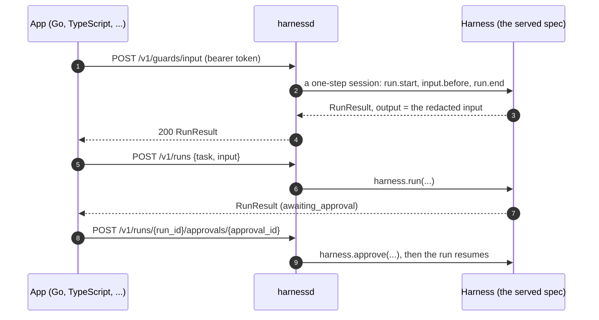

# harnessd sidecar

`harnessd` (package `harnessweaver-sidecar`) serves one `harness.yaml` over HTTP/JSON, so apps in any language get the same guards, routing, policy, tool governance, approvals and evals as a Python app, decided by the same core ([ADR-0038](../adr/0038-harnessd.md)). It loads the spec exactly as an app does: layers, locks, plugins and tasks.

```bash
export HARNESSD_TOKEN=sk-test-change-me     # required: harnessd never runs without a token (RULES S6)
uv run harnessd examples/02_support_rag/harness.yaml -e offline --profile-dir examples/_org
# listening on 127.0.0.1:7070
```

`harnessweaver sidecar [SPEC]` does the same from the CLI.

| Option | Default | Meaning |
| --- | --- | --- |
| `SPEC` | `harness.yaml` | The spec to serve |
| `-e`, `--env` | `$HARNESSWEAVER_ENV` | The overlay |
| `--profile-dir` | none | Extra directories for `org://` profiles (repeatable) |
| `--host` | `127.0.0.1` | Where to listen; keep it local (S6) |
| `--port` | `7070` | The port |
| `--token-env` | `HARNESSD_TOKEN` | The environment variable holding the bearer token clients must send |
| `--max-body-bytes` | `10485760` (10 MiB) | The largest request body harnessd reads; anything over answers 413 |

The spec's directory becomes importable, so task handlers and tool paths next to it resolve.

## How it works



- **Checks are one-step sessions.** A check opens a session for the principal, tenant and task the request names, makes its one governed call and closes it, so `run.start` policy rules, budgets, the trace and the stored run all apply. A block is the `RunResult`'s `status` and `error`, not an HTTP error, and `GET /v1/runs/{run_id}` reads it later.
- **The caller names the principal.** Holding the token makes the client the app, which already decides who it acts for, as in-process code does.

## Routes

Every route except `GET /v1/health` needs `Authorization: Bearer <token>`. The full description is the OpenAPI document, [`contracts/openapi/harnessd.openapi.json`](https://github.com/Wise-DreamerZ/HarnessWeaver/blob/main/contracts/openapi/harnessd.openapi.json); [`contracts/proto/harnessweaver/v1/harnessd.proto`](https://github.com/Wise-DreamerZ/HarnessWeaver/blob/main/contracts/proto/harnessweaver/v1/harnessd.proto) mirrors it for gRPC later.

| Route | Body | What it does | Answer |
| --- | --- | --- | --- |
| `GET /v1/health` | - | Liveness and versions; no token | `{status, harnessd, harnessweaver}` |
| `GET /v1/spec` | - | The effective spec, every layer applied | `{name, api_version, tasks, level, required_level, spec}` |
| `GET /v1/hooks?task=` | - | The middleware on each hook point, in run order | lists of `{name, band, fail_mode, timeout_seconds}` |
| `POST /v1/guards/{stage}` | `{principal, tenant, task, content}`; for `context`: `{..., source, query, items}` | `input`, `context` or `output`: that stage's guards and middleware | `RunResult`; output is the content as the guards left it |
| `POST /v1/guards/providers/{name}:check` | `{content, envelope, settings, stage}` | One guardrail provider, for guards declared `where: sidecar` | `GuardResult` |
| `POST /v1/decisions/{router}` | `{principal, tenant, task, text, options, state, default}` | A routing decision | `RunResult`; output is the `Decision` |
| `POST /v1/policy/evaluate` | a `PolicyRequest` | The policy engine alone | `PolicyDecision` |
| `POST /v1/tools/{name}/authorize` | `{principal, tenant, task, args, labels}` | The governor's steps 1 to 7, as a dry run | `ToolVerdict` |
| `POST /v1/tools/{name}/sanitize` | `{principal, tenant, task, arguments, output, is_error}` | Step 9 and `tool.after` on a result your own tool returned | `RunResult`; output is the `ToolResult` |
| `POST /v1/validate` | `{principal, tenant, task, output}` | A final output parsed into its task's output type, then `output.before` | `RunResult` |
| `POST /v1/runs` | `{task, input, principal, tenant, idempotency_key, budget, attributes}` | Run a task to the end, or until it waits for approval | `RunResult` |
| `GET /v1/runs/{run_id}` | - | A run's latest state | `RunResult` |
| `POST /v1/runs/{run_id}/approvals/{approval_id}` | `{decision, approver, edited_args, reason}` | Answer an approval (`approve`, `reject`, `edit`) | `RunResult` |
| `POST /v1/evals/run` | `{dataset}` or `{file}` | An eval suite sent inline, or a file the spec's `evals` lists | `SuiteResult` |

`principal` is an id or `{id, roles, attrs}` (default `anonymous`); `tenant` defaults to `default`.

## Errors

A taxonomy error that reaches a route answers with its `ErrorInfo` body (`code`, `type`, `message`, `retryable`, `details`):

| Status | Codes |
| --- | --- |
| 400 | `spec_invalid`, `expression_error` |
| 401 | A missing or wrong token |
| 403 | `policy_denied` |
| 404 | `not_found` (an unknown task, run, approval, tool or eval suite) |
| 413 | `validation_failed`: the body is over `--max-body-bytes` |
| 422 | `validation_failed`, and requests that don't match the schema |
| 502 | `provider_error`, `tool_error` |

An invalid request is described by field locations and messages, never by the values it held (RULES R9).

## A walkthrough

```bash
URL=http://127.0.0.1:7070/v1
AUTH="Authorization: Bearer $HARNESSD_TOKEN"

curl -s -H "$AUTH" -H "Content-Type: application/json" "$URL/guards/input" \
  -d '{"principal": "gina", "task": "support", "content": "I am ann@example.com, where is my refund?"}' \
  | jq -c '{status, output}'
# {"status":"completed","output":"I am [EMAIL], where is my refund?"}
```

[Example 04's README](https://github.com/Wise-DreamerZ/HarnessWeaver/blob/main/examples/04_polyglot_typescript/README.md#the-curl-walkthrough) has a complete walkthrough of seven calls on Example 02's spec (health, auth, guards, routing, a full task run, an injection, the policy), and its tests run it as written.

## Clients

- **TypeScript:** `SidecarClient` in `@harnessweaver/core`, with a typed method per route ([TypeScript](typescript.md#the-sidecar-client)).
- **Any language:** generate a client from the OpenAPI document, or call the routes with any HTTP library.

## Guards that run in the sidecar

A guard declared `where: sidecar` keeps its place in the app's pipeline, but its provider runs in harnessd, so the provider needn't be installed next to the app (a Python-only guard used from TypeScript, for example):

```yaml
sidecar: { url: http://127.0.0.1:7070, token_env: HARNESSD_TOKEN }
guardrails:
  input:
    - { id: pii, use: presidio.pii, action: redact, where: sidecar }
```

Only the provider's check is posted to `{sidecar.url}/v1/guards/providers/{name}:check`, with the token from `sidecar.token_env`; the guard's action, mode, fail mode and timeout stay with the app. A sidecar that can't answer is a provider error, which the guard's fail mode turns into a block or a pass (RULES R2). `plugins.allow` applies to the provider's name on both sides (S8). In test mode the request is refused (R14). If a lock covers the guard, a lock must cover `sidecar.url` too, or loading fails ([Locks](layers.md#locks)).

## The container

```bash
docker build -f deploy/harnessd/Dockerfile -t harnessd .
docker run --rm -p 127.0.0.1:7070:7070 -e HARNESSD_TOKEN -v "$PWD:/app:ro" harnessd
```

The image is built from `uv.lock` on digest-pinned bases (RULES S5) and runs as an unprivileged user. It includes the sidecar and the `openai`, `anthropic`, `otel` and `cel` plugins; pass `--build-arg PACKAGES="harnessweaver-sidecar ..."` for others. Inside the container harnessd listens on all of the container's interfaces; publish the port on the host's 127.0.0.1, as above.

## Security

- harnessd binds `127.0.0.1` unless told otherwise, refuses to start without a token, and compares tokens in constant time (RULES S6).
- The token is checked before any of the body is read, so a peer without it can't make harnessd buffer or parse anything. Everything except `GET /v1/health` answers 401 without the token, including unknown paths and FastAPI's `/docs`, `/redoc` and `/openapi.json`; the API's description is the checked-in OpenAPI document.
- A token holder's body is capped too, by the bytes that arrive, so a chunked upload counts. Raise `--max-body-bytes` if your requests carry large eval datasets or inputs.
- Treat the token like any credential: generate it per environment, keep it in a secret store, rotate it.
- Put harnessd next to the app (a sidecar container in the same pod, or the same host), not on a shared network.

*Planned:* the `stream` guard stage over HTTP, gRPC serving, and an approval page.
