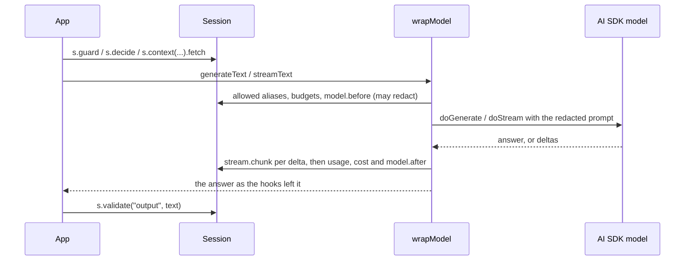

# TypeScript

`@harnessweaver/core` is a native TypeScript port of the core: it loads the same `harness.yaml` (layers, locks, bounds, built-in and org profiles, overlays, levels) and runs the same hook bus, budgets and cost, guards, cel-lite policy and rules, routing, tool governor, context governance, prompts and eval graders, held to the same language-neutral fixtures as Python (RULES R11, [ADR-0040](../adr/0040-typescript-sdk.md)). `@harnessweaver/ai-sdk` governs Vercel AI SDK (v7) models with it.

TypeScript runs the **Session** style: your code owns the flow, and the harness governs each step. Model calls are your AI SDK model's, wrapped with `wrapModel`.

```ts
import { load } from "@harnessweaver/core";
import { wrapModel } from "@harnessweaver/ai-sdk";
import { generateText } from "ai";

const harness = load("harness.yaml");            // HARNESSWEAVER_ENV picks the overlay

const answer = await harness.session({ task: "support", principal: { id: user.id, roles: ["customer"] }, tenant: user.org }, async (s) => {
  const question = String(await s.guard("input", text));          // input.before: redacts or blocks
  const route = await s.decide("intent", { text: question });     // route.decide
  const articles = await s.context("help").fetch(question);       // ACLs, labels, caps, context.after
  const prompt = await s.prompt("answer@1", { question, intent: String(route.choice), articles: listing(articles) });
  const { text: reply } = await generateText({ model: wrapModel(s, model, { alias: "fast" }), prompt });
  return s.validate("output", reply);                             // output.before: guards and rules
});
```



[Example 04](../resources/examples.md#example-04-one-spec-every-language) is a complete app: Example 02's spec from TypeScript, with tests that compare its answers with Python's.

## Install

`npm install @harnessweaver/core`, plus `npm install @harnessweaver/ai-sdk ai @ai-sdk/provider` for the AI SDK adapter. Node 22 or later; ESM only. From a clone of the repository: `pnpm -C typescript install && pnpm -C typescript build`.

## Loading

```ts
load(path: string, options?: LoadOptions): Harness
```

| Option | Meaning |
| --- | --- |
| `env` | The overlay `harness.<env>.yaml`; defaults to `$HARNESSWEAVER_ENV`. A missing file is fine |
| `profileDirs` | Extra directories to search for `org://` profiles, before `$HARNESSWEAVER_PROFILE_PATH` |
| `plugins` | Plugins the spec may use (`definePlugin`); JavaScript has no entry points, so they are passed in |
| `tools` | Tool handlers by name: `{ refund_payment: (args, env) => ... }`. Each tool still needs its manifest |
| `clock` | An injected clock; `new FakeClock()` in tests |
| `sidecar` | A `SidecarClient` for guards declared `where: sidecar`; defaults to one built from the spec's `sidecar` section. A lock on `sidecar.url` doesn't bind it: it is app code, which runs with the app's authority |

Loading fails with a `SpecError` subclass for anything the spec asks TypeScript to enforce that it can't: an unknown provider, a guard or routing stage with no TypeScript provider (unless the guard is `where: sidecar`), and every check Python makes (locks, bounds, levels, expressions, unknown keys). `harness.name`, `harness.spec` (the `EffectiveSpec`, including `spec.data`, the merged spec, and `spec.level`) and `harness.hooks(task?)` describe what was loaded.

## Sessions

```ts
harness.session<T>(options: SessionOptions, fn: (s: Session) => Promise<T> | T): Promise<T>
```

`run.start` fires (with any `run.start` policy rules), `fn` runs, and `run.end` fires with the run's result, also when `fn` throws (after `run.error`). A control that stops the run throws in your code.

| Option | Meaning |
| --- | --- |
| `task` | The task whose budget, guards and approvals apply |
| `principal` | A principal id, or `{ id, roles, attrs }` |
| `tenant` | The tenant (default `default`) |
| `budget` | Tighter limits for this run (`deadline` in milliseconds) |
| `attributes` | App tags for the envelope |
| `input` | The run's input, for `run.start` and the result |
| `onEnd` | Called with the `RunResult` (status, output, error, usage, cost, trace) when the session ends, completed or not |

| Session method | What it does |
| --- | --- |
| `s.guard("input", content)` | Input guards and middleware (`input.before`); returns the content, possibly redacted |
| `s.decide(router, { text, options, state, default })` | A routing decision (`route.decide`) |
| `s.context(source).fetch(query, { limit })` | Retrieve from a context source, governed, then `context.after` |
| `s.context(source).check(items, { query })` | Govern items your code retrieved |
| `s.prompt(ref, variables)` | Render a versioned prompt |
| `s.tool(name, args)` | A governed tool call, through the handler given to `load` |
| `s.validate("output", value)` | Output guards and rules (`output.before`); throws `ValidationFailed` when one asks for a repair, so your code can ask the model again |
| `s.generate(request, call)` | One governed model call through `call` (what `wrapModel` uses) |
| `s.run`, `s.runId`, `s.envelope`, `s.trace` | The run's context, id, envelope and trace |

Errors are the same taxonomy as Python, exported from `@harnessweaver/core`: `RunBlocked`, `RunEscalated` (both `RunInterrupted`), `ValidationFailed`, `BudgetExceeded`, `SpecError` and its subclasses, `ProviderError`, and the rest, each with the same stable `code`.

## Models

`@harnessweaver/ai-sdk` governs AI SDK v7 models with a `LanguageModelV4Middleware`:

```ts
import { harnessMiddleware, wrapModel } from "@harnessweaver/ai-sdk";
import { wrapLanguageModel } from "ai";

const governed = wrapModel(s, openai("gpt-5"), { alias: "fast" });
// or, composed with other AI SDK middleware:
const composed = wrapLanguageModel({ model: openai("gpt-5"), middleware: [harnessMiddleware(s, { alias: "fast" }), other] });
```

Every call through the wrapped model:

- checks the alias against `models.allowed_aliases` (pass the spec's alias with `{ alias }`; without one the model id is checked) and the run's budget;
- fires `model.before`; text the middleware changed (a redaction) is written back into the prompt the model receives: system, user and tool-result text, never the model's own earlier answers;
- calls the model, records usage and cost (from `models.prices`), and fires `model.after`, whose text changes reach your app; a `Retry` there asks the model once more;
- for `streamText`, fires `stream.chunk` for every text delta (with the text before it), so stream guards can redact a chunk or cut the stream, and closes the call on the stream's finish. A `Retry` at `model.after` can't re-ask a model whose words were already sent, so it blocks.

The model's own errors pass through unchanged, so the AI SDK's retries still work; the session's `run.end` records the failure.

**Offline.** The TypeScript core has no `scripted` provider. [Example 04's `offline.ts`](https://github.com/Wise-DreamerZ/HarnessWeaver/blob/main/examples/04_polyglot_typescript/src/offline.ts) shows an AI SDK model that answers from a spec's offline `models.rules` and `models.replies`, so the same overlay works in both languages; in tests, the AI SDK's `MockLanguageModelV4` (`ai/test`) works well.

## Tools

```ts
const harness = load("harness.yaml", {
  tools: { lookup_order: async ({ order_id }) => db.orders.find(String(order_id)) },
});
await harness.session({ principal: "casey" }, (s) => s.tool("lookup_order", { order_id: "A-1001" }));
```

The governor runs steps 1 to 7 and step 9: the manifest and digest, the schema, policy and approval rules, the trifecta, rate limits, then sanitizing the result ([Tools](../tutorial/tools.md)). A call that needs approval escalates. The `http`, `code` and `mcp` transports are *planned* for TypeScript.

## Plugins

```ts
import { defineMiddleware, definePlugin, defineProvider, outcome, type GuardResult } from "@harnessweaver/core";

export const acme = definePlugin({
  namespace: "acme",
  version: "1.0.0",
  providers: [
    defineProvider({
      port: "Guardrail",
      name: "banned_words",                                    // becomes acme.banned_words
      deterministic: true,
      settings: { properties: { words: { type: "array", items: { type: "string" }, default: ["darn"] } } },
      create: (settings) => ({
        check: (content: string): GuardResult =>
          (settings.words as string[]).some((w) => content.includes(w))
            ? { action: "block", reason: "a banned word", findings: [{ type: "banned" }] }
            : { action: "allow" },
      }),
    }),
  ],
  middleware: [
    defineMiddleware({ name: "tag", hooks: ["input.before"], fail_mode: "closed", handler: () => outcome.continue() }),
  ],
});

const harness = load("harness.yaml", { plugins: [acme] });   // use: acme.banned_words, middleware: [{ use: acme.tag }]
```

- `defineProvider({ port, name, deterministic, stages, settings, create })`: `port` is `Guardrail`, `PolicyEngine`, `Decider`, `Evaluator`, `ModelProvider`, `ContextProvider` or `Embedder`; `settings` is a JSON Schema whose defaults are filled in before `create(settings)` runs.
- `defineMiddleware({ name, hooks, fail_mode, band, timeout, handler })`: `fail_mode` is required, as in Python. The handler receives `(event, envelope)` and returns an outcome (`outcome.continue(modified)`, `outcome.block(reason, code)`, ...) or nothing.
- `definePlugin({ namespace, version, contract, providers, middleware, profiles })`: bare names get the namespace; a name in another namespace, or in a reserved one, is refused; the contract range is checked (V5); `plugins.allow` applies (S8).

## The sidecar client

`SidecarClient` calls harnessd from TypeScript:

```ts
import { SidecarClient } from "@harnessweaver/core";

const sidecar = new SidecarClient({ url: "http://127.0.0.1:7070", tokenEnv: "HARNESSD_TOKEN" });
const result = await sidecar.startRun({ task: "support", input: question, principal: { id: "gina", roles: ["customer"] }, tenant: "globex" });
```

| Option | Meaning |
| --- | --- |
| `url` | harnessd's address |
| `token` / `tokenEnv` | The bearer token, or the variable it is read from on each request |
| `fetch` | A `fetch` to use instead of the global one (tests, proxies) |
| `timeoutMs` | A per-request timeout |

Methods map one to one onto the routes: `health`, `spec`, `hooks`, `checkStage`, `checkProvider`, `decide`, `evaluatePolicy`, `authorize`, `sanitize`, `validate`, `startRun`, `getRun`, `answerApproval` and `runEvals`. An `ErrorInfo` answer is thrown as the taxonomy error it names. In test mode the client refuses to call out unless you pass a `fetch`. A guard declared `where: sidecar` uses the same client to run its provider in harnessd ([harnessd](sidecar.md)).

## What differs from Python

| | Python | TypeScript |
| --- | --- | --- |
| Integration styles | Wrap, Session, Run | Session (with `wrapModel` for models) |
| Model providers | `scripted`, `openai.chat`, `anthropic.messages` | The app's AI SDK model, through `wrapModel` |
| `Suspend` (approvals) | Pauses a harness-driven run durably | Escalates: a TypeScript session can't wait for a person |
| Routing stages | `rules`, `lexical`, `semantic`, `llm` | `rules`, `lexical`; `semantic` and `llm` *planned* |
| Tool transports | `native`, `http`, `code` | Handlers passed to `load`; `http`, `code`, `mcp` *planned* |
| Telemetry | OpenTelemetry API, `otel.sdk` | The trace on every `RunResult`; OpenTelemetry export *planned* |
| Plugins | Entry points or `plugins.local` | Passed to `load({ plugins })` |

Numbers follow Python exactly where the fixtures need it: cel-lite ints are `bigint`, so `7 / 2` is `3`; canonical JSON (for digests and graders) matches Python's; string lengths and positions count code points.

## Working on the TypeScript packages

See [typescript/README.md](https://github.com/Wise-DreamerZ/HarnessWeaver/blob/main/typescript/README.md): `pnpm -C typescript test`, `typecheck` and `build`, the fixture runners, and how the embedded contracts are kept in sync.
