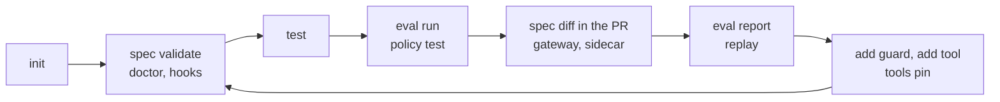

# HarnessWeaver CLI

The `harnessweaver` command (package `harnessweaver-cli`) scaffolds projects, checks specs, runs tests and evals, manages tools and plugins, serves the sidecar and writes gateway configs.

## A project's life, with the CLI



1. **Start:** `init` a project from a [template](resources/templates.md).
2. **Check:** `spec validate` loads it exactly as the app will; `doctor` advises; `hooks` shows what runs where.
3. **Test:** `test` runs the project's tests offline.
4. **Gate:** `eval run` and `policy test` in CI fail the build on a regression or a changed verdict.
5. **Review:** `spec diff git:main:harness.yaml harness.yaml` in the pull request shows changed values, locks and level.
6. **Run:** serve the spec to other languages with `sidecar`, or generate `gateway` configs.
7. **Learn:** `eval report` summarizes sampled production runs; `replay` checks a change against recorded ones.
8. **Grow:** `add guard` (in shadow mode), `add tool`, `tools pin`, and back to step 2.

```bash
uv run harnessweaver --help
uv run harnessweaver --version          # the CLI's and the core's versions
```

## Conventions

- **`SPEC`** is the app spec; it defaults to `harness.yaml` in the working directory. Commands load it exactly as the app does, and make its directory importable (as it is when the app runs from there), so handler and type paths resolve.
- **`-e`, `--env ENV`** applies the overlay `harness.<ENV>.yaml`; without it, `$HARNESSWEAVER_ENV` decides.
- **`--profile-dir DIR`** adds a directory to the search path for `org://` profiles (repeatable), in front of `$HARNESSWEAVER_PROFILE_PATH`.
- **`--format text|json`**, where offered, picks human-readable or machine-readable output.
- **Exit codes:** 0 for success, 1 for a check that failed (a regression, a policy mismatch, a doctor failure), 2 for a command that couldn't run (a broken spec, a missing file).

| Command | What it does |
| --- | --- |
| [`init`](#init) | Start a project from a template |
| [`spec validate`, `spec explain`, `spec diff`](#spec) | Load, explain and compare specs |
| [`doctor`](#doctor) | Check a spec and advise |
| [`hooks`](#hooks) | Show the middleware on every hook point |
| [`test`](#test) | Run the app's tests offline |
| [`eval run`, `eval report`](#eval) | Run eval suites; summarize online samples |
| [`policy test`](#policy-test) | Check tool calls against the governor |
| [`replay`](#replay) | Replay a recorded run |
| [`add guard`, `add tool`](#add) | Add a guard in shadow mode; write a tool manifest |
| [`tools pin`](#tools-pin) | Pin tool definition digests |
| [`plugin new`, `plugin list`](#plugin) | Scaffold and inspect plugins |
| [`sidecar`](#sidecar) | Serve the spec over HTTP (harnessd) |
| [`gateway litellm`, `gateway mcp`](#gateway) | Write gateway configs from the spec |
| [`dev`](#dev) | Write (and start) a local stack |
| [`contracts export`](#contracts-export) | Write the contract JSON Schemas |

## init

```text
harnessweaver init [DIRECTORY] [-t TEMPLATE] [--name NAME] [--force]
```

Starts a project: `harness.yaml`, an offline overlay, code, a prompt, evals and tests, all of which pass offline.

| Option | Default | Meaning |
| --- | --- | --- |
| `DIRECTORY` | `.` | Where to create the project |
| `-t`, `--template` | `extraction` | `extraction`, `rag`, `agent`, `workflow`, `chat`, or a plugin's template as `<namespace>.<template>` |
| `--name` | the directory's name | The project name, written into the files |
| `--force` | off | Overwrite existing files; without it, `init` never overwrites |

See [Templates](resources/templates.md).

## spec

### spec validate

```text
harnessweaver spec validate [SPEC] [-e ENV] [--profile-dir DIR] [--format text|json]
```

Loads the spec as the app would: every layer, lock and bound, plugin, provider and task, and the hooks each runner reaches (RULES R4). Prints the layers, tasks and adoption level; exits 2 when the spec doesn't load.

```text
ok: ticket-triage is valid
  adoption level L1 (required: L0)
  layers: profile://defaults, profile://extraction, harness.yaml (harness.yaml), harness.offline.yaml (harness.offline.yaml)
  tasks: extract
```

### spec explain

```text
harnessweaver spec explain [SPEC] [-e ENV] [--profile-dir DIR] [--path PREFIX] [--format text|json]
```

Every effective value, the layer it came from, and its locks and bounds. `--path guardrails.input` shows only paths starting with that prefix.

### spec diff

```text
harnessweaver spec diff BEFORE AFTER [-e ENV] [--profile-dir DIR] [--exit-code]
```

Compares two effective specs as Markdown, for pull request comments: changed values, locks and profile layers added and removed, and the adoption level. Either side can be a path or `git:<ref>:<path>` (`git:main:harness.yaml`). A `git:` side is loaded from that ref's own tree, including `.harness/profiles`, file profiles and any `--profile-dir` inside the repository; only directories outside the repository come from the file system. `--exit-code` exits 1 when they differ.

## doctor

```text
harnessweaver doctor [SPEC] [-e ENV] [--profile-dir DIR] [--strict] [--format text|json]
```

Validates the spec, then checks and advises:

| Check | Reports |
| --- | --- |
| `level` | The adoption level and the level the risk tier requires |
| `next level` | What the next level needs, by requirement |
| `hooks` | Whether each task's runner reaches every hook the baseline and budgets need |
| `retries` | Duplicate retry owners, such as SDK retries behind a gateway (RULES R5) |
| `pins` | Unpinned org and plugin profiles; tool manifests with no pin or a mismatched one |
| `shadow guards` | Guards in shadow mode, to promote when evals back them (R8) |
| `content` | Whether content capture is on (R9) |
| plugins | Installed plugins that share or claim a reserved namespace |

Exits 1 on a failure, and on a warning too with `--strict`.

## hooks

```text
harnessweaver hooks [SPEC] [-e ENV] [--profile-dir DIR] [--task TASK]
```

The middleware on every hook point, in the order it runs, with band, fail mode and timeout. `--task` shows the chains a task's runs use, including its own guards.

## test

```text
harnessweaver test [-e ENV] [PYTEST ARGS...]
```

Runs pytest with `HARNESSWEAVER_TEST_MODE=1` (live providers refuse to call out) and the `offline` overlay (`-e` picks another). Extra arguments go to pytest, so `harnessweaver test ../my-app -k refund` runs one project's matching tests.

## eval

### eval run

```text
harnessweaver eval run [SPEC] [-e ENV] [--profile-dir DIR] [--suite NAME]... [--task TASK]... [--baselines DIR] [--update-baseline] [--format text|json]
```

Runs the spec's eval suites, compares each with its baseline (`.harness/baselines/<task>.<suite>.json` next to the spec, or `--baselines DIR`), and prints the shadow-guard report. Exits 1 when a suite misses its threshold or a case that passed in the baseline fails, and 2 when the suites can't run. `--update-baseline` accepts the results of suites that meet their thresholds. See [Evals](tutorial/evals.md).

### eval report

```text
harnessweaver eval report [SPEC] [-e ENV] [--profile-dir DIR] [--task TASK] [--format text|json]
```

Summarizes the production runs `evals.online` sampled: statuses, grader pass rates, and how often each shadow guard would have fired.

## policy test

```text
harnessweaver policy test [SPEC] [-e ENV] [--profile-dir DIR] [-c FILE]... [--format text|json]
```

Checks each case's tool call against the governor as a dry run, nothing executes. `-c`, `--cases` names the test files (default `policy_tests.yaml` next to the spec). Exits 1 when a verdict differs from its expectation, 2 when the tests can't run. See [Dry runs and policy tests](advanced/governor.md#dry-runs).

## replay

```text
harnessweaver replay RUN_ID [SPEC] [-e ENV] [--profile-dir DIR] [--format text|json]
```

Runs a recorded run (`state.record: true`) again against the current code and spec, answering from the recording and never executing tools, and shows what changed. Exits 1 when the status or output changed, 2 when the run can't be replayed. See [State and replay](tutorial/state.md#replay-a-run).

## add

### add guard

```text
harnessweaver add guard USE [SPEC] [--stage STAGE] [--id ID] [--action ACTION] [--set KEY=VALUE]... [-e ENV] [--profile-dir DIR]
```

Adds a guard in shadow mode (`mode: log_only`): it records what it would do and changes nothing until a reviewed edit promotes it to `enforce` (RULES R8). `--stage` defaults to `input`; `--id` defaults to the provider name with dashes; `--action` overrides the provider's action; `--set` gives provider settings, each value read as YAML. Comments in `harness.yaml` are kept, and an edit that doesn't load is taken back.

```bash
uv run harnessweaver add guard topic.deny --stage output --set 'topics={legal: [lawsuit, attorney]}'
```

### add tool

```text
harnessweaver add tool HANDLER [SPEC] [--dir tools] [--risk low|medium|high|critical] [--side-effect none|read|write_internal|write_external|destructive] [--force]
```

Writes a tool manifest from a function, `package.module:function`: the name is the function's, the description its docstring summary, and the input schema comes from its parameters. Adds `--dir` (relative to the spec) to `tools.manifests`. Review it, then pin it.

## tools pin

```text
harnessweaver tools pin [SPEC] [--tool NAME]... [-e ENV] [--profile-dir DIR]
```

Writes each manifest's current `definition_digest` into it, comments kept, so a tool whose definition changes without review is blocked (S2).

## plugin

### plugin new

```text
harnessweaver plugin new NAMESPACE [DIRECTORY] [--force]
```

Scaffolds a standalone plugin package in `DIRECTORY` (default `./<namespace>-harness`): a `pyproject.toml` with the entry point, the `hw.Plugin` object, a sample guard, and tests whose pytest run includes the conformance suite. See [Plugins](advanced/plugins.md).

### plugin list

```text
harnessweaver plugin list [--format text|json]
```

Installed plugins: namespace, distribution, version, contract range, and whether it is compatible with this `harnessweaver` (V5).

## sidecar

```text
harnessweaver sidecar [SPEC] [-e ENV] [--profile-dir DIR] [--host 127.0.0.1] [--port 7070] [--token-env HARNESSD_TOKEN]
```

Serves the spec to other languages over HTTP: runs harnessd (needs `harnessweaver-sidecar`). It refuses to start without a token in the `--token-env` variable, and binds 127.0.0.1 unless told otherwise (S6). See [harnessd](advanced/sidecar.md).

## gateway

```text
harnessweaver gateway litellm [SPEC] [-e ENV] [--profile-dir DIR] [-o FILE]
harnessweaver gateway mcp     [SPEC] [-e ENV] [--profile-dir DIR] [-o FILE]
```

`litellm` writes a LiteLLM Proxy config from the spec: gateway models and aliases, router settings, a timeout, message logging off, and a tool-permission guardrail from the manifests. `mcp` writes a neutral tool allow-list for an MCP gateway: each allowed tool's server, digest and scopes, and the withheld tools with the reason. Both print to stdout unless `-o` names a file. See [Gateways](deployment/gateways.md).

## dev

```text
harnessweaver dev [SPEC] [-e ENV] [--profile-dir DIR] [--up]
```

Writes `.harness/dev/` next to the spec: a Compose file with LiteLLM (configured from the spec), an OpenTelemetry collector, Langfuse and harnessd, with local secrets in `.env`. `--up` starts it with `docker compose up -d`. See [The local dev stack](deployment/gateways.md#the-local-dev-stack).

## contracts export

```text
harnessweaver contracts export [OUT] [--check]
```

Writes the JSON Schema of every contract (`harness.yaml`, profiles, tool manifests, events, outcomes, results, ...) into `OUT` (default `contracts/schemas`). `--check` reports drift and writes nothing. See [Contracts](reference/contracts.md).
