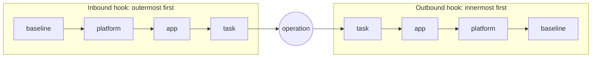

# The hook bus

The hook bus is the one shared piece every app runs unchanged. When a hook point fires, the bus runs every middleware attached to it and combines their answers. Its ordering rules make the result predictable when many modules, plugins and teams act on the same event.

## Rules

1. **Priority bands.** Middleware runs in four bands: `baseline` (the org's, outermost), then `platform`, then `app`, then `task`. Within a band, registration order applies.
2. **Onion order.** Inbound hooks run outermost-first (baseline to task). Outbound hooks run innermost-first (task to baseline). A baseline tracer therefore wraps everything inside it, on the way in and on the way out.
3. **Most severe outcome wins** when several middleware answer the same event: `Block` > `Suspend` > `Escalate` > `Retry` > `Continue(modified)` > `Continue`.
4. **Fail mode is declared, never implied.** If a middleware raises or times out, `fail_mode="closed"` turns that into `Block`, and `fail_mode="open"` records the failure and continues. Baseline middleware always fails closed (RULES R2).



## Where bands come from

A middleware's band is decided by the layer that declares it, not by the code that implements it:

| Declared in | Band |
| --- | --- |
| An org profile (`org://...`), a plugin's profile (`profile://acme.baseline`) or a profile file | `baseline` |
| A built-in profile (`profile://rag`), or the framework defaults | `platform` |
| The app's `harness.yaml` or an environment overlay | `app` |
| A task's own `guardrails` | `task` |

The `band` argument of `@hw.middleware` is only a default. A `middleware:` item in the spec sets the real band, and only profiles may put middleware in `baseline` (RULES S8): a plugin can't make its own code un-removable. Baseline middleware that declares `fail_mode: open` fails loading (R2).

## How one hook point runs

```python
async def emit(hook, event, ctx):
    chain = middleware_for(hook)                 # sorted by (band, registration order)
    if hook.direction is OUTBOUND:
        chain = list(reversed(chain))
    outcomes = []
    for mw in chain:
        try:
            with anyio.fail_after(mw.timeout):
                outcome = await mw(event, ctx.envelope) or Continue()
        except Exception as exc:                 # including timeouts
            outcome = mw.on_failure(exc)         # closed -> Block, open -> Continue
        ctx.trace.record(hook, mw, outcome)      # every outcome is traced (R13)
        outcomes.append(outcome)
        if isinstance(outcome, Continue) and outcome.modified is not None:
            event = outcome.modified             # changes chain to the next middleware
        if isinstance(outcome, Block):
            break                                # nothing outranks Block
    return HookResult(outcome=most_severe(outcomes), event=event)
```

The details, pinned by the `bus` conformance fixtures that both Python and TypeScript pass:

- Returning `None` means `Continue()`.
- `Continue(modified=...)` replaces the event for every later middleware and for the operation itself: a redaction made by one guard is what the next guard, and then the model, sees.
- Returning something that isn't an outcome, or a modified event of another hook's type, is a failure, handled by the fail mode.
- A closed failure becomes `Block` with code `middleware_error`, or `middleware_timeout` when the middleware's `timeout` ran out. The trace records the exception's type, never its message (R9).
- The trace has one `outcome` (or `failure`) event per middleware, then one `hook` event with the combined outcome. So it shows every hook point that fired, even one with no middleware attached.

## Writing middleware

A middleware is an async function, or a class with an async `__call__`, decorated with `@hw.middleware`:

```python
import harnessweaver as hw


@hw.middleware(hooks=["tool.before"], band="app", fail_mode="closed", timeout="2s")
async def no_weekend_refunds(event: hw.ToolCallEvent, env: hw.Envelope) -> hw.Outcome | None:
    """Refunds asked for at the weekend wait for someone in finance."""
    if event.tool.name == "refund_payment" and env.clock.is_weekend():
        return hw.Suspend(reason="weekend refunds need approval", approver_role="finance")
    return None
```

| Argument | Meaning |
| --- | --- |
| `hooks` | The hook points it attaches to. A spec item can narrow them, never widen them |
| `fail_mode` | Required: `closed` (a raise or timeout blocks) or `open` (it is recorded and the run continues) (ADR-0014) |
| `band` | The default band; the spec item decides |
| `timeout` | A duration (`"2s"`, `"250ms"`) or seconds; none by default |
| `name` | Defaults to the function's name, or the class name in snake case |
| `config` | For a class: the Pydantic model its settings are validated against; the class is built with `Cls(config)` |
| `sample` | Settings the conformance suite builds it with, when `config` has required fields |

Middleware reaches a harness through a plugin and a `middleware:` item in the spec:

```python
# app/harness_plugin.py
import harnessweaver as hw
from app.middleware import no_weekend_refunds

plugin = hw.Plugin(namespace="acme", version="1.0.0", middleware=[no_weekend_refunds])
```

```yaml
# harness.yaml
plugins:
  local: ["app.harness_plugin"]       # in-repo code; installed packages use an entry point
middleware:
  - { use: acme.no_weekend_refunds }  # band: app, from this layer
```

A middleware with settings is a class:

```python
from pydantic import BaseModel, ConfigDict


class CapSettings(BaseModel):
    model_config = ConfigDict(extra="forbid")
    max_usd: float


@hw.middleware(hooks=["tool.before"], fail_mode="closed", config=CapSettings)
class RefundCap:
    def __init__(self, config: CapSettings) -> None:
        self.max_usd = config.max_usd

    async def __call__(self, event: hw.ToolCallEvent, env: hw.Envelope) -> hw.Outcome | None:
        if event.tool.name == "refund_payment" and event.call.arguments.get("amount_usd", 0) > self.max_usd:
            return hw.Block(reason="over the refund cap", code="refund_cap")
        return None
```

```yaml
middleware:
  - { use: acme.refund_cap, max_usd: 500 }   # every key but id, use, band, hooks, fail_mode, timeout and enabled is a setting
```

To change an event, return a modified copy: `hw.Continue(modified=event.model_copy(update={"input": redacted}))`. Middleware never raises to control the run; it returns an outcome. See [Middleware](../advanced/middleware.md) for testing and for the spec item's other keys, and [Outcomes and errors](outcomes.md) for what each outcome does.

## Seeing the chains

```bash
uv run harnessweaver hooks harness.yaml --task extract
```

prints, for every hook point, the middleware in the order it runs, with its band, fail mode and timeout. Guards appear as `guardrails.<stage>[<id>]`, business rules as `validation.rules[<id>]`, and spec middleware by name.
