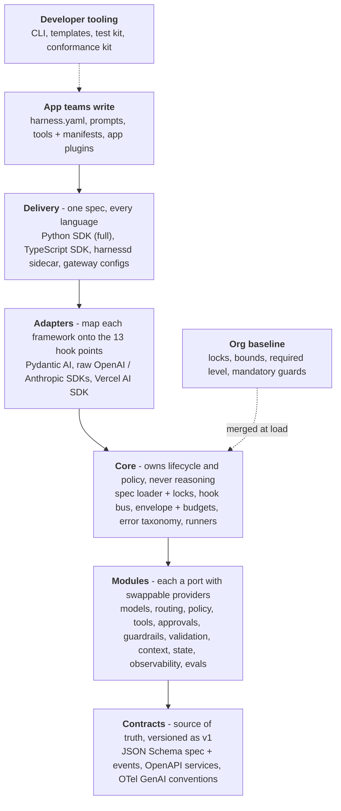
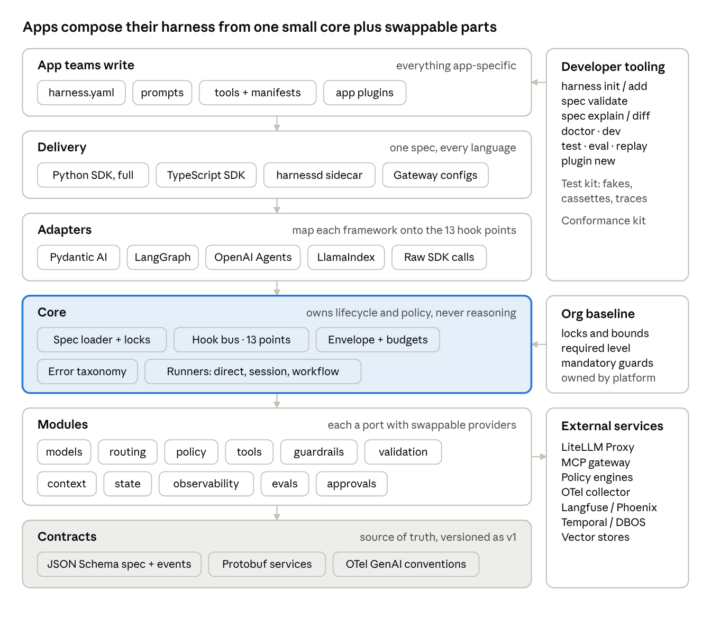
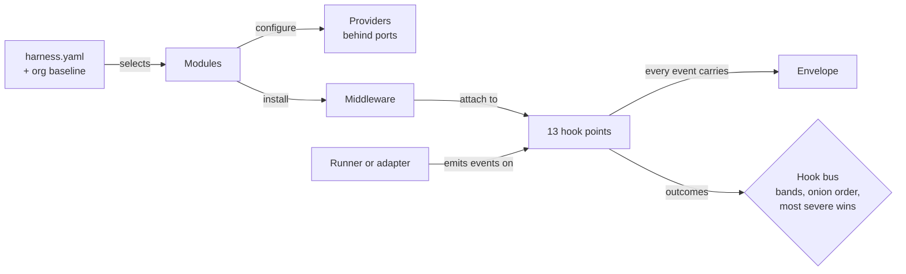

# Concepts

HarnessWeaver is a **framework that produces harnesses**. Each app team assembles its own harness from a small core plus swappable parts, and the platform team's org baseline applies to every app and can't be removed.

## Who writes what

| Who | Writes | Examples |
| --- | --- | --- |
| HarnessWeaver | The spec format, the core (lifecycle, budgets, hook bus, error taxonomy), standard modules, plugins for popular frameworks and model APIs, a sidecar for other languages, a CLI, templates and a test kit | `harnessweaver`, `harnessweaver-openai`, `harnessd` |
| The platform or security team | An org baseline profile (mandatory controls, locked values, bounds) and the list of approved plugins | `org://acme-baseline@^1` |
| Each app team | A `harness.yaml`, its prompts, its tools and any app-specific plugins. It keeps whatever executor it already uses | Raw SDK calls, Pydantic AI, the Vercel AI SDK, a custom loop |

## The layers

App teams touch only the top layer and their spec. Everything below it ships with HarnessWeaver or comes from the platform team. The core is small: it owns lifecycle and policy, and delegates all reasoning to whatever runner the app chose.

The design guide's original rendering of the same model:

## Twelve concepts

Everything else is an implementation detail of a module.

| Concept | What it is | Defined by | In code |
| --- | --- | --- | --- |
| **Harness** | The runtime object an app builds from a spec. It runs tasks, opens sessions, and wraps or instruments existing clients and agents | HarnessWeaver, from the app's spec | `hw.Harness`, `hw.load(...)` |
| **Spec** | The declarative definition of one app's harness, usually `harness.yaml` | The app team | `hw.HarnessSpec` |
| **Profile** | A reusable partial spec. Built-in profiles preset modules for a kind of app; the org baseline is a profile with locks and bounds | HarnessWeaver, the platform team, plugins | `hw.ProfileSpec`, `extends:` |
| **Task** | A named, versioned unit of work with input and output types, a runner, a prompt, a budget and task-level controls | The app team | `tasks.<name>` |
| **Envelope** | The immutable context carried through every call: run id, tenant, principal, task, budget, deadline, labels | HarnessWeaver, from the request | `hw.Envelope` |
| **Hook point** | One of 13 named moments in the lifecycle (`model.before`, `tool.before`, ...). Everything that governs a run attaches here | HarnessWeaver (a fixed, versioned set) | `hw.HookPoint` |
| **Middleware** | A function attached to hook points. It can observe, modify, block, retry, escalate or suspend | Modules, plugins, apps | `@hw.middleware` |
| **Port** | A typed interface for one capability: `Guardrail`, `PolicyEngine`, `ModelProvider`, `Decider`, ... | HarnessWeaver | `harnessweaver.ports` |
| **Provider** | A concrete implementation of a port, such as `pii.regex` for `Guardrail` | HarnessWeaver, plugins, apps | `@hw.provider` |
| **Module** | A bundle that wires one capability end to end: its port, a default provider, the middleware it installs and its spec section | HarnessWeaver | `guardrails:`, `tools:`, ... |
| **Runner** | What executes a task: `direct`, `session`, `workflow`, `pydantic_ai.agent`, or your own. Runners don't implement controls; hook points do | HarnessWeaver, plugins | `@hw.runner` |
| **Plugin** | A package or module that contributes providers, middleware, routing stages, runners, adapters, profiles or templates, through one contract, whatever its name | HarnessWeaver, third parties, apps | `hw.Plugin` |

**How they connect:** a **spec** selects **modules**. Each module configures a **provider** behind its **port** and installs **middleware** on **hook points**. The **runner** (or your own code, in a session) emits hook events as the work happens, and every event carries the **envelope**.

## Design goals

Every feature is tested against these goals, in this order. When two conflict, the earlier one wins.

1. **Safe by default, removable by nobody.** Org baseline controls apply automatically and can't be switched off by app config.
2. **Non-invasive.** HarnessWeaver wraps whatever the app already uses. Adopting it never requires rewriting an agent or switching frameworks.
3. **Incremental.** Each [adoption level](adoption-levels.md) is useful on its own. One line of code gets you level 0.
4. **Composable.** Every capability is a module behind a port. Apps pick modules; modules pick providers.
5. **Declarative first, code when needed.** Common setup is YAML. Anything YAML can't express is a plain Python or TypeScript function in a plugin.
6. **Small core.** The Python core depends only on Pydantic, the OpenTelemetry API, PyYAML, anyio and loguru. Everything heavy is a plugin.
7. **Polyglot by contract.** One spec format and one set of wire contracts serve Python, TypeScript and any language that speaks HTTP.
8. **Testable.** Every module runs against fakes, and every plugin passes a shared conformance suite.
9. **Stable extension surface.** Hook points, ports and the spec are versioned and change slowly. Internals can change freely.
10. **Observable.** Every decision HarnessWeaver makes (a route chosen, a guard fired, a tool denied, a budget hit) is a traced event.

**Non-goals.** HarnessWeaver is not an agent framework, a prompt library, a vector database, a model host or a hosted platform. It doesn't pick an app's model, prompt, retrieval method or workflow.

## Read next

- [Lifecycle and hook points](lifecycle.md): the 13 hook points and a run end to end.
- [The hook bus](hook-bus.md): how many middleware act on one event predictably.
- [Outcomes and errors](outcomes.md): what middleware can answer, and how runs end.
- [Envelope, labels and budgets](envelope.md): the context every call carries.
- [Integration styles](integration-styles.md): Wrap, Session and Run.
- [Adoption levels](adoption-levels.md): from L0 Observe to L4 Improve.

The full architecture, with every decision and its reason, is [DESIGNS.md](https://github.com/Wise-DreamerZ/HarnessWeaver/blob/main/DESIGNS.md); the invariants it upholds are in [RULES.md](https://github.com/Wise-DreamerZ/HarnessWeaver/blob/main/RULES.md).
