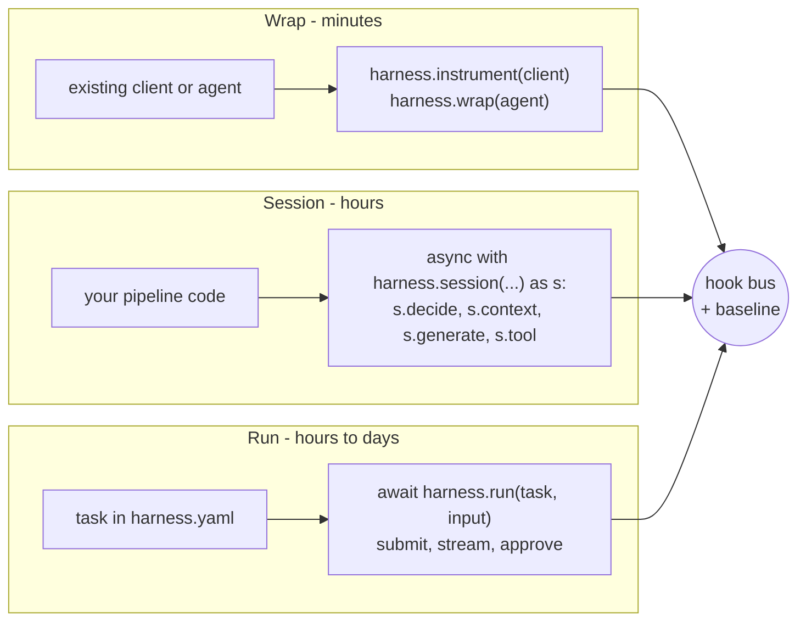

# Integration styles

You can adopt HarnessWeaver in three ways, per task. All three load the same spec and apply the same baseline controls. They differ in who owns the control flow, and so in what the harness can guarantee.



| Style | Effort | Control flow | Controls guaranteed | Use for |
| --- | --- | --- | --- | --- |
| **Wrap** | Minutes | Your existing framework | The hooks the adapter reaches | Existing apps, quick wins (L0) |
| **Session** | Hours | Your code | Every hook your code asks for, except run-level durability | Custom pipelines, RAG |
| **Run** | Hours to days | A HarnessWeaver runner | Every hook, plus idempotency, durability, approvals and repair | New tasks, agents, long-running work |

## Wrap

Govern a client or agent the app already has, without changing the code that uses it.

```python
harness = hw.load("harness.yaml")
client = harness.instrument(AsyncOpenAI(base_url=GATEWAY), tenant="acme", task="triage")
reply = await client.chat.completions.create(model="fast", messages=[...])   # unchanged app code
```

- `harness.instrument(client)` finds an adapter from the client's type: it loads the plugin whose namespace is the client's top-level package (`openai`, `anthropic`) and asks it for an adapter that wraps that type. `adapter=` names one explicitly. Supported today: `openai.OpenAI`/`AsyncOpenAI` (`chat.completions.create`) and `anthropic.Anthropic`/`AsyncAnthropic` (`messages.create`).
- **Outside a run**, each call becomes a small run of its own: `run.start`, `input.before` on the message texts, `model.before`, `model.after`, `output.before` on the answer, `run.end`. So the budget, guards and trace apply per call.
- **Inside a run or session**, a call is one governed model call of that run.
- Redactions are written back: the API receives the redacted request, and the app gets the answer as the output guards left it.
- `harness.wrap(agent, task=...)` does the same for an agent from another framework. For Pydantic AI it governs every model request, tool call and the final output ([ADR-0037](../adr/0037-framework-adapters.md)). A call that needs approval escalates, because the harness can't resume the app's code.
- The adapter's `reaches` is checked when you wrap: if the baseline or the budget needs a hook the adapter can't reach, `instrument()` fails instead of running ungoverned (RULES R4).
- Streaming through an instrumented client or a wrapped agent is *planned*; until then it raises rather than running ungoverned.

## Session

Your code owns the steps; the harness governs each one.

```python
async with harness.session("support", principal=user, tenant=user.org) as s:
    question = await s.guard("input", question)                       # input.before
    route = await s.decide("intent", text=question)                   # route.decide
    articles = await s.context("help").fetch(question)                # ACLs, labels, context.after
    answer = await s.generate(prompt="answer@1", question=question,   # model.before/after, output.before
                              intent=route.choice, articles=listing)
    result = await s.tool("lookup_order", order_id="A-1001")          # tool.before, governor, tool.after
```

| Method | What it does |
| --- | --- |
| `s.guard("input", content)` | Runs the input guards and middleware (`input.before`); returns the content, possibly redacted |
| `s.decide(router, text=..., options=..., state=..., default=...)` | Asks a router (`route.decide`); returns a `Decision` with `kind`, `choice`, `confidence`, `reason` and `stage` |
| `s.context(source).fetch(query, limit=...)` | Retrieves from a context source, governed (ACLs re-checked, labels, caps), then `context.after` |
| `s.context(source).check(items)` | Governs items your code retrieved itself, the same way |
| `s.generate(prompt=..., messages=..., model=..., output=..., stream=..., temperature=..., max_tokens=..., **variables)` | A governed model call. `prompt` renders a versioned prompt; `output` parses into a type and repairs up to `validation.max_repairs` times; `model` is an alias |
| `s.tool(name, **arguments)` | A governed tool call; returns its output |
| `s.validate("output", value, output=...)` | Checks a final output you produced yourself (`output.before`), parsed into `output` first if given |
| `s.prompt(ref, **variables)` | Renders a versioned prompt (`answer@1`) without calling a model |
| `s.memory` | Key-value entries for this tenant, principal and task ([Context and memory](../modules/context.md#memory)) |
| `s.run_id`, `s.envelope`, `s.trace` | The run's id, its current envelope and its trace so far |

- `harness.session(task=None, *, principal, tenant, budget, attributes)` opens one run. With a task, that task's budget, guards and controls apply. When the block ends, `run.end` fires and the run's `RunResult` is kept.
- A control that stops the run raises a `RunInterrupted` error in your code (`RunBlocked`, `RunEscalated`). A `Suspend` escalates, because your code can't be resumed later.
- The same function can serve as a task: `runner: { use: session, handler: "support.flow:answer" }` calls `answer(session, input)` inside a harness-driven run, which adds idempotency, approvals that suspend and resume, and evals ([Example 02](../getting-started/examples.md#example-02-support-assistant)).

## Run

The harness owns the lifecycle; a **runner** executes the task the spec defines.

```python
result = await harness.run("extract_invoice", InvoiceDoc(text=doc), principal=user, tenant="acme",
                           idempotency_key=request_id)
if result.status == hw.RunStatus.AWAITING_APPROVAL:
    ...  # show result.approval to an approver, then harness.approve(result.run_id, ...)
```

These methods are all `async` (`harness.stream` is an async iterator).

| Method | What it does |
| --- | --- |
| `harness.run(task, input, *, principal, tenant, idempotency_key, budget, attributes)` | Runs to a terminal state, or until it suspends; returns a `RunResult`. With an `idempotency_key`, a repeat returns the stored result for `(tenant, task, key)` |
| `harness.submit(...)` | Same arguments; starts the run in the background and returns its id at once (inside `async with harness:`) |
| `harness.stream(run_id)` | Yields the run's `RunEvent`s: status and approval events, plus live trace events and streamed chunks |
| `harness.result(run_id)` | The run's latest `RunResult` |
| `harness.approve(run_id, approval_id, decision, *, approver, edited_args, reason)` | Answers a pending approval (`approve`, `reject`, `edit`) and continues the run |
| `harness.resume(run_id)` | Continues a run whose approval was saved but which didn't finish (after a crash) |
| `harness.cancel(run_id)` | Stops a running or waiting run |

### Runners

| Runner | What it executes |
| --- | --- |
| `direct` | One typed `generate` from the task's prompt and input, with a **bounded** governed tool loop over the task's `tools` (`max_steps`, default 8). No planning, memory or templating ([ADR-0011](../adr/0011-bounded-tool-loop.md)) |
| `session` | Your function `handler(session, input) -> output`; the harness owns the run around it |
| `workflow` | A fixed graph of your functions: steps run when what they `need` has finished, ready steps run in parallel, and a step with an `evaluator` loops up to `max_rounds` |
| `pydantic_ai.agent` (plugin) | A Pydantic AI agent, governed end to end; approvals suspend and resume it |

```yaml
tasks:
  extract:   { runner: direct, input: app.models:Doc, output: app.models:Invoice, prompt: extract@1 }
  support:   { runner: { use: session, handler: "support.flow:answer" }, output: support.models:Reply }
  report:
    runner:
      use: workflow
      output: draft
      steps:
        - { id: facts,   handler: "app.flow:facts" }
        - { id: risks,   handler: "app.flow:risks" }
        - { id: draft,   handler: "app.flow:draft", needs: [facts, risks], evaluator: "app.flow:review", max_rounds: 3 }
  refund:    { runner: { use: pydantic_ai.agent, agent: "app.agents:refund_agent" }, tools: [refund_payment] }
```

Runner details are in the [section reference](../spec/reference.md#tasks). Every runner declares the hook points it `reaches`; loading fails if the baseline needs one it can't (R4).

## Choosing

- **Start with Wrap** if the app exists and you want tracing, cost and guards today.
- **Use Session** when your code's flow is the product: retrieval pipelines, multi-step logic, anything a framework doesn't model well.
- **Use Run** for new tasks, agents and anything that needs approvals that wait for a person, idempotency or evals that run the task end to end.

A spec can mix them: one task run by `direct`, a session elsewhere in the app, and an instrumented client for a legacy path, all under the same baseline.
