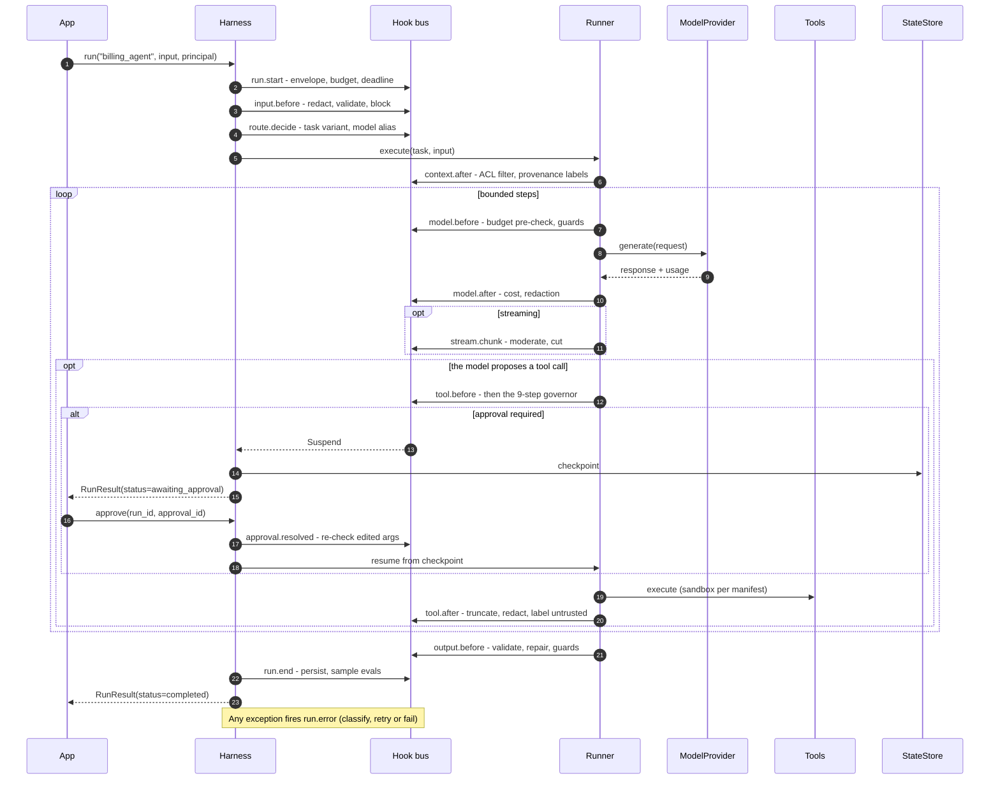
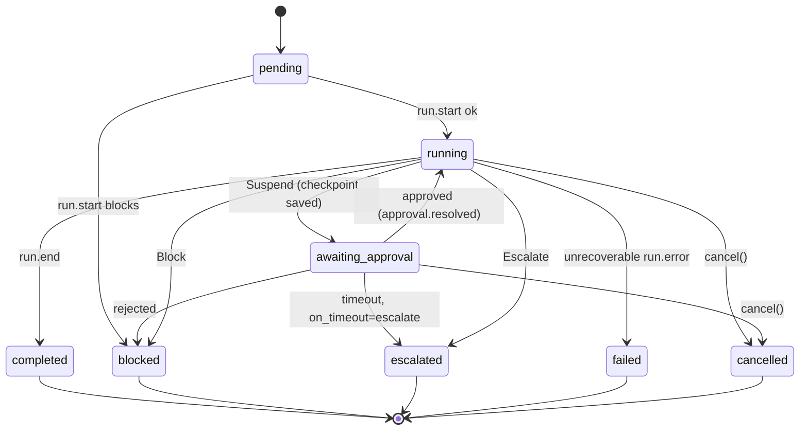

# Lifecycle and hook points

HarnessWeaver's most important contract is a fixed set of **13 hook points**. Every runner and adapter maps its own events onto them, so one guardrail or policy works unchanged across raw SDK calls, Pydantic AI, the Vercel AI SDK or anything else.

Each hook point has a **direction**:

- **Inbound** hooks fire on the way *into* an operation, and their middleware runs outermost-first (baseline first).
- **Outbound** hooks fire on the way *out*, and their middleware runs innermost-first (baseline last).

[The hook bus](hook-bus.md) explains the ordering.

## The 13 hook points

| Hook point | Direction | Fires when | Middleware may | Typical modules |
| --- | --- | --- | --- | --- |
| `run.start` | inbound | The envelope is built, before any work | Reject, check idempotency, set budget and deadline | policy (`run.start` rules), budgets, observability |
| `input.before` | inbound | Raw input arrives | Validate, redact, block | guardrails (input) |
| `route.decide` | inbound | A choice is needed: intent, task variant, model alias | Return a `Decision` | routing |
| `context.after` | outbound | Retrieval returns items | Filter, label, drop, cap | context, guardrails (context) |
| `model.before` | inbound | A model request is about to be sent | Modify messages, pre-check the budget, block | budgets, middleware |
| `model.after` | outbound | A model response arrives | Record usage and cost, redact, block, retry | budgets, observability |
| `stream.chunk` | inbound | A streamed chunk arrives | Redact, cut the stream | guardrails (stream) |
| `tool.before` | inbound | The model (or the app) proposes a tool call | Allow, deny, rewrite arguments, require approval | tools, policy, approvals |
| `tool.after` | outbound | A tool returns | Sanitize, truncate, label untrusted | tools, guardrails (tool_result) |
| `output.before` | inbound | A candidate final output exists | Validate, repair, escalate, block | validation, guardrails (output) |
| `approval.resolved` | inbound | A human answers a suspended step | Re-check edited arguments, resume or end | approvals |
| `run.error` | outbound | An exception escapes a step | Classify it into the error taxonomy | core |
| `run.end` | outbound | The run reaches a terminal state | Persist, emit completion, sample for evals | state, evals, observability |

`harnessweaver hooks harness.yaml --task <task>` prints the middleware on each hook point of your spec, in the order it runs.

## A run, end to end

Not every run fires every hook: a run without retrieval never fires `context.after`, and `run.error` fires only on an error. A [session](integration-styles.md#session) fires the hooks your code asks for, in the order it asks.

## Event payloads

Each hook point has one typed event. Middleware receives it with the run's envelope. The payloads are contracts (schema `hook-event`), so they hold only HarnessWeaver types, never an SDK's (RULES R7).

| Hook point | Event | Fields |
| --- | --- | --- |
| `run.start` | `RunStartEvent` | `task`, `input` |
| `input.before` | `InputEvent` | `input` |
| `route.decide` | `RouteEvent` | `request` (a `DecisionRequest`: `router`, `text`, `options`, `state`), `decision` |
| `context.after` | `ContextEvent` | `source`, `query`, `items` (`ContextItem`s) |
| `model.before` | `ModelRequestEvent` | `request` (a `ModelRequest`) |
| `model.after` | `ModelResponseEvent` | `request`, `response` (a `ModelResponse`) |
| `stream.chunk` | `StreamChunkEvent` | `request`, `chunk` (`index`, `delta`, `usage`), `text_so_far` (the text before this chunk) |
| `tool.before` | `ToolCallEvent` | `call` (`id`, `name`, `arguments`), `tool` (a `ToolInfo`), `approval` (set when a human already approved this call) |
| `tool.after` | `ToolResultEvent` | `call`, `tool`, `result` (`output`, `is_error`, `untrusted`, `truncated`) |
| `output.before` | `OutputEvent` | `output`, `attempt` (0, then 1 for the first repair), `schema_name`, `approval` |
| `approval.resolved` | `ApprovalResolvedEvent` | `request` (an `ApprovalRequest`), `decision` (an `ApprovalDecision`) |
| `run.error` | `RunErrorEvent` | `error` (an `ErrorInfo`), `step` |
| `run.end` | `RunEndEvent` | `status`, `output`, `error`, `usage`, `cost_usd` |

The neutral model contracts are:

| Contract | Fields |
| --- | --- |
| `ModelRequest` | `alias`, `model`, `messages`, `tools` (`ToolSpec`s), `output_schema`, `temperature`, `max_tokens`, `stream`, `metadata` |
| `Message` | `role` (`system`, `user`, `assistant`, `tool`), `content`, `tool_calls`, `tool_call_id`, `name`, `extensions` |
| `ModelResponse` | `model`, `text`, `tool_calls`, `output`, `usage` (`input_tokens`, `output_tokens`), `cost_usd`, `finish_reason`, `extensions` |

`extensions` carries a provider's own per-turn data (such as Claude's thinking blocks) that the harness keeps opaque and replays unchanged ([ADR-0022](../adr/0022-provider-extensions.md)).

## Run statuses

A run moves through these statuses; the terminal ones end it.

| Status | Meaning |
| --- | --- |
| `pending` | Created, not yet started |
| `running` | Working |
| `awaiting_approval` | Suspended until a human answers; the checkpoint is saved |
| `completed` | Finished with an output |
| `blocked` | A control refused a step; `error.details.code` says which (`policy_denied`, `budget_exceeded`, ...) |
| `escalated` | Handed to a human queue |
| `failed` | An error that isn't a control's decision ended it |
| `cancelled` | `cancel()` stopped it |

Every run ends with a `RunResult`: `run_id`, `task`, `task_version`, `status`, `output`, `error` (an `ErrorInfo`), `approval` (the pending `ApprovalRequest`, when waiting), `usage`, `cost_usd`, `cost_known`, `trace`, `started_at` and `ended_at`.

## The trace

Every run keeps a `RunTrace`, a framework-neutral record of what happened, on its `RunResult`. Each `TraceEvent` has a sequence number, a time, a `kind` and a `source`:

| Kind | Recorded |
| --- | --- |
| `hook` | A hook point fired, with the combined outcome of its middleware |
| `outcome` | One middleware's answer, with its band and whether it modified the payload |
| `failure` | A middleware raised or timed out (its exception type, never its message) |
| `note` | A framework decision: a guard fired, a budget check, a route chosen, a governor step, a repair |

Notes carry a `code` (`guard_fired`, `budget_exceeded`, `repair`, ...) and `details` with ids, names and numbers, never content (RULES R9, R13). `harnessweaver.testing.render_trace(result)` prints a trace one event per line, and `assert_trace` checks it in tests ([Testing](../tooling/testing.md)).
