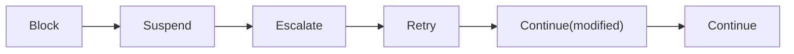

# Outcomes and errors

Middleware answers every event with one of six **outcomes**. Guardrails speak a richer vocabulary of seven **actions**, which the guardrails module maps onto outcomes. When a control stops a run, the run's status says how, and code sees a **taxonomy error** with a stable code.

## Outcomes



*Most severe on the left. When outcomes are combined, the leftmost one wins.*

| Outcome | Meaning | What happens |
| --- | --- | --- |
| `Continue()` | Proceed unchanged | - |
| `Continue(modified=...)` | Proceed with a changed event (redacted text, rewritten arguments) | Later middleware and the operation see the new event |
| `Retry(reason)` | Redo the step, a bounded number of times | At `model.after` the model is asked again, once; at `output.before` a repair attempt runs |
| `Escalate(reason, to)` | Stop the automated path and hand off to a human queue | The run ends `escalated` |
| `Suspend(reason, approver_role)` | Pause durably until an approver answers | A checkpoint is saved; the run is `awaiting_approval` |
| `Block(reason, code)` | Refuse | The step never executes; the run ends `blocked` |

Where each outcome is honored:

- **`Retry`** is honored at `model.after` (the model is asked again, once) and at `output.before` (a repair, up to `validation.max_repairs`). When the retries run out, the run is blocked with code `retry_exhausted`. Anywhere else a `Retry` becomes `Block` with code `retry_not_supported`.
- **`Suspend`** pauses at `tool.before` and `output.before` in a harness-driven run ([Approvals](../tutorial/approvals.md)). Anywhere else, and in a standalone session or a TypeScript session, it escalates, because the app's code can't be resumed later.
- **`Block`** stops the chain: no later middleware on that hook runs.

## Guard actions

A guardrail provider proposes an action; the spec's `action` overrides it whenever the provider flags something.

| Action | Maps to | Notes |
| --- | --- | --- |
| `allow` | `Continue()` | |
| `redact` | `Continue(modified=...)` | Redactions chain through the pipeline. Asking a provider that can't redact to redact blocks |
| `repair` | `Retry` | Output stage only (the model is asked to fix its answer); anywhere else it blocks |
| `escalate` | `Escalate` | |
| `require_approval` | `Suspend` | An output a human already approved passes this guard |
| `block` | `Block` | At the context stage a block drops the item, not the run |
| `log_only` | `Continue()` plus a "would have fired" trace note | Shadow mode (RULES R8) |

See [Guardrails](../tutorial/guardrails.md).

## How a run ends

| Outcome reaching the run | Run style (`harness.run`) | Session style |
| --- | --- | --- |
| `Block` | `RunResult.status == "blocked"`, `error.details.code` holds the block's code | `RunBlocked` is raised in your code |
| `Escalate` | `status == "escalated"` | `RunEscalated` is raised |
| `Suspend` | `status == "awaiting_approval"`, `RunResult.approval` holds the request | `RunEscalated` (a session can't be resumed) |
| A failed repair | `blocked` or `escalated`, as `validation.on_failure` says, code `validation_failed` | `s.generate(output=...)` repairs by itself, then raises `RunBlocked` or `RunEscalated`; `s.validate(...)` raises `ValidationFailed` at the first repair request, for your code to handle |

`RunBlocked`, `RunEscalated` and `RunSuspended` all derive from `RunInterrupted`, so a session can catch one class:

```python
from harnessweaver.errors import RunInterrupted

async with harness.session("support", principal=user) as s:
    try:
        answer = await s.generate(prompt="answer@1", question=question)
    except RunInterrupted as stop:
        answer = f"Sorry, I can't help with that ({stop.details.get('code')})."
```

Common block codes:

| Code | From |
| --- | --- |
| `policy_denied` | A deny rule, at `run.start` or governor step 3 |
| `budget_exceeded` | A budget limit, before or after a model call, or before a tool call |
| `max_steps` | The `direct` runner's tool loop reached `max_steps` |
| `retry_exhausted` | `model.after` asked for a retry after the retry was used |
| `retry_not_supported` | A `Retry` where it isn't honored |
| `validation_failed` | The output is still invalid after the last repair |
| `middleware_error`, `middleware_timeout` | A closed middleware raised or timed out |
| `model_not_allowed` | A model alias outside `models.allowed_aliases` |
| `model_refusal` | The model declined, or a content filter cut its answer short (`openai.chat`, `anthropic.messages`, `wrapModel`) |
| `guard_blocked` | A guard's `block`; the trace note names the guard (`guardrails.input[pii]`) and its findings |
| `tool_not_offered` | The model of a `direct` task called a registered tool the task doesn't offer |
| Governor codes | `tool_unknown`, `manifest_required`, `tool_disabled`, `tool_not_enabled`, `digest_mismatch` (step 1), `schema_invalid` (2), `policy_denied` (3), `trifecta` (4), `rate_limited` (5), `judge_blocked` (6), `approval_rejected` (7); see [Tools](../advanced/governor.md) |

## The error taxonomy

Only taxonomy errors cross a public boundary (RULES C5). Each has a stable code that travels as `ErrorInfo` (`code`, `type`, `message`, `retryable`, `details`) in `run.error` events, in `RunResult.error`, and over the wire.

| Code | Errors | Retryable |
| --- | --- | --- |
| `budget_exceeded` | `BudgetExceeded` | no |
| `deadline_exceeded` | `DeadlineExceeded` | no |
| `policy_denied` | `PolicyDenied` | no |
| `validation_failed` | `ValidationFailed` | no |
| `provider_error` | `ProviderError` (a model or another upstream failed) | yes |
| `tool_error` | `ToolError` | no |
| `expression_error` | `ExpressionSyntaxError`, `ExpressionEvalError` | no |
| `spec_invalid` | `SpecError` and its load-time subclasses: `LockViolation`, `BoundViolation`, `LevelTooLow`, `UnreachableHook`, `IncompatibleContract`, `UnknownProvider`, `PluginConflict`, `PluginNotAllowed` | no |
| `not_found` | `NotFound`: an unknown task, run or approval | no |
| `blocked`, `escalated`, `suspended` | `RunBlocked`, `RunEscalated`, `RunSuspended`, all `RunInterrupted`. `details` holds the `hook` and the block's `code`. `ModelRefusal` is the `RunBlocked` a provider raises when the model declines; its `response` holds what the call used | no |
| `internal` | `InternalError`: anything unexpected | no |

All are in `harnessweaver.errors` (and `@harnessweaver/core` exports the same names). `errors.classify(exc)` turns any exception into the taxonomy, defaulting to `InternalError`.

- **`SpecError` is a load-time error.** A spec that is invalid, breaks a lock or bound, misses its required level, or names something that isn't installed fails when the harness loads, never in the middle of a run (R4). See [Troubleshooting](../how-to/troubleshooting.md) for each one.
- **Messages never hold content.** Error messages and details name fields, rules, codes and ids, never prompts, outputs, tool arguments or variable values (R9).
