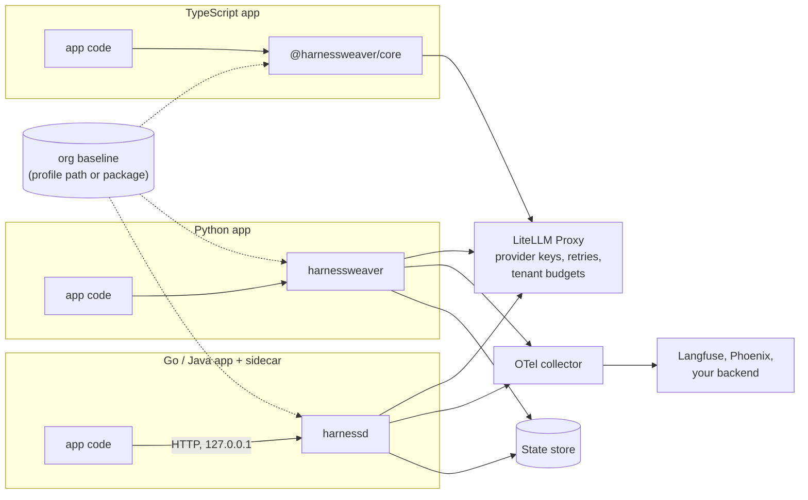

# Deployment

HarnessWeaver is a library and a spec, not a service you must run. Most apps deploy it **in process**; apps in other languages add the **harnessd sidecar**; apps with no SDK at all get controls through **gateway configs**. All three load the same spec and the same org baseline.

The short version:

1. Run models behind a **gateway** (LiteLLM Proxy) that holds the provider keys and owns retries.
2. Keep the **org baseline** in one versioned place every app extends, and lock what must not change.
3. Give each environment an **overlay** (`harness.prod.yaml`), selected by `HARNESSWEAVER_ENV`.
4. Use a **durable state store** when runs wait for approval.
5. Send **traces** to an OpenTelemetry collector, and keep content capture off.
6. Gate every change in **CI**: `spec validate`, tests, `eval run`, `policy test`, and `spec diff` in the pull request.

| Page | Covers |
| --- | --- |
| [Versioning](versions.md) | How contracts, packages and profiles are versioned, and how to upgrade safely |
| [Configuration](configuration.md) | Environment variables, overlays per environment, files the harness reads and writes |
| [Gateways and the dev stack](gateways.md) | LiteLLM and MCP gateway configs generated from the spec, and a local stack |
| [Security](security.md) | The threat model and its controls, the invariants an operator can rely on, and hardening |

## Install

HarnessWeaver is a set of packages: a small Python core, a CLI, a sidecar, plugins, and a TypeScript core with an AI SDK adapter. Install the core and only the plugins your spec uses. Installing a plugin enables nothing on its own: only the names your `harness.yaml` refers to are imported (RULES S8).

| For | You need |
| --- | --- |
| Python apps, the CLI and the sidecar | Python 3.12 or later, and [uv](https://docs.astral.sh/uv/) |
| TypeScript apps | Node 22 or later |
| The local dev stack (`harnessweaver dev --up`) and the sidecar image | Docker with Compose |

```bash
uv add harnessweaver                     # the core: pydantic, opentelemetry-api, pyyaml, anyio, loguru
uv add "harnessweaver[openai]"           # plus one first-party plugin
uv add --dev harnessweaver-cli           # the harnessweaver command
uv add "harnessweaver[all]"              # every first-party plugin, the CLI and the sidecar
```

| Package | Extra | What it adds |
| --- | --- | --- |
| `harnessweaver` | - | The core: spec loader, hook bus, envelope and budgets, runners, the built-in modules, the test kit. `import harnessweaver as hw` |
| `harnessweaver-cli` | `cli` | The `harnessweaver` command ([CLI](../cli.md)) |
| `harnessweaver-sidecar` | `sidecar` | `harnessd`, the HTTP sidecar ([harnessd](../advanced/sidecar.md)) |
| `harnessweaver-openai` | `openai` | `openai.chat`, for any OpenAI-compatible endpoint, and `instrument()` for OpenAI clients |
| `harnessweaver-anthropic` | `anthropic` | `anthropic.messages` for Claude, and `instrument()` for Anthropic clients |
| `harnessweaver-pydantic-ai` | `pydantic-ai` | The `pydantic_ai.agent` runner and `wrap()` for Pydantic AI agents |
| `harnessweaver-monty` | `monty` | `monty.sandbox`, which runs code-executing tools away from the host process |
| `harnessweaver-otel` | `otel` | `otel.sdk`, which sets up the OpenTelemetry SDK and an exporter |
| `harnessweaver-cel` | `cel` | `cel.policy`, full CEL for policy rules |

An extra only installs the package. Your spec still decides what is used, and an org baseline can restrict which plugins apps may use (`plugins.allow`).

For TypeScript:

```bash
npm install @harnessweaver/core                          # the TypeScript core
npm install @harnessweaver/ai-sdk ai @ai-sdk/provider     # plus wrapModel for the Vercel AI SDK (v7)
```

From a clone, `pnpm -C typescript install && pnpm -C typescript build` builds both packages; [Example 04](../resources/examples.md#example-04-one-spec-every-language) uses them from source. The sidecar image builds with `docker build -f deploy/harnessd/Dockerfile -t harnessd .` ([harnessd](../advanced/sidecar.md#the-container)).

## Deployment shapes



## In process (Python, TypeScript)

The app depends on `harnessweaver` (or `@harnessweaver/core`) and the plugins its spec uses, and ships its `harness.yaml`, overlays, prompts, manifests and eval sets with its code.

- **Models:** point `models` at a gateway (`openai.chat` with `base_url`), or at a provider directly (`anthropic.messages`). Keys come from the environment, never the spec (RULES S1).
- **Org baseline:** put the org's profiles on `HARNESSWEAVER_PROFILE_PATH` (a mounted directory, a shared volume), or install them as a plugin package and extend `profile://<namespace>.<name>@^N`.
- **State:** `memory` is fine for stateless services; use `sqlite` (or a durable plugin) when runs wait for approval or you rely on idempotency across restarts.
- **Telemetry:** let the app's own OpenTelemetry setup collect HarnessWeaver's spans, or set `observability.configure_sdk: true` with `harnessweaver-otel` and an OTLP endpoint.

## Sidecar (any language)

Run `harnessd` next to the app (a sidecar container in the same pod, or a process on the same host), serving the app's spec:

```bash
docker build -f deploy/harnessd/Dockerfile -t harnessd .
docker run -p 127.0.0.1:7070:7070 -e HARNESSD_TOKEN -e HARNESSWEAVER_ENV=prod -v /srv/app:/app:ro harnessd
```

- Keep it local: harnessd binds 127.0.0.1 by default; inside a container it listens on the container's interfaces, so publish the port on 127.0.0.1 or keep it inside the pod (S6).
- Give it a token from your secret store; it refuses to start without one.
- The image includes the sidecar and the `openai`, `anthropic`, `otel` and `cel` plugins; build with `--build-arg PACKAGES="..."` for others, including your own plugins.
- Give it the same state store choice and telemetry settings as an in-process app.

See [harnessd](../advanced/sidecar.md).

## Gateway only

Apps that call models and tools over the network with no SDK get the controls a gateway can enforce: model aliases, retries, timeouts, no message logging, and a tool allow-list from the manifests. Generate the configs in CI from the spec (`harnessweaver gateway litellm`, `gateway mcp`) and deploy them with the gateway; tools that need a run (approvals, egress, tenants, rate limits) are withheld and must go through the harness or harnessd. See [Gateways](gateways.md).

## The services around it

| Service | Role | Notes |
| --- | --- | --- |
| LiteLLM Proxy | Model egress: provider keys, retries, fallbacks, tenant budgets, cost reporting | One owner for retries (RULES R5): SDK retries stay off behind it. Its `x-litellm-response-cost` header gives the harness exact costs |
| OpenTelemetry collector | Receives spans and metrics | Forward to Langfuse, Phoenix or your own backend |
| State store | Runs, checkpoints, idempotency, events, recordings, samples | `sqlite` today; Postgres and Redis *planned* |
| MCP gateway | Shared tools over MCP | Configure it from `harnessweaver gateway mcp` |
| Approval channel endpoint | Receives approval requests | A webhook, your own callback, or polling `memory` |

`harnessweaver dev --up` runs LiteLLM, a collector, Langfuse and harnessd locally, wired to a spec ([The local dev stack](gateways.md#the-local-dev-stack)).

## CI

```bash
uv run harnessweaver spec validate harness.yaml -e prod --profile-dir org-profiles
uv run harnessweaver doctor harness.yaml -e prod --strict
uv run harnessweaver test
uv run harnessweaver eval run harness.yaml -e offline
uv run harnessweaver policy test harness.yaml
uv run harnessweaver spec diff git:origin/main:harness.yaml harness.yaml > spec-diff.md   # post as a PR comment
```

Validate every overlay you deploy (`-e prod`, `-e staging`): an overlay can break a lock or bound that the base spec respects.

## Production checklist

- [ ] The spec extends the org baseline at a pinned range (`org://acme-baseline@^1`), and `doctor` reports no unpinned profiles.
- [ ] `spec validate -e <env>` passes for every deployed environment.
- [ ] Models go through a gateway, with SDK retries off and keys only in the gateway's environment.
- [ ] `observability.capture_content` is false (and locked by the baseline).
- [ ] Every tool has a pinned manifest; `doctor` reports no unpinned or mismatched digests.
- [ ] Every task has a budget with a deadline, within the baseline's bounds.
- [ ] Runs that can wait for approval use a durable state store and a real approval channel.
- [ ] New guards started in shadow mode and were promoted on eval evidence.
- [ ] `eval run` and `policy test` gate the build, with committed baselines.
- [ ] harnessd, if used, binds locally and takes its token from a secret store.
- [ ] Logs are enabled where you want them (`logger.enable("harnessweaver")`), going to a sink you chose.
