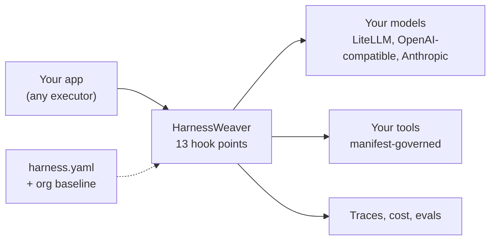

# HarnessWeaver

**The composable AI harness framework.** Weave your own AI harness: bring your models, choose your plugins, define your execution.

Every AI application needs the same controls around its models: tracing and cost, budgets and deadlines, PII redaction and prompt-injection checks, validated output, governed tool calls, human approvals, routing and evals. Most teams rebuild these inside each app, differently every time.

HarnessWeaver is a framework for building **your own harness**. You keep the executor you already use (raw SDK calls, Pydantic AI, the Vercel AI SDK, a custom pipeline), describe your controls in one `harness.yaml`, and HarnessWeaver intercepts every model call, tool call and output at **13 fixed hook points**. Your platform team publishes an **org baseline** that every app inherits and no app can switch off.



## What you get

| Control | How it works | Read more |
| --- | --- | --- |
| Tracing and cost | Every run, model call, tool call and decision is traced (OpenTelemetry GenAI conventions) and costed | [Observability](modules/observability.md) |
| Budgets and deadlines | Per-run limits on cost, tokens, model calls, tool calls and time, checked before each call | [Envelope, labels and budgets](concepts/envelope.md) |
| Guardrails | PII, secrets, prompt injection, size, topics, citations and LLM judges on input, retrieved context, tool results, output and streams | [Guardrails](modules/guardrails.md) |
| Typed output | Pydantic validation with bounded repair, plus business rules | [Validation](modules/validation.md) |
| Tool governance | No tool runs without a manifest; a nine-step governor checks schema, policy, the lethal trifecta, rate limits and approvals | [Tools](modules/tools.md) |
| Policy and approvals | Deterministic rules decide; a human approves what they require; runs suspend durably and resume | [Policy](modules/policy.md), [Approvals](modules/approvals.md) |
| Routing | A cascade of rules, lexical, semantic and LLM stages picks the intent, task or model | [Routing](modules/routing.md) |
| Retrieval governance | ACLs re-checked on every retrieved item, untrusted labels, size caps | [Context and memory](modules/context.md) |
| Evals | Golden sets with baselines in CI, shadow-guard reports, online sampling of production runs | [Evals](modules/evals.md) |
| Org baseline | Locks, bounds and a required adoption level by risk tier, enforced when an app loads | [Layers, locks and bounds](spec/layers.md) |

## A taste

The spec declares the controls ([Example 01](getting-started/examples.md#example-01-invoice-extraction), abridged):

```yaml
apiVersion: harnessweaver/v1
kind: Harness
metadata: { name: invoice-extraction, owner: finance-platform, risk_tier: internal }
extends: ["profile://extraction"]          # PII redaction on input, secrets check on output, one repair

models:
  provider: openai.chat                    # LiteLLM Proxy, or any OpenAI-compatible endpoint
  base_url: http://localhost:4000          # the gateway holds the provider keys and owns retries
  api_key_env: LITELLM_API_KEY
  default: fast
  aliases: { fast: fast-chat }
  prices: { fast-chat: { input_per_mtok: 0.25, output_per_mtok: 2.00 } }

tasks:
  extract_invoice:
    runner: direct
    input: invoices.models:InvoiceDoc
    output: invoices.models:Invoice        # a Pydantic model; an invalid answer is repaired
    prompt: extract_invoice@1
    budget: { max_model_calls: 3, max_usd: 0.02, deadline: 30s }

validation:
  rules:
    - { id: positive-total, when: "output.total <= 0", message: "the total must be positive" }
```

and the app's code is one call, with no retry loop, error handling around the model or tracing setup:

```python
import asyncio

import harnessweaver as hw
from invoices.models import Invoice, InvoiceDoc
from invoices.samples import INVOICE_TEXT


async def main() -> None:
    harness = hw.load("harness.yaml")      # profiles, org baseline and env overlay, validated here
    result = await harness.run("extract_invoice", InvoiceDoc(text=INVOICE_TEXT), principal="ap-clerk", tenant="acme")
    if result.ok:
        invoice = Invoice.model_validate(result.output)
        print(invoice.invoice_number, invoice.total, invoice.currency)
    print(result.status, result.cost_usd)  # every hook, guard and repair is on result.trace


asyncio.run(main())
```

Already have an app? Govern the client it uses, without changing the code that calls it:

```python
client = harness.instrument(AsyncOpenAI(base_url="http://localhost:4000"), tenant="acme")
reply = await client.chat.completions.create(model="fast-chat", messages=messages)   # traced, costed, budgeted, guarded
```

The same spec also serves [TypeScript](tooling/typescript.md) apps, and any language through the [harnessd sidecar](tooling/sidecar.md).

## Why a framework, not a harness

| | A central harness | HarnessWeaver |
| --- | --- | --- |
| Who owns control flow | The harness | Your app, with HarnessWeaver intercepting |
| How controls are applied | Hard-wired in one runtime | Composed per app from plugins, plus an org baseline that can't be removed |
| Adopting it | Route your app through it | One line for tracing, then grow level by level |
| Languages | Usually one | Python, TypeScript, and any language through the sidecar |

HarnessWeaver is **not** an agent framework, a prompt library, a vector database or a model host. It never does the reasoning (RULES R12). It governs the tools that do.

## Where to start

- **New here?** Follow the [Quickstart](getting-started/quickstart.md): a governed, traced and tested task in fifteen minutes, offline.
- **Learning the model?** Read [Concepts](concepts/index.md), starting with the [lifecycle and hook points](concepts/lifecycle.md).
- **Writing a spec?** The [spec overview](spec/index.md), then the [section reference](spec/reference.md).
- **Platform or security team?** [Layers, locks and bounds](spec/layers.md), [adoption levels](concepts/adoption-levels.md) and [security](operations/security.md).
- **Not on Python?** [TypeScript](tooling/typescript.md), or any language through the [harnessd sidecar](tooling/sidecar.md).
- **Building a plugin?** [Extending HarnessWeaver](extending/index.md).

!!! note "Status"
    HarnessWeaver is pre-release: 0.1.0 is in preparation and the packages aren't published yet. Install from a clone of the repository ([Installation](getting-started/installation.md)). Anything marked *planned* in these pages doesn't exist yet.
