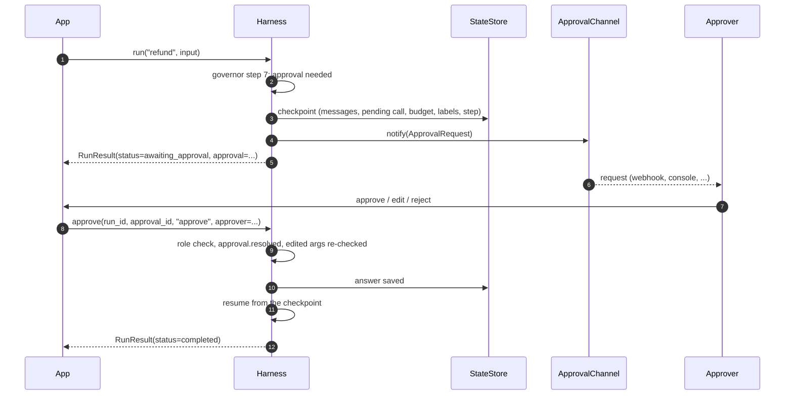

# Approvals

When a step needs a human, the run **suspends**: its state is checkpointed in the state store, an approval request goes to the approval channel, and the run's status becomes `awaiting_approval`. An approver answers with `harness.approve(...)` (or harnessd's approval route), and the run continues where it stopped, even in another process after a restart.

```yaml
approvals:
  use: webhook                      # memory (default), callback, console, webhook
  url: https://approvals.acme.example/hooks/harness
  headers_env: { Authorization: APPROVALS_TOKEN }
  timeout: 24h
  on_timeout: escalate              # or reject
  approver_role: finance            # when the step that asked names none
tasks:
  refund:
    approvals: { tools: [refund_payment], approver_role: finance, timeout: 4h }
state: { use: sqlite }              # so waiting runs survive a restart
```

## What asks for approval

| Source | Where |
| --- | --- |
| A policy rule with `effect: require_approval` | Governor step 3 |
| A manifest's `approval.when` (true, or unevaluable) | Governor step 3 |
| `tools.approval_by_risk` for the tool's risk | Governor step 3 |
| A task's `approvals.tools` | Governor step 3 |
| The lethal trifecta, with `tools.trifecta: require_approval` | Governor step 4 |
| The tool judge answering `require_approval` or `escalate` | Governor step 6 |
| A middleware returning `Suspend(reason, approver_role)` | `tool.before` or `output.before` |
| A guard with `action: require_approval` | `output.before`; at the other stages a `Suspend` can't pause the run, so it escalates |
| A framework's own approval (for example a Pydantic AI tool with `requires_approval=True` in the runner) | Through `RunContext.approval_needed` |

Suspension works in a harness-driven run (`harness.run`, `submit`, and the runners). In a standalone session, a wrapped agent and TypeScript, a request for approval **escalates** instead, because the app's code can't be resumed later.

## The flow



```python
result = await harness.run("refund", "Refund order A-1001 in full", principal=customer)
if result.status == hw.RunStatus.AWAITING_APPROVAL:
    request = result.approval                 # an ApprovalRequest
    # ... show it to someone with request.approver_role ...
    result = await harness.approve(result.run_id, request.approval_id, "approve",
                                   approver=hw.Principal(id="fiona", roles=("finance",)))
```

## The request

An `ApprovalRequest` has `approval_id`, `run_id`, `reason`, `approver_role`, the pending `call` and `tool` (for a tool call), `requested_at` and `expires_at`. It is a contract (schema `approval-request`), so a channel can send it anywhere as JSON.

- **Approver role:** from the step that asked (a middleware's `Suspend`, or the manifest's `approval.approver_role`), else the task's `approvals.approver_role`, else `approvals.approver_role`.
- **Expiry:** the task's `approvals.timeout`, else `approvals.timeout` (24 hours from the defaults profile).

## Answering

`harness.approve(run_id, approval_id, decision, *, approver, edited_args=None, reason=None)`:

| Decision | Effect |
| --- | --- |
| `approve` | The call (or output) goes ahead |
| `edit` | The call goes ahead with `edited_args`, which pass through every governor step again (schema, policy, trifecta, ...) |
| `reject` | The run ends `blocked` (`approval_rejected`) |

The harness checks that the approver holds the approver role, fires `approval.resolved` (middleware there can re-check the answer), saves the answer, then resumes. An approval never overrides a deny: edited arguments that a rule denies are blocked. An answer after `expires_at` ends the run as `on_timeout` says (`escalate` or `reject`).

Over HTTP: `POST /v1/runs/{run_id}/approvals/{approval_id}` with `{decision, approver, edited_args, reason}` ([harnessd](../tooling/sidecar.md)).

## Grants

An approval becomes a **grant** that matches the call by tool name and arguments, or the output by its content. When the resumed run repeats that call, it carries the approval into `tool.before` as `event.approval`, so middleware doesn't ask again (but still sees edited arguments). An approved output carries it into `output.before`, where it answers guards that ask for approval. One approval answers every request for approval at that step and nothing else: it never turns a block, an escalation or a repair into an allow.

## How runs resume

([ADR-0021](../adr/0021-resuming-approved-steps.md))

| Runner | Resumes |
| --- | --- |
| `direct` | From the exact step: the pending tool call runs with the approval |
| `session`, `workflow` | By running the interrupted handler (or workflow step) again; finished workflow steps don't run again, and the repeated call matches the grant. Work before a suspension point should be safe to repeat (use the call's idempotency key) |
| `pydantic_ai.agent` | From the agent's saved message history, with the deferred call answered; only the call a human approved runs |

A run's deadline is paused while it waits: the resumed run gets the time it had left.

## Channels

Once the request and the checkpoint are saved, the channel `approvals.use` names is notified.

| Channel | Does | Settings |
| --- | --- | --- |
| `memory` | Keeps every request (the default), for tests and apps that poll | none |
| `callback` | Calls your function, sync or async, with each `ApprovalRequest`; it must not answer in-line | `handler`: `package.module:function` |
| `console` | Writes one line per request, for local development | `stream`: `stderr` (default) or `stdout` |
| `webhook` | POSTs each request as JSON | `url`; `timeout` (default `10s`); `headers_env`: header name to environment variable (S1). Refuses the network in test mode |

A channel that fails is traced (`approval_notify_failed`) and the run keeps waiting: the request is already saved. Slack, e-mail and an approval page are *planned* channels.

## Crash safety and background runs

- `approve()` saves the answer before resuming. If the process dies mid-resume, `harness.resume(run_id)` continues the run.
- `harness.cancel(run_id)` stops a running or waiting run.
- Inside `async with harness:`, `harness.submit(task, input, ...)` returns a run id at once, and `harness.stream(run_id)` yields `RunEvent`s: `status` and `approval` events from the state store's event log, plus live `trace` and `chunk` events. An app can push approval requests to people from that stream.
- Use the `sqlite` state store (or a durable plugin) in production, so waiting runs survive restarts.
