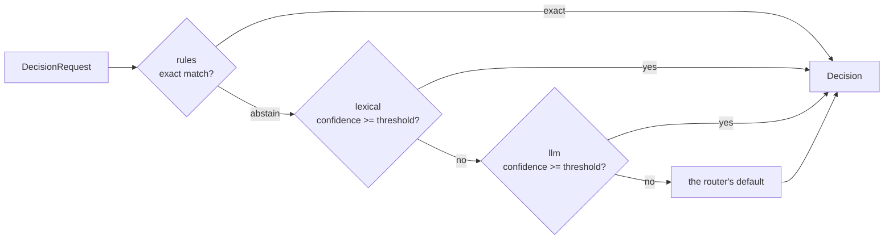

# Routing

A **router** answers one question with one of a fixed set of options: which kind of question is this, which pipeline should handle it, which model alias should serve it. Each router is a **cascade** of stages: cheap, exact stages first, probabilistic ones after, and a default when nobody is sure. Every stage's answer is traced, including the stages that lost.

```yaml
routing:
  intent:
    options: [outage, billing, howto]
    cascade:
      - id: outage-words
        use: rules
        rules:
          - { when: "text.matches('(down|outage|not loading|Down|Outage)')", choice: outage }
      - id: words
        use: lexical
        threshold: 0.3
        utterances:
          billing: [how long does a refund take, I was charged twice, where is my invoice]
          howto: [how do I export a report, how do I add a user]
    default: howto
```

```python
route = await s.decide("intent", text=question)
route.choice       # "outage"
route.kind         # "exact", "probabilistic", "abstain" or "default"
route.confidence   # None for exact answers, 0 to 1 otherwise
route.stage        # "outage-words": the stage that decided
```

## How a cascade decides



([ADR-0029](../adr/0029-routing-cascade.md); fixtures suite `routing`, the same in Python and TypeScript.)

- Stages run in order, and **the first confident answer wins**. An `exact` answer is always confident. A `probabilistic` answer is confident when its confidence reaches the stage's `threshold`; a stage without a threshold accepts any confidence.
- An answer outside the router's options, or a stage that fails, counts as an abstention.
- With no confident stage, the router's `default` answers (kind `default`). Without a default, the decision abstains (kind `abstain`, `choice` none), and your code decides what to do.
- A stage is named by its `id`, or the generated `<use>#<n>`.

## Asking a router

| Where | How |
| --- | --- |
| A session | `await s.decide(router, text=..., options=[...], state={...}, default=...)` |
| Middleware | Any middleware on `route.decide` sees the `RouteEvent` and can answer with a modified event carrying a `Decision` |
| harnessd | `POST /v1/decisions/{router}` with `{principal, tenant, text, options, state, default}`; the answer is a `RunResult` whose output is the `Decision` |

The cascade answers only requests for its router name, and offers the router's options unless the caller passes its own. It is installed as one middleware on `route.decide`, in the band of the layer that declared it.

## Stages

### rules

Deterministic. The first rule whose cel-lite `when` is true decides, exactly; otherwise the stage abstains. A rule that can't be evaluated doesn't match.

| Setting | Meaning |
| --- | --- |
| `rules` | A list of `{when, choice}`. `when` sees `text`, `state`, `options` and `router` |
| `file` | A YAML file with a `rules` list, relative to the spec |

### lexical

Deterministic. Each option scores its closest example utterance by the cosine of token counts; the best option wins, with that score as its confidence. Ties go to the option listed first; a text that shares no token with any utterance abstains. Tokens are lowercased runs of letters and digits.

| Setting | Meaning |
| --- | --- |
| `utterances` | A map of option to example texts |
| `file` | A YAML file with an `utterances` map |

### semantic

Like `lexical`, but compares embeddings. The built-in embedder, `semantic.hashing`, hashes words and character trigrams (32-bit FNV-1a) into a fixed-size vector: dependency-free and deterministic. A plugin can bring a real embedding model as an `Embedder` provider.

| Setting | Default | Meaning |
| --- | --- | --- |
| `utterances`, `file` | | As for `lexical` |
| `encoder` | `semantic.hashing` | The `Embedder` provider |

`semantic.hashing` takes `dims` (default 256).

### llm

Probabilistic. Asks the model to pick one of the options, or none, with a confidence. The call is governed and budgeted like any other model call, the model's explanation isn't kept (RULES R9), and the confidence is uncalibrated: tune the threshold on a labelled set of examples.

| Setting | Default | Meaning |
| --- | --- | --- |
| `model` | `models.default` | The model alias |
| `instructions` | none | How to choose, for the model |

### Your own stage

A custom stage is a `@hw.decider` function (or a `Decider` provider class) in a plugin:

```python
import harnessweaver as hw


@hw.decider("vip_rules")                    # use: acme.vip_rules
async def vip_rules(request: hw.DecisionRequest) -> hw.Decision:
    """VIP customers go straight to a person."""
    if request.state.get("tier") == "vip":
        return hw.Decision.exact("human", reason="vip customer")
    return hw.Decision.abstain()
```

`hw.Decision.exact(choice, reason=...)`, `hw.Decision.probabilistic(choice, confidence, reason=...)` and `hw.Decision.abstain()` build answers. A decider is deterministic unless declared otherwise (`@hw.decider("name", deterministic=False)`). `FakeDecider` from the test kit stands in for routing in tests.

## Kinds of decision

One `Decider` port covers three kinds of decision, with different trust rules:

| Kind | Example | Allowed stages | Trust rule |
| --- | --- | --- | --- |
| Intent or task | Which pipeline answers this question? | rules, lexical, semantic, llm, custom | May be probabilistic; tune thresholds on labelled examples |
| Model | Which alias serves this call? | rules by task and size | Returns an alias; the gateway handles fallback |
| Policy | May this principal call this tool? | Not routing: the [policy](policy.md) engine | Must be deterministic (RULES R3) |

## Tracing

Every stage's answer, confidence and reason is a `harness.routing` trace note (with `won: true` on the winner), and the final decision is a `harness.decision` note and span (RULES R13). Reasons name rules, options and scores, never the request's text (R9).

## TypeScript

`@harnessweaver/core` runs the `rules` and `lexical` stages natively, with the same results as Python. The `semantic` and `llm` stages are *planned* for TypeScript; a spec that uses them fails to load there (R4), and can be served through [harnessd](../tooling/sidecar.md) instead.
