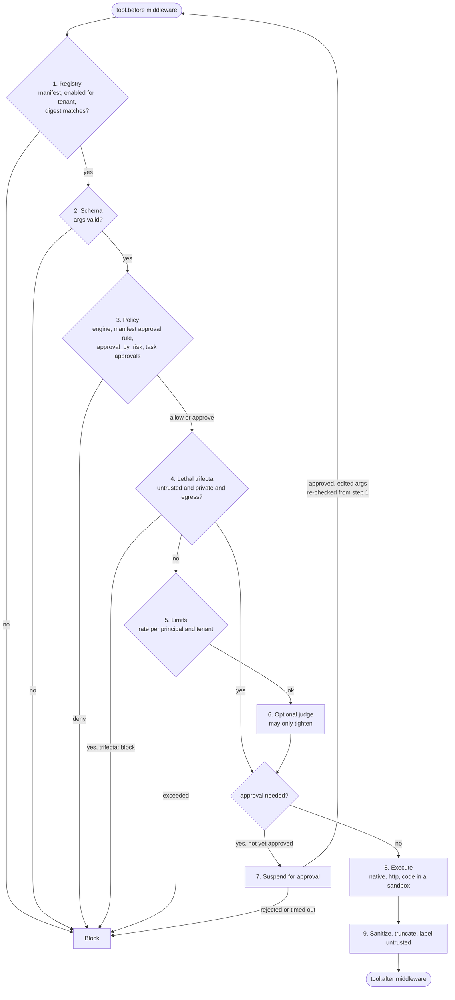

# Tools

No tool runs without a manifest (RULES S2), and no call runs without passing the **governor**: nine deterministic steps that check the tool, its arguments, the policy, the lethal trifecta, rate limits and approvals, then execute it and sanitize its result. The same steps govern a call proposed by a model in the `direct` runner, a call from a Pydantic AI agent, and `s.tool(...)` in your own code.

```yaml
tools:
  manifests: ["tools/*.tool.yaml"]       # relative to harness.yaml
  require_manifest: true                 # the default; usually locked by the baseline
  trifecta: require_approval             # or block
  approval_by_risk: { high: required, critical: required }
  max_output_bytes: 20000
policy:
  rules:
    - { id: refund-cap, when: "tool.name == 'refund_payment' && args.amount_usd > 1000", effect: deny }
tasks:
  refund:
    runner: direct
    tools: [lookup_order, refund_payment]    # the tools offered to the model
    approvals: { tools: [refund_payment] }   # always approved by a human in this task
```

The manifest format is described in [Tool manifests](../spec/tool-manifests.md).

## Calling tools

| Who calls | How |
| --- | --- |
| The `direct` runner | Offers the task's `tools` to the model and runs a bounded loop: each tool call the model proposes is governed, and its result goes back to the model, up to `max_steps` model calls |
| `pydantic_ai.agent` / `harness.wrap(agent)` | Every tool the agent calls is governed; each needs a manifest |
| A session | `await s.tool("lookup_order", order_id="A-1001")` returns the tool's output |
| harnessd | `POST /v1/tools/{name}/authorize` (a dry run) and `POST /v1/tools/{name}/sanitize` (step 9 on your own tool's result) |
| TypeScript | `await s.tool("lookup_order", { order_id: "A-1001" })`, with handlers passed to `load(..., { tools })` |

## The governor

Steps 1 to 7 run **inside** the governed tool call, after the `tool.before` middleware and on the arguments it leaves, so no middleware can rewrite arguments past the checks ([ADR-0025](../adr/0025-governor-placement.md)). Step 9 runs before the `tool.after` middleware. Every decision is a `harness.governor` trace note with its step, code and reason, never the argument values (RULES R9, R13).



| Step | Checks | Block codes |
| --- | --- | --- |
| 1. Registry | The tool is registered and has a manifest (when `require_manifest`), is enabled, is enabled for the run's tenant, and its pinned digest matches its definition | `tool_unknown`, `manifest_required`, `tool_disabled`, `tool_not_enabled`, `digest_mismatch` |
| 2. Schema | The arguments match the manifest's `input_schema` | `schema_invalid` |
| 3. Policy | The policy engine decides `allow`, `deny` or `require_approval`. Approval is also needed when the manifest's `approval.when` is true (or can't be evaluated), when `tools.approval_by_risk` marks the tool's risk `required`, and for the tools the task lists in `approvals.tools` | `policy_denied` |
| 4. Trifecta | A tool with `egress`, called after untrusted content and private data both entered the run, needs approval (`trifecta: require_approval`) or is blocked (`trifecta: block`) | `trifecta` |
| 5. Limits | The manifest's `rate_limit` per principal and per tenant. A call reserves its place before the later steps, so concurrent calls can't all pass the same check, and gives it back if it doesn't go ahead. Windows slide on the run's clock | `rate_limited` |
| 6. Judge | `tools.judge`, a guardrail that sees `{tool, args}`: `block` blocks; `require_approval` or `escalate` asks a human; a judge that fails asks a human rather than letting the call through | `judge_blocked` |
| 7. Approval | A call that needs approval suspends ([Approvals](approvals.md)), unless it carries an approval already given for this tool and these arguments. Edited arguments go through every step again; an approval never overrides a deny | `approval_rejected` |
| 8. Execute | Runs the tool through its transport, with its `timeout` and idempotency key | a `ToolError` when the tool fails |
| 9. Output | The manifest's sanitizers (`pii_redact`, then `strip_instructions`), a cut to `max_bytes` UTF-8 bytes (a JSON result becomes its compact JSON text), and the `untrusted` label unless the manifest says `label: trusted` | - |

The run's `max_tool_calls` budget is checked before `tool.before`. A tool that raises gives the model only its error's type, since the message may hold content (R9).

### The lethal trifecta

Untrusted content (which may carry injected instructions), private data, and a tool that can send data out are each harmless alone and dangerous together (RULES S3). The run's labels track the first two: retrieved context and untrusted tool output set `untrusted_seen`; a tool with `data_access: [pii:*]` or a guard finding marked private (such as `pii.regex`'s) sets `private_seen`. Step 4 then stops a tool with `egress` from running unattended. Set `trifecta: block` where no human should be asked, as [Example 03](../getting-started/examples.md#example-03-refund-agent) does for e-mail.

### Idempotency

Every call gets a key that stays the same when a resumed run repeats it: `<run_id>:<digest of the call>`. A native handler with an `idempotency_key` parameter receives it, and an `http` tool gets an `Idempotency-Key` header, so the tool's owner can drop a repeat. After an approval, a `session` or `workflow` step runs again, so the key matters ([How runs resume](approvals.md#how-runs-resume)).

## Dry runs and policy tests

`harness.authorize(tool, args, principal=..., tenant=..., task=..., labels=...)` runs steps 1 to 7 for a call that never executes ([ADR-0036](../adr/0036-dry-runs-and-guard-notes.md)): a rate-limit place taken is given back, and nothing is approved. It returns a `ToolVerdict` with `decision` (`allow`, `require_approval` or `block`), `step`, `code`, `reason` and `approver_role`.

`harnessweaver policy test` checks a table of such calls, by default `policy_tests.yaml` next to the spec:

```yaml
cases:
  - { id: small-refund, tool: refund_payment, args: { order_id: A-1002, amount_usd: 30 }, principal: casey, expect: allow }
  - { id: big-refund, tool: refund_payment, args: { order_id: A-1001, amount_usd: 250 }, principal: casey,
      expect: require_approval, approver_role: finance }
  - id: contractor
    tool: refund_payment
    args: { order_id: A-1002, amount_usd: 30 }
    principal: { id: carl, roles: [contractor] }
    expect: block
    code: policy_denied
  - id: mail-after-untrusted-private-data
    tool: email_customer
    args: { to: casey@example.com, body: Your refund is on its way. }
    labels: { untrusted_seen: true, private_seen: true }
    expect: block
    code: trifecta
  - { id: bad-order-id, tool: lookup_order, args: { order_id: "1; DROP TABLE" }, expect: block, step: 2 }
```

Each case has an `id`, the `tool` and `args`, optionally `principal`, `tenant`, `task` and `labels`, and what it expects: `expect` (the decision) and, when given, `code`, `step` and `approver_role`. The command exits 1 when a verdict differs and 2 when the tests can't run, so it belongs in CI next to the evals.

## Working with manifests

| Command | What it does |
| --- | --- |
| `harnessweaver add tool app.tools:refund_payment [--risk high] [--side-effect write_external]` | Writes a manifest from the function's signature and docstring, and adds its directory to `tools.manifests` |
| `harnessweaver tools pin [--tool NAME]` | Writes each manifest's current `definition_digest`, keeping comments |
| `harnessweaver doctor` | Fails a mismatched pin, warns about unpinned manifests (printing the digest to pin) |
| `harnessweaver gateway mcp` / `gateway litellm` | Turns the manifests into gateway allow-lists, withholding tools that need a run ([Gateways](../tooling/gateways.md)) |

## Sandboxed code

A `code` tool runs the code in one of its arguments in the `Sandbox` its manifest names, never in the host process (RULES S4, [ADR-0027](../adr/0027-code-transport.md)). With `harnessweaver-monty`:

```yaml
apiVersion: harnessweaver/v1
kind: Tool
metadata: { name: python }
spec:
  transport: code
  sandbox: monty                # short for monty.sandbox
  description: Run Python over the given rows and return the last expression.
  input_schema:
    type: object
    properties: { code: { type: string }, rows: { type: array } }
    required: [code]
  limits: { timeout: 2s, max_memory_mb: 64 }
```

The code runs with the other arguments as globals and returns `{value, stdout}`, or `{error, stdout}` when it raises. It can't open host files, reach the network or read the environment, and each call gets a fresh worker.

## TypeScript

`@harnessweaver/core` runs steps 1 to 7 and step 9 for tools whose handlers you pass to `load("harness.yaml", { tools: { name: handler } })`; each still needs its manifest. The `http`, `code` and `mcp` transports are *planned* for TypeScript.
