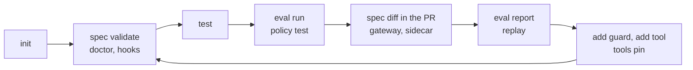

# Tooling

The tools around the core: a CLI for every stage of a project's life, a test kit that keeps everything offline, project templates, the TypeScript SDK, the harnessd sidecar for other languages, and generators for gateways and a local stack.

| Tool | For | Page |
| --- | --- | --- |
| `harnessweaver` CLI | Scaffolding, checking specs, tests, evals, policy tests, replay, tools, plugins, the sidecar, gateways | [CLI](cli.md) |
| `harnessweaver.testing` | Offline harnesses, scripted models, fake tools and deciders, trace assertions, leak checks, cassettes | [Testing](testing.md) |
| `harnessweaver init` templates | Starting a project: extraction, RAG, agent, workflow, chat | [Templates](templates.md) |
| `@harnessweaver/core`, `@harnessweaver/ai-sdk` | TypeScript apps, with Vercel AI SDK models | [TypeScript](typescript.md) |
| `harnessd` | Any language, over HTTP | [harnessd sidecar](sidecar.md) |
| `gateway` and `dev` | LiteLLM and MCP gateway configs; a local stack with Langfuse | [Gateways and the dev stack](gateways.md) |

## A project's life, with the CLI

1. **Start:** `init` a project from a template.
2. **Check:** `spec validate` loads it exactly as the app will; `doctor` advises; `hooks` shows what runs where.
3. **Test:** `test` runs the project's tests offline.
4. **Gate:** `eval run` and `policy test` in CI fail the build on a regression or a changed verdict.
5. **Review:** `spec diff git:main:harness.yaml harness.yaml` in the pull request shows changed values, locks and level.
6. **Run:** serve the spec to other languages with `sidecar`, or generate `gateway` configs.
7. **Learn:** `eval report` summarizes sampled production runs; `replay` checks a change against recorded ones.
8. **Grow:** `add guard` (in shadow mode), `add tool`, `tools pin`, and back to step 2.
