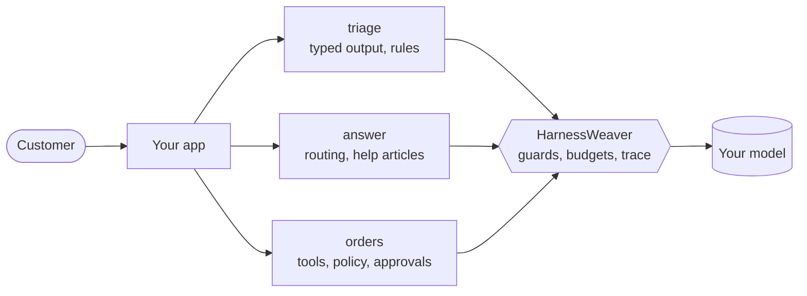

# Tutorial

This tutorial builds one app with HarnessWeaver, a feature per chapter.

Each chapter builds on the one before, and each also reads on its own, so you can come back to the one you need later.

## What you'll build

You'll build the harness for an AI **support desk**. By the end it has three tasks:

- `triage` turns a customer's message into a typed ticket: a category, a priority and a summary.
- `answer` answers a question from the help center, citing the article it used.
- `orders` looks orders up and refunds them with tools, under a policy, with a person approving large refunds.



The app's own code stays small. Almost everything the harness does comes from one file, `harness.yaml`, which grows a little in each chapter.

## Run the code

Every block of code in the tutorial is a complete file, or a part of one, that you can copy into your project and run.

The code is also in the repository, under [`docs_src/tutorial/`](https://github.com/Wise-DreamerZ/HarnessWeaver/tree/main/docs_src/tutorial). Each folder there is the project as it stands at the end of one chapter, and the repository's tests run every one of them offline, so the code you see here works.

Everything runs **offline**: no API keys, no network, no spend. Each chapter's `harness.offline.yaml` swaps the real model for a scripted one, and `HARNESSWEAVER_ENV=offline` turns it on. [First steps](first-steps.md) explains how that works.

## Install HarnessWeaver

You need [uv](https://docs.astral.sh/uv/getting-started/installation/). It installs a suitable Python (3.12 or later) on its own.

Create the folder for your project, `support-desk/`, with this `pyproject.toml`:

```toml title="pyproject.toml"
[project]
name = "support-desk"
version = "0.1.0"
requires-python = ">=3.12"
dependencies = ["harnessweaver[openai]"]

[dependency-groups]
dev = ["harnessweaver-cli", "pytest"]
```

`harnessweaver` is the core, `harnessweaver-openai` lets the harness call any OpenAI-compatible endpoint, and `harnessweaver-cli` gives you the `harnessweaver` command. [Installation details](../deployment/index.md#install) lists every package and extra.

Then, inside `support-desk/`:

```console
$ uv sync
$ uv run harnessweaver --version
harnessweaver-cli 0.7.1 (harnessweaver 0.18.0)
```

!!! tip
    Every `uv run ...` command in this tutorial runs from inside `support-desk/`.

## What's in the project at the end

```text
support-desk/
  pyproject.toml
  harness.yaml              the spec: models, tasks and every control
  harness.offline.yaml      a scripted model, for running offline
  harness.prod.yaml         production settings
  helpdesk/                 your app's code: models, steps and tools
  prompts/                  versioned prompts
  tools/                    tool manifests
  data/help.yaml            help-center articles
  evals/                    golden and red-team sets
  tests/                    your tests
  policy_tests.yaml         expected policy decisions
  .harness/profiles/        the org baseline
  .harness/baselines/       eval baselines
```

## Advanced guide

After this tutorial comes the [Advanced guide](../advanced/index.md). It covers what this tutorial leaves out: how specs layer and merge, the tool governor in depth, writing your own plugins, providers and middleware, TypeScript, and the harnessd sidecar.

Read the tutorial first. It's enough to build a complete, governed app, and the advanced guide builds on it.
