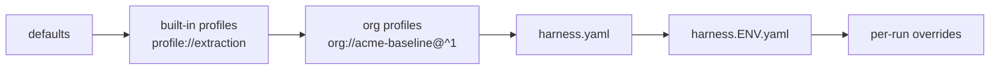

# Profiles and the org baseline

Every app in a company needs some of the same controls, and some of them must never be switched off. A **profile** is a reusable partial spec that an app extends. An **org baseline** is the profile your platform or security team publishes: every app extends it, and its **locks** and **bounds** make sure no app removes or loosens what it requires.

## Use a built-in profile

The guards from the last chapter are common enough that HarnessWeaver ships them as the `extraction` profile:

```yaml
# profile://extraction (built in)
guardrails:
  input:
    - { id: extraction-pii, use: pii.regex, action: redact }
  output:
    - { id: extraction-secrets, use: secrets.scan, action: block }
validation:
  max_repairs: 1
  on_failure: escalate
budgets:
  per_run: { deadline: 1m }
```

Extend it, and your spec loses the lines the profile now provides:

```yaml title="harness.yaml" hl_lines="6-7"
--8<-- "docs_src/tutorial/profiles/harness.yaml"
```

Your spec still wins wherever it says something: its `deadline: 2m` overrides the profile's `1m`. The `pii` and `secrets` guards are gone from it, because the profile has them, and so does the baseline below. The injection guard stays, since it's your app's own.

| Profile | For | Adds |
| --- | --- | --- |
| `extraction` | Typed extraction | PII redaction on input, secrets check on output, one repair then escalate |
| `rag` | Answers from retrieved context | PII and injection checks on input, injection check on context, secrets check on output |
| `agent` | Tool-using agents | Injection check on input, secrets redacted from tool results, 20 tool calls |
| `workflow` | Deterministic pipelines | Secrets check on output, a 5 minute deadline |
| `chat` | Conversational apps | PII redaction on input, secrets checks on each streamed chunk and on output |

[Built-in profiles](../reference/profiles.md) has each one in full.

## Write an org baseline

The platform team's baseline is a `kind: Profile` document. Put it in `.harness/profiles/`, next to the spec:

```yaml title=".harness/profiles/acme-baseline.yaml"
--8<-- "docs_src/tutorial/profiles/.harness/profiles/acme-baseline.yaml"
```

- `require_level` sets the adoption level an app must reach ([Adoption levels](../concepts/adoption-levels.md)). L1 needs typed output, which `triage` has.
- `locks` lists paths that no later layer may change: here, content capture, the allowed aliases, and the two baseline guards.
- `bounds` lists limits: an app may set its budgets lower, never higher.

The spec names it as `org://acme-baseline@^1`: the name, and an npm-style version range. `^1` accepts any 1.x version, so a new major version of the baseline, which may add locks, never reaches an app unannounced. Profiles are found in the directories on `HARNESSWEAVER_PROFILE_PATH` and in `.harness/profiles/` next to the spec. A real platform team distributes its baseline on the path, or in a plugin, because a team can edit its own repository ([Who owns a profile](../advanced/layers.md#who-owns-a-profile)).

## Try to break a lock

Suppose a team wants to switch off the baseline's PII guard in some environment:

```yaml title="harness.loose.yaml"
--8<-- "docs_src/tutorial/profiles/harness.loose.yaml"
```

The spec doesn't load. `hw.load` raises a `LockViolation`, and `spec validate`, which loads a spec exactly as the app does, says why:

```console
$ uv run harnessweaver spec validate harness.yaml -e loose
error: guardrails.input[base-pii].enabled is locked by org://acme-baseline@1.0.0 (.harness/profiles/acme-baseline.yaml) (lock 'guardrails.input[base-pii]'); it can't be changed (R1)
```

A lock is checked when the spec loads, never at run time, and the error names the path, the lock and the layer. Bounds work the same way: a task budget of `max_usd: 0.25` fails with `BoundViolation`, because the baseline allows at most `0.10`. A bound is never clamped to fit (RULES R10), so nobody is surprised by a limit they didn't set.

## How the layers merge

An app's effective spec is built from layers. Each later layer overrides the earlier ones, except where a value is locked or bounded:



Built-in profiles always come before org profiles, whatever order `extends` lists them in, so a baseline can tighten a built-in profile and never the reverse. Guards and rules are **keyed lists**: they merge by `id`, so a later layer can add items or change an unlocked item by restating its id, but can't remove or reorder earlier ones.

## See where every value came from

`spec explain` prints each effective value, the layer that set it, and its locks:

```console
$ uv run harnessweaver spec explain harness.yaml -e offline --path guardrails
guardrails.input[extraction-pii].use         = "pii.regex"  <- profile://extraction
guardrails.input[extraction-pii].action      = "redact"  <- profile://extraction
guardrails.input[base-pii].use               = "pii.regex"  <- org://acme-baseline@1.0.0 (.harness/profiles/acme-baseline.yaml)  [locked by org://acme-baseline@1.0.0]
guardrails.input[base-pii].action            = "redact"  <- org://acme-baseline@1.0.0 (.harness/profiles/acme-baseline.yaml)  [locked by org://acme-baseline@1.0.0]
guardrails.input[injection].use              = "injection.heuristic"  <- harness.yaml (harness.yaml)
guardrails.input[injection].mode             = "log_only"  <- harness.yaml (harness.yaml)
guardrails.output[extraction-secrets].use    = "secrets.scan"  <- profile://extraction
guardrails.output[extraction-secrets].action = "block"  <- profile://extraction
guardrails.output[base-secrets].use          = "secrets.scan"  <- org://acme-baseline@1.0.0 (.harness/profiles/acme-baseline.yaml)  [locked by org://acme-baseline@1.0.0]
guardrails.output[base-secrets].action       = "block"  <- org://acme-baseline@1.0.0 (.harness/profiles/acme-baseline.yaml)  [locked by org://acme-baseline@1.0.0]
```

`hooks` shows what runs on each hook point, in order, with its band. The baseline's guards come first:

```console
$ uv run harnessweaver hooks harness.yaml -e offline --task triage
...
| input.before      | 1     | guardrails.input[base-pii]            | baseline | closed    |         |
|                   | 2     | guardrails.input[extraction-pii]      | platform | closed    |         |
|                   | 3     | guardrails.input[injection]           | app      | closed    |         |
...
| output.before     | 1     | guardrails.output[base-secrets]       | baseline | closed    |         |
|                   | 2     | guardrails.output[extraction-secrets] | platform | closed    |         |
|                   | 3     | validation.rules[bugs-are-urgent]     | app      | closed    |         |
|                   | 4     | validation.rules[short-summary]       | app      | closed    |         |
...
```

## Recap

- `extends` merges profiles under your spec: built-in ones (`profile://extraction`), org ones (`org://acme-baseline@^1`) and files.
- An org baseline's **locks** forbid changes, its **bounds** limit numbers, and its `require_level` sets the adoption level. Breaking any of them fails at load.
- `spec explain` shows where each value came from, and `hooks` shows what runs where.

[Layers, locks and bounds](../advanced/layers.md) covers every merge rule, lock form and bound in depth, and [Write an org baseline](../how-to/org-baseline.md) is a checklist for platform teams.
