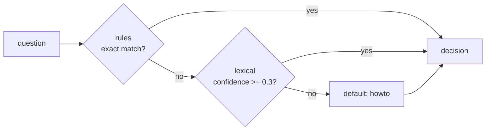

# Routing

Not every question needs a model. "The dashboard is down" deserves the status page, at once and for free. A **router** answers one question with one of a fixed set of options, here "what kind of question is this?". Your code then takes the cheapest path that serves it.

## Declare a router

Add a `routing` section with a router called `intent`:

```yaml title="harness.yaml (the routing section)"
--8<-- "docs_src/tutorial/routing/harness.yaml:19:33"
```

A router is a **cascade** of stages, tried in order. The first confident answer wins:

1. `outage-words` is a `rules` stage. It's exact and deterministic: the first rule whose cel-lite `when` is true decides. Here, any question that mentions "down", "outage" or "not loading" is an outage.
2. `examples` is a `lexical` stage. It compares the question with example sentences for each option and picks the closest. Its answer counts only when its confidence reaches `threshold`.
3. When no stage is confident, the router's `default` answers.



## Ask it in your steps

```python title="helpdesk/flows.py" hl_lines="5 10-12"
--8<-- "docs_src/tutorial/routing/helpdesk/flows.py"
```

`s.decide` returns a `Decision`:

| Field | Holds |
| --- | --- |
| `choice` | The option chosen, or `None` when the router abstained |
| `kind` | `exact` (a rules stage), `probabilistic` (a scored stage), `default` or `abstain` |
| `confidence` | `None` for exact answers, else 0 to 1 |
| `stage` | The id of the stage that decided |
| `reason` | Why, without the question's text |

## Run it

Ask one question of each kind, and print the routing notes from each trace:

```python title="main.py"
--8<-- "docs_src/tutorial/routing/main.py"
```

```console
$ HARNESSWEAVER_ENV=offline uv run python main.py
We know about the outage and are fixing it. Updates: status.acme.example
   5 note    route.decide      harness.routing: rule 1
   8 note    route.decide      harness.decision: rule 1
Refunds go back to the card you paid with within five business days.
   5 note    route.decide      harness.routing: no rule matched
   6 note    route.decide      harness.routing: closest to billing
   9 note    route.decide      harness.decision: closest to billing
```

The outage question was decided by the first rule, and the model was never called. The refund question passed the rules stage, and the lexical stage found it closest to `billing`. Every stage's answer is in the trace, including the stages that lost, so you can see why each question went where it did (RULES R13).

## Stages

| Stage | Kind | How it decides |
| --- | --- | --- |
| `rules` | Deterministic | The first `{when, choice}` rule whose cel-lite `when` is true. `when` can read `text`, `state`, `options` and `router` |
| `lexical` | Deterministic | Token overlap (cosine) with each option's example `utterances` |
| `semantic` | Deterministic with the built-in embedder | Embedding similarity with the examples. The built-in `semantic.hashing` embedder needs no model; a plugin can bring a real one |
| `llm` | Probabilistic | Asks a model to pick an option, with a confidence. Governed and budgeted like any model call |

Put cheap, exact stages first and probabilistic ones after them. Tune each `threshold` on a labelled set of questions, because a stage's confidence isn't calibrated. Each stage's settings are in [Providers](../reference/providers.md#routing-stages). You can also write your own stage as a plugin ([Runners, deciders and adapters](../advanced/runners-and-adapters.md#deciders)).

!!! warning "Routing is not permission"
    A router may decide which path a request takes. It must never decide whether something is *allowed*. Permission belongs to [policy](policy.md), which must be deterministic (RULES R3). A probabilistic stage can route a request, but it can never grant anything.

## Recap

- A router answers with one of its `options`, through a **cascade** of stages: the first confident answer wins, then the `default`.
- `s.decide("intent", text=...)` asks it from your steps. Every stage's answer is in the trace.
- Use cheap, exact stages first, and never use routing to grant permissions.
