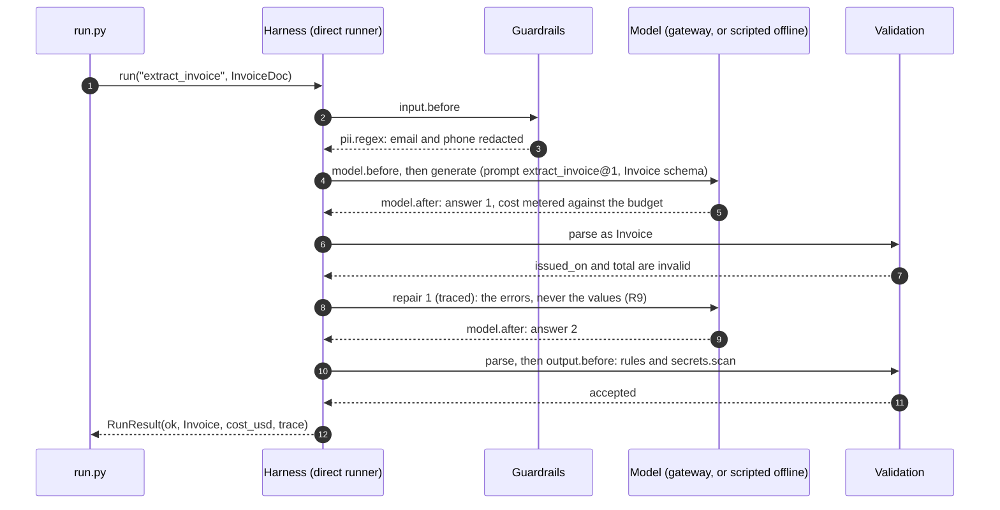

# Example 01: invoice extraction (L1, Run style)

An accounts payable team turns the text of supplier invoices into a typed
`Invoice`. The app calls `harness.run()` and nothing else: the spec supplies the
controls, and the app has no retry loop, no error handling around the model and
no tracing code.

| | |
| --- | --- |
| Adoption level | **L1 Guard** (`harnessweaver doctor` reports it) |
| Style | Run (`harness.run`), plus the L0 Wrap style in `l0_instrument.py` |
| Profile | `profile://extraction`: PII redaction on input, secrets check on output, one repair, then escalate |
| Model | `openai.chat` through a LiteLLM gateway; a scripted model offline |

## Run it offline

```bash
HARNESSWEAVER_ENV=offline uv run python examples/01_invoice_extraction/run.py
HARNESSWEAVER_ENV=offline uv run python examples/01_invoice_extraction/l0_instrument.py
uv run pytest examples/01_invoice_extraction -q
```

`HARNESSWEAVER_ENV=offline` applies `harness.offline.yaml`, which swaps the
gateway for a scripted model. Its first answer is invalid (a date that isn't a
date, a total that isn't a number), so every offline run shows a repair.

## What happens in one run



If the repaired answer is still invalid, the extraction profile escalates the
run to a person (`validation.on_failure: escalate`). A secret in the answer
blocks the run. A run that would go over `max_usd` or `max_model_calls` stops
before the model call.

## Files

| File | What it shows |
| --- | --- |
| [harness.yaml](harness.yaml) | The task, its typed input and output, the prompt, budgets, prices and business rules |
| [harness.offline.yaml](harness.offline.yaml) | The offline overlay: an invalid answer, then a valid one |
| [invoices/models.py](invoices/models.py) | `InvoiceDoc`, `LineItem`, `Invoice` |
| [prompts/extract_invoice@1.md](prompts/extract_invoice@1.md) | The versioned prompt (`name@version`, ADR-0013) |
| [evals/golden.yaml](evals/golden.yaml) | Golden cases, graded by the evals module once it lands (*planned*) |
| [run.py](run.py) | The whole app: load, run, print |
| [l0_instrument.py](l0_instrument.py) and [instrument.yaml](instrument.yaml) | L0: govern an existing OpenAI client in three lines |
| [tests/](tests/test_invoice_extraction.py) | Repair, escalation, redaction, secrets, budgets, L0, `doctor` |

## Business rules

The schema checks shapes; `validation.rules` checks what the schema can't. A
rule's `when` describes a violation (ADR-0023), and a violated rule asks for a
repair with its `message`:

```yaml
validation:
  rules:
    - { id: positive-total, when: "output.total <= 0", message: "the total must be positive" }
    - { id: no-negative-lines, when: "output.line_items.exists(item, item.amount < 0)", message: "..." }
    - { id: total-adds-up, when: "output.subtotal + output.tax - output.total > 0.005 || ...", message: "..." }
```

## L0: three lines for an app that already calls OpenAI

```python
import harnessweaver as hw                                  # 1
harness = hw.load("instrument.yaml")                        # 2
client = harness.instrument(AsyncOpenAI(...), tenant="acme")  # 3
```

The client is used exactly as before. Each call is governed: the email and
phone number in the invoice are redacted before they reach the gateway, and the
call is traced and metered. `instrument.yaml` has no business rules, because the
client's answers are text and the rules are about a typed `Invoice`; a rule that
can't be checked fails closed.

## Going live

Point `models.base_url` at your LiteLLM gateway, set `LITELLM_API_KEY`, and map
`fast-chat` and `strong-chat` to real models in the gateway's config. The
gateway owns retries and fallbacks (R5), so the SDK client is built with
retries off.
