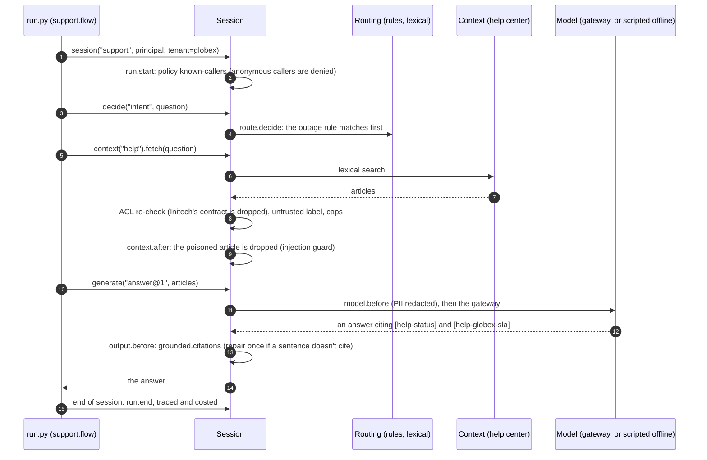

# Example 02: support assistant (L4, Session style)

Acme's support assistant answers customers' questions from the help center and
cites the articles it used. The app owns the flow (route the question, retrieve
articles, answer) and calls the harness for each step; the spec and Acme's org
baseline supply every control. [Example 04](../04_polyglot_typescript/README.md)
serves this same spec to TypeScript and, through harnessd, to any language.

| | |
| --- | --- |
| Adoption level | **L4 Improve**: the baseline asks a customer-facing app for L2, and the task's eval suite makes it L4 (`harnessweaver doctor` reports it) |
| Style | Session (`async with harness.session(...)`, in `run.py`); the same flow is the `support` task for evals |
| Profiles | `org://acme-baseline@^1` (locked PII redaction, secrets check, reviewed plugins, no content in telemetry, budget caps) and `profile://rag` (injection checks on questions and on retrieved articles) |
| Model | `openai.chat` through a LiteLLM gateway; a scripted model offline |

## Run it offline

```bash
HARNESSWEAVER_ENV=offline uv run python examples/02_support_rag/run.py
uv run harnessweaver eval run examples/02_support_rag/harness.yaml -e offline --profile-dir examples/_org
uv run pytest examples/02_support_rag -q
```

## What happens in one question



## Files

| File | What it shows |
| --- | --- |
| [harness.yaml](harness.yaml) | The router, the context source with ACLs, the citation guard, the run.start policy, the task and its budget |
| [harness.offline.yaml](harness.offline.yaml) | The offline overlay: one scripted answer per golden question |
| [support/flow.py](support/flow.py) | The whole app: `decide`, `fetch`, `generate` |
| [support/models.py](support/models.py) | `Reply`, the task's typed output |
| [data/help_center.yaml](data/help_center.yaml) | The articles: open ones, one per customer, and a poisoned one |
| [prompts/answer@1.md](prompts/answer@1.md) | The versioned prompt (ADR-0013) |
| [evals/golden.yaml](evals/golden.yaml) | Golden questions graded on intent and citations |
| [run.py](run.py) | The Session style in a script |
| [gateway/](gateway) | `harnessweaver gateway litellm` output: the LiteLLM config for apps that call the gateway directly (a golden file) |
| [tests/](tests/test_support_rag.py) | Tenant isolation, the poisoned article, injection, repair, PII, the policy, the baseline's locks, `doctor` |

## What the baseline guarantees

Acme's platform team owns [the baseline](../_org/acme-baseline.yaml); this app
can add controls but not remove them. The tests load the spec with overlays that
try to switch content capture on, disable the PII guard, or allow an unreviewed
plugin, and each fails to load with a `LockViolation` (R1).

## Going live

Point `models.base_url` at your LiteLLM gateway, set `LITELLM_API_KEY`, and set
`HARNESSWEAVER_PROFILE_PATH` to where your org's profiles live. Replace the
`memory` context provider with a vector store plugin (*planned*; until then,
retrieve with your own client and pass the items through a `passthrough` source
with `s.context(name).check(items)`); the ACL re-check, the injection guard and
the citation check stay the same.
