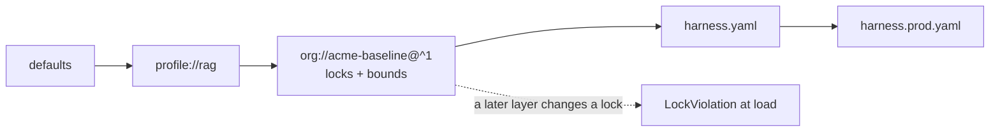

# Acme's org baseline

[acme-baseline.yaml](acme-baseline.yaml) is the profile Acme's platform security
team publishes. Every Acme app extends it:

```yaml
extends: ["org://acme-baseline@^1", "profile://rag"]
```

and finds it through `HARNESSWEAVER_PROFILE_PATH` (or `--profile-dir`)
pointing at this directory.

| It sets | So that |
| --- | --- |
| `plugins.allow` (locked) | Only reviewed plugins load (S8): `openai`, `anthropic`, `otel`, `pydantic_ai`, and `acme` for Acme's own code |
| `require_level` | Internal tools reach L1, customer-facing apps L2, apps that take actions L3 |
| `observability.capture_content: false` (locked) | No prompt or output content in telemetry (R9) |
| `guardrails.input[base-pii]`, `guardrails.output[base-secrets]` (locked) | PII is redacted and secrets are blocked in every app (R1) |
| `tools.require_manifest: true`, `tools.approval_by_risk` (locked) | No tool runs without a manifest (S2), and high- and critical-risk calls wait for a human |
| `bounds` on budgets | No app or caller goes over the org's caps; a value out of bounds fails loading (R10) |



[Example 02](../02_support_rag/README.md) and [Example 03](../03_refund_agent/README.md)
extend it, and test that a lock violation fails loading. Its own tests, in
[tests/](tests/test_acme_baseline.py), show each lock and bound failing loading
when an app tries to get around it. Tightening it is a breaking change and needs
a new major version (V3); loosening it is a minor one (1.1.0 allowed `pydantic_ai`
and `acme`).
