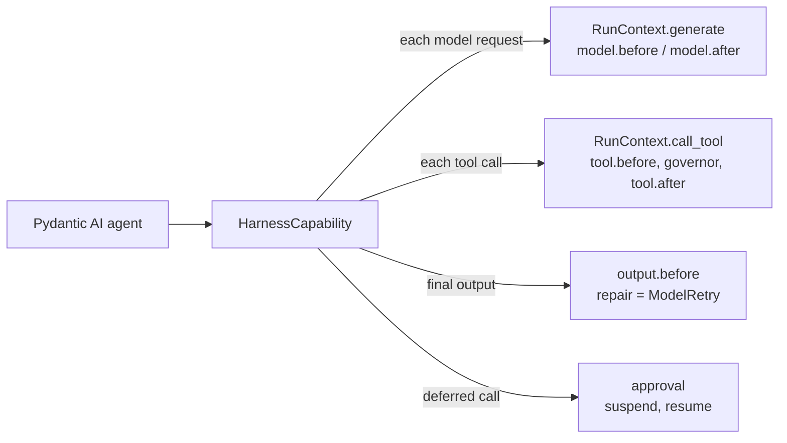

# harnessweaver-pydantic-ai

A first-party [HarnessWeaver](https://github.com/Wise-DreamerZ/HarnessWeaver) plugin for [Pydantic AI](https://ai.pydantic.dev). It is built on the same plugin contract any third-party plugin uses: one `hw.Plugin` object, published through the `harnessweaver.plugins` entry point under the namespace `pydantic_ai` (see DESIGNS.md No. 13).

```bash
uv add harnessweaver-pydantic-ai        # or: uv add "harnessweaver[pydantic-ai]"
```

It needs `pydantic-ai-slim` 2.57 or later within 2.x. Importing the plugin imports nothing from Pydantic AI; that happens the first time a spec or `wrap()` uses it (RULES S8).

Both contributions govern the agent through `HarnessCapability`, a Pydantic AI capability. It sends every model request and tool call through the harness, so the hook points, the tool governor, budgets, telemetry and recordings work as they do for the harness's own runners (ADR-0037).



## `pydantic_ai.agent`: a runner

```yaml
tasks:
  billing_agent:
    runner: { use: pydantic_ai.agent, agent: "app.agents:billing_agent" }
    prompt: billing@2                   # becomes the agent's instructions
    tools: [refund_payment]             # offered next to the agent's own tools
    budget: { max_usd: 1.00, max_tool_calls: 20, deadline: 2m }
```

| Setting | Default | Meaning |
| --- | --- | --- |
| `agent` | required | `'package.module:attribute'` of a Pydantic AI agent |
| `model` | `harness` | `harness`: the spec's `models` answer (aliases, prices, the gateway); `agent`: the agent's own model, still governed |
| `deps` | none | `'package.module:function'` called with `(session, input)` that returns the agent's deps |

- The harness owns the run: idempotency, deadlines, `run.start`, `input.before`, approvals and `run.end`. The input is the agent's prompt.
- Structured output is asked for with the neutral request's output schema. The task's `max_repairs` bounds the agent's output retries, and a repair request from `output.before` middleware reaches the model as a `ModelRetry`.
- Every tool the agent calls needs a manifest (S2): one from `tools.manifests` or a tool given in code with the agent tool's name. The manifest governs the call; the agent still runs its own function.
- A call that needs approval (from the governor, a `tool.before` middleware, or a tool the agent marks `requires_approval=True`) suspends the run. `harness.approve()` continues the agent from its saved message history with Pydantic AI's deferred tool results; only the call a human approved runs. The runner adds `DeferredToolRequests` to the agent's output types for this, so an agent with output validators must list it itself.
- Tools that defer to external execution (`CallDeferred`) aren't supported by the runner.

## `harness.wrap(agent)`

```python
agent = harness.wrap(billing_agent, task="billing_agent", tenant="acme")
result = await agent.run("I was charged twice")
```

- Every run of the returned agent (`run`, `run_sync`, `iter`) is governed. Outside a harness run it is a run of its own: `run.start`, `input.before` on the prompt (a redaction replaces the prompt), the agent's model requests and tool calls, `output.before` on the output, `run.end`.
- Called inside a session or a session runner's handler, its model and tool calls are part of that run, and the session owns the output.
- The agent keeps its own model. Changes `model.before` middleware makes to the messages or instructions reach that model for the request only; the agent's history keeps what it had.
- A call that needs the harness's approval escalates (`RunEscalated`), as in a session; inside a session runner's handler it suspends the run, and the handler runs again once approved (ADR-0021). A tool the app gates itself with `requires_approval=True` stays the app's to answer; the harness still governs the call when it runs.
- Streaming a wrapped agent (`run_stream`) is *planned* and raises for now, rather than running ungoverned (R4).

| Reaches | Runner | `wrap()` |
| --- | --- | --- |
| `run.start`, `input.before`, `run.error`, `run.end` | yes | yes |
| `model.before`, `model.after` | yes | yes |
| `tool.before`, `tool.after` | yes | yes |
| `output.before` | yes | yes (its own runs) |
| `approval.resolved` | yes | no: approvals escalate |
| `route.decide`, `context.after`, `stream.chunk` | no | no |

## Conformance

From this package's directory (at the repository root, `make conformance` checks every first-party plugin):

```bash
uv run pytest --harnessweaver-conformance=pydantic_ai
```
