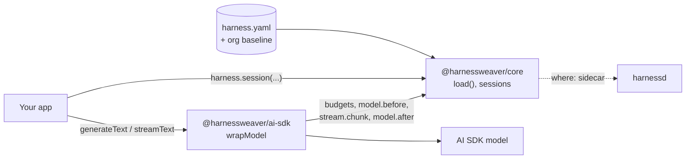

# HarnessWeaver for TypeScript

A pnpm workspace with two packages (DESIGNS No. 24, ADR-0040):

| Package | What it is |
| --- | --- |
| `@harnessweaver/core` | The HarnessWeaver core for TypeScript: the same `harness.yaml`, hook bus, budgets, guards, cel-lite policy, routing, tool governor, context, prompts and eval graders as Python, held to the same fixtures in `contracts/` (R11) |
| `@harnessweaver/ai-sdk` | `wrapModel(session, model)`: Vercel AI SDK (v7) models governed by a session's run |



## Use it

```ts
import { load } from "@harnessweaver/core";
import { wrapModel } from "@harnessweaver/ai-sdk";
import { generateText } from "ai";

const harness = load("harness.yaml"); // HARNESSWEAVER_ENV picks the overlay

const reply = await harness.session({ task: "support", principal: user.id, tenant: user.org }, async (s) => {
  const question = await s.guard("input", text);         // input.before: redacts or blocks
  const route = await s.decide("intent", { text: question }); // route.decide
  const items = await s.context("help").fetch(question);   // ACLs, labels, context.after
  const { text: answer } = await generateText({ model: wrapModel(s, model), prompt: ask(question, items) });
  return s.validate("output", answer);                     // output.before: guards and rules
});
```

A halting outcome throws a `RunInterrupted` error (`RunBlocked`, `RunEscalated`) in your code; `ValidationFailed` asks for a repair. Pass `onEnd` to `session` to get the `RunResult` (status, usage, cost and trace).

- **Tools** are governed with `s.tool(name, args)`: the manifest, schema, policy, approvals, rate limits and the lethal trifecta (S3), then the result is sanitized. Give the handlers to `load("harness.yaml", { tools: { refund_payment } })`.
- **Plugins** are passed in, as JavaScript has no entry points: `load(path, { plugins: [definePlugin({ namespace: "acme", version: "1.0.0", providers, middleware })] })`.
- **The sidecar:** a guard declared `where: sidecar` runs its (Python-only) provider in `harnessd`, and `SidecarClient` calls every other `/v1` route.
- **Not in TypeScript:** a `Suspend` escalates, since a session can't wait for a person. *Planned:* OpenTelemetry export, the `semantic` and `llm` routing stages, `http` and `mcp` tool transports, and durable approvals. A spec that needs a control TypeScript can't enforce fails to load (R4).

## Work on it

Node 22+ and pnpm (the version in `package.json`).

```bash
pnpm -C typescript install
pnpm -C typescript test
pnpm -C typescript typecheck
pnpm -C typescript build
```

- The fixture runners live in `packages/core/test/`, one test file per area; `suites.test.ts` fails when a suite folder in `contracts/fixtures/conformance/` has no runner.
- `packages/core/src/generated/contracts.ts` embeds the JSON Schemas and built-in profiles. After `make schemas` or a profile change, run `pnpm -C typescript/packages/core run sync`; a test fails while it is stale.
- `@harnessweaver/ai-sdk` type-checks and tests against the core's sources, so neither needs a build first.
- The workspace also holds [Example 04](../examples/04_polyglot_typescript/README.md), a TypeScript app on Example 02's spec. Its tests start harnessd, so they need the Python workspace installed (`uv sync --all-packages`).
- pnpm keeps its package store outside the repository; if it lands in the repository (a `.pnpm-store/` folder), pass `--store-dir` to `pnpm install`.
